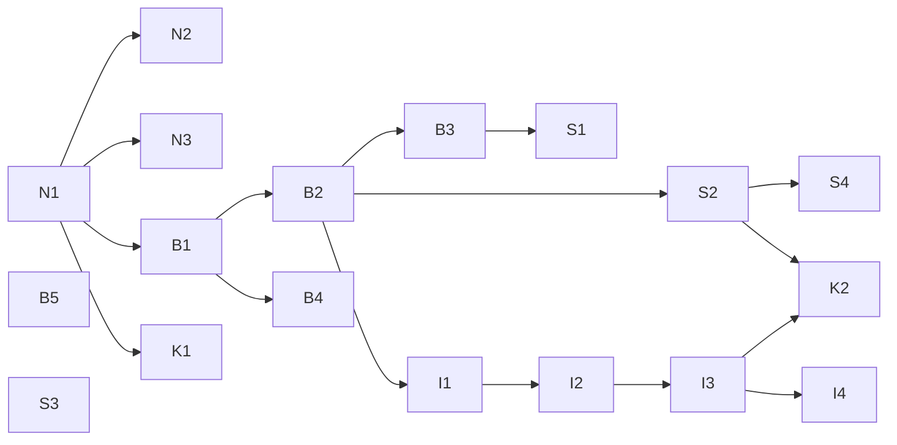

# Delivery — Bề mặt sản phẩm: thứ tự xây, theo pull request

Danh sách graduate của plan (phase Converge, 2026-10-19). Mỗi PR **một mục đích**, mang ADR + docs của nó (spec trước, trong
cùng PR), chạy `pnpm verify` trước khi mở; owner review và merge từng PR. Số ADR được cấp khi PR mở (tiếp sau 0040). Lên
UAT/prod theo E-01: owner nói "deploy" → tag `uat-…`; "lên prod" → tag `prod-…`.

## Các lane và PR

| PR | Lane | Nội dung | ADR | Cần trước | Items |
|---|---|---|---|---|---|
| **N1** | Nền | `docs/guides/environments.md` (bốn môi trường, `main` + tag, ba lời khoá, tầng kiểm thử, dev local, dữ liệu và quay lui); `AGENTS.md` dòng prod; *Environment rules*; sửa sự thật ở `uat.md`, `index.md`, roadmap | **Environments, tags and promotion** (sửa 0010, 0021 §5) | — | E-01, E-04a |
| N2 | Nền | `tools/env-check`: `pnpm check:uat`, `pnpm check:prod`, `pnpm release:check <tag>` | — | N1 | E-01 §2, §6 |
| N3 | Nền | Dev Mode C `pnpm stack:image <tag\|sha>` + lệnh dữ liệu mẫu (chỉ dev) | — | N1 | E-01 §4 |
| **B1** | Bố cục | Chuẩn bố cục thành spec (`docs/architecture/hosts-and-paths.md`); gói `@tohe/routes` + codegen: route của Caddy, danh sách app shell, robots, `HubPaths` cho API, proxy Vite; test va chạm; 404 thật; `robots.txt`/`sitemap.xml`/`security.txt`; HSTS `includeSubDomains`; cờ Scalar (tắt mặc định ngoài dev) | **Layout standard: one domain, hosts by trust, namespaces by component** (sửa 0040, 0021, 0027) | N1 | D-01 |
| B2 | Bố cục | Route của app: danh mục `/play`, `/play/<g>/rooms/…`, `/account/…`; manifest `id "/"`, `start_url "/play"`; 301 cho đường dẫn trong link email còn hạn; e2e | (B1) | B1 | D-01 Q2, Q7 |
| B3 | Bố cục | `apps/web` (Astro) build vào image hub: trang giới thiệu dời từ `apps/site`, script đưa người quay lại tới `/play`; `apps/site` → `apps/docs` ở gốc `docs.` (`/docs/*` → 301); key chart `site` → `docs` (`publicUrls.docs`) | (B1) | B2 | D-01 Q3, Q6, Q8 |
| B4 | Bố cục | `console.toheplay.io.vn`: site thứ hai trong Caddy của hub, đăng nhập riêng (email + mật khẩu + TOTP), cookie `__Host-tohe.console` (`SameSite=Strict`), chỉ chuyển `/api/admin/…` + đăng nhập; `apps/admin` → `apps/console`; key chart `console`, `publicUrls.console`, ingress | (B1) | B1 | D-01 Q9 |
| B5 | Bố cục | `notify.` là người gửi thư (docs, ví dụ cấu hình); `status.` (docs, danh sách thứ cần theo dõi) | — | — | D-01 Q10, Q11 |
| **S1** | Bề mặt | Nội dung công khai user-first: `/`, `/games/<gameId>`, `/guides/…`, `/faq`, `/about`, `/terms`, `/privacy` (tĩnh, cùng nguồn `documents.ts`); ảnh OG, JSON-LD, kiểm SEO trong build; `/new-game` + DoD thêm trang công khai | — | B3 | E-02 |
| S2 | Bề mặt | Hub, những chạm đầu tiên: vào là chơi, lời chào, component cài app (Android · iOS 26 · WebView), manifest `screenshots`/`shortcuts`, `og:` của hub, Góp ý; e2e hành trình | — | B2 | E-03 |
| S3 | Bề mặt | Google trên prod: hướng dẫn từng bước, kiểm luồng (owner tạo client) | — | — | D-05 |
| S4 | Bề mặt | Bộ đếm phễu người mới trong metrics (không định danh) | — | S2 | D-04 |
| **I1** | Định danh | Hồ sơ máy ở hub (thay khách, chuyển dữ liệu khách tự động), màn tên, liên kết vào account giữ id (S1–S4, S13) | **Device profiles and identity levels** (sửa 0023, 0024) | B2 | D-06, D-07 |
| I2 | Định danh | Hồ sơ máy trên server (khoá thiết bị, proof-of-work, giới hạn, dọn 90 ngày, câu tuổi/đồng ý), bàn mở cho `named`, độ tin thấp nhất, mã chuyển máy (S8) | (I1; sửa 0016, 0025, 0029) | I1 | D-06 §4, D-07 S8 |
| I3 | Định danh | Đường ống lối vào ở hub, module `Links`, `/s/`, thẻ xem trước cho `/r/` và `/s/`, ô "Nhập mã" | **Entry links** | I2 | D-08 |
| I4 | Định danh | Game Contract: `identity`, `entries`, `init.entry`, `entry`, `identity.require`, `share`; SDK + kit + conformance; Ghép Khối "Thách bạn" | **Game Contract: identity, entries and sharing** | I3 | D-06 §5, D-08 §6 |
| K1 | Kết | Viết lại `docs/vision.md` (owner duyệt từng câu) | — | N1 | E-04b |
| K2 | Kết | Vòng thử thiết bị của owner trên prod (Android, iPhone iOS 26 + app đã cài, Zalo, Messenger, máy tính) + sửa lỗi | — | S2, I3 | E-03 §14 |

## Chạy song song thế nào

- **Bắt đầu ngay khi owner nói "làm"**: N1. Sau N1: N2, N3, B1, K1 song song. B5 và S3 chủ yếu là việc của owner, lúc nào
  cũng được.
- **Không song song được**: PR thêm migration EF Core (I1 nếu cần, I2, I3) đụng chung `ToheDbContextModelSnapshot.cs` — merge
  từng cái, cái sau rebase lên cái trước; file sinh (`services/api/openapi/`, `apps/hub/src/api/schema.gen.ts`, và từ B1 cả
  route sinh từ `@tohe/routes`) sinh lại sau khi rebase.
- **B2 → B3 → S1** cùng đụng router/Caddy của hub — tuần tự.
- Mỗi PR một nhánh + worktree; plan này là bảng điều phối.

## Điều phối agent: một master, nhiều worker (chốt — owner, 2026-10-19: "ok triển đi")

Owner (2026-10-19): "lập ra 1 rule và làm theo dạng như là sẽ quyết định làm việc gì với model gì bằng cách spawn ra agent
phù hợp làm riêng xong sau đó phối hợp trên 1 luồng master".

**Trần chi phí** (owner, 2026-10-19: "tối đa chỉ được dùng Opus 5.5 và effort tối đa là xhigh th nha (tối đa là master, k
đc hơn, tôi k có nhìu chi phí)"): **không model nào trên Opus 5.5, không effort nào trên xhigh**; chỉ master được xhigh;
không Fable, không `max`, không `/fast` (giá gấp đôi).

**Master** = phiên chính (Opus 5.5 · xhigh — trần). Chỉ master: nói chuyện và chốt với owner; viết *gói việc*; viết và giữ
`plans/`, memory, bảng *Trạng thái*; review diff; chạy lại `pnpm verify`; mở PR; gắn tag, deploy theo lời khoá (E-01).
Worker không quyết thiết kế, không push, không mở PR, không merge, không deploy, không đụng UAT/prod.

| Worker | Model · effort | Làm gì | Quyền | Cách ly |
|---|---|---|---|---|
| `scout` | Haiku 5.5 · low | tìm trong code, log, docs, web; trả về sự thật + đường dẫn | chỉ đọc | — |
| `builder` | **Sonnet 5.5 · high** cho PR đã rõ (N2, N3, B2, B3, B5, S2, S4) · **Opus 5.5 · high** cho PR khó (B1, B4, I1–I4) | làm **một PR** theo gói việc: code + test + docs, `pnpm verify`; **không commit** — master review diff rồi commit | sửa trong worktree của nó | worktree riêng |
| `chore` | Sonnet 5.5 · medium | việc cơ học: đổi tên, sinh lại file, sửa CI, nâng phụ thuộc | sửa trong worktree của nó | worktree riêng |
| `reviewer` | Opus 5.5 · high | đọc ADR/spec/diff đối chiếu item của plan, tìm lỗ hổng; không sửa — mắt mới vì ngữ cảnh mới, không vì model mạnh hơn | chỉ đọc | — |

**Tiết kiệm**: mở agent chỉ khi nó giữ được ngữ cảnh của master gọn hoặc làm song song được; việc nhỏ master tự làm;
tối đa **2 worker cùng lúc**; `reviewer` chỉ cho 5 PR có ADR; master hạ effort xuống high cho các lượt điều phối thường
(cập nhật plan, mở PR) khi owner muốn tiết kiệm thêm.

**Luật chọn**

| Việc | Ai |
|---|---|
| Quyết định, hỏi owner, viết ADR lần đầu, nội dung cần giọng của owner | master tự làm |
| Một PR trong `delivery.md` đã có gói việc | một `builder` cho cả PR (không chia một PR cho nhiều agent) |
| Việc cơ học không cần phán đoán | `chore` |
| Tìm kiếm rộng, đọc log, research | `scout` |
| PR có ADR (N1, B1, I1, I3, I4) trước khi mở | `reviewer` (Opus · high) một lượt; master quyết sửa gì |
| Việc nhỏ (< ~15 phút, vài file) | master tự làm — mở agent tốn hơn làm |

**Gói việc** (master viết, mỗi worker một gói): mục tiêu một câu · item/ADR liên quan (đường dẫn) · phạm vi trong/ngoài ·
file dự kiến · tiêu chí xong (test, `pnpm verify`, docs) · ràng buộc (`AGENTS.md`, không UAT/prod, không push) · nhánh +
worktree · báo cáo trả về: đã đổi gì, kết quả kiểm (dán output), lệch khỏi gói, câu hỏi mở.

**Giữ ổn định**

- Tối đa **2 worker chạy cùng lúc** (trần chi phí); không bao giờ hai worker đụng cùng khu vực (migration EF, file sinh, router/Caddy của hub)
  — theo *Chạy song song thế nào* ở trên.
- Master **không tin báo cáo suông**: đọc diff, chạy lại `pnpm verify`, chỉ báo owner điều đã kiểm.
- Worker trượt kiểm: master gửi lại một lần kèm lỗi; trượt lần hai thì master tự làm tiếp.
- Worker gặp câu hỏi thiết kế: dừng và trả về; master hỏi owner — không đoán.
- Chỉ master ghi `plans/` và memory (một người ghi, không xung đột).

## Việc chỉ owner làm được

| Khi | Việc |
|---|---|
| Mỗi PR | Review và merge |
| Mỗi lần lên UAT / prod | Nói "deploy" / "lên prod" — agent gắn tag và làm phần còn lại (E-01) |
| B1 lên prod | Merge PR `platform-infra` đặt `hub.securityContact: security@toheplay.io.vn` (agent mở lúc "lên prod"); chưa đặt thì `security.txt` trả 404 |
| B3, B4 lên prod | Merge PR `platform-infra` đổi values (key `docs`, `console`, host `console.`) cùng bản chart — không chỉ là `targetRevision` nên chờ owner |
| B4 | DNS `console` (proxied) + Cloudflare Access: một application cho `console.toheplay.io.vn`, chính sách cho phép email của owner |
| B5 | Thêm `notify.toheplay.io.vn` ở Resend (Cloudflare tự thêm DNS), đổi người gửi trong Infisical `/tohe` và `uat.env`; chọn dịch vụ trang trạng thái, CNAME `status` DNS-only |
| S1 | Duyệt giọng văn trang công khai; sau khi lên: xác minh Search Console + Bing (TXT) |
| S3 | Theo [hướng dẫn](../../docs/guides/sign-in-with-google.md) (#78): chọn chế độ Đăng ký, tạo OAuth client Google, secret `google-client-secret` vào Infisical `/tohe`, merge PR values |
| I2 | Duyệt câu tuổi/đồng ý cùng Điều khoản + Quyền riêng tư |
| K1 | Duyệt từng câu của vision |
| K2 | Thử trên thiết bị thật |

## Trạng thái

| PR | Nhánh | Trạng thái |
|---|---|---|
| N1 | `docs/n1-environments` | [#71](https://github.com/vinh466/tohe-play/pull/71) **merged** (2026-10-19, `9759e98`) — master: ADR 0041; builder (Sonnet · high): docs + `.claude/agents`; reviewer (Opus · high): 0 blocker, 5 major, 9 minor, đã sửa; `pnpm verify` xanh; **CI xanh** (verify, chart, stack) |
| CI | `ci/run-what-changed` | [#73](https://github.com/vinh466/tohe-play/pull/73) **merged** (2026-10-19); PR chỉ docs giờ ~50 giây (#74), PR code ~8,6 phút — ngoài 18 PR, owner yêu cầu: CI chạy theo phạm vi thay đổi (notes / docs / all), job song song, cache Turborepo; `main` vẫn chạy đủ, không đọc cache |
| N2 | `feat/n2-env-check` | [#76](https://github.com/vinh466/tohe-play/pull/76) **merged** (2026-10-19, `42422c8`) — builder (Sonnet · high); lần chạy thật đầu tiên bắt được sự cố: DNS `games.toheplay.io.vn` mất (NXDOMAIN), game prod không tải; owner thêm lại, `check:prod` 17 đạt / 0 lỗi (19:00) |
| N3 | `feat/n3-stack-image-seed` | [#75](https://github.com/vinh466/tohe-play/pull/75) mở (2026-10-19), chờ owner merge — master merge `main` vào (giữ cả hai bên ở `package.json`, `compose.yaml`), `pnpm verify` xanh — builder (Sonnet · high); master thêm khoá thứ hai `Dev:SeedAllowed` (không seed được UAT kể cả khi ép môi trường Development); `pnpm verify` xanh, 261 API test |
| B1 | `feat/b1-layout-standard` | [#77](https://github.com/vinh466/tohe-play/pull/77) **merged** (2026-10-19, `1ebb671`) — master: ADR 0042 + `docs/architecture/hosts-and-paths.md`; builder (Opus · high): `@tohe/routes`, sinh cấu hình, 404, robots, security.txt, HSTS, cờ Scalar; reviewer (Opus · high): 0 blocker, 4 major, 7 minor, đã sửa; `pnpm verify` xanh; **CI xanh** (stack đọc `security.txt` thật). Tạm: gốc `noindex` tới B3; `sitemap.xml` dời sang B3 |
| S3 | `docs/s3-sign-in-with-google` | [#78](https://github.com/vinh466/tohe-play/pull/78) **merged** (2026-10-19, `74330fe`) — master viết `docs/guides/sign-in-with-google.md` (không tốn worker). Phát hiện: nhà cung cấp có khoá là **bật mặc định**, nên owner chọn chế độ Đăng ký trước PR values |
| K1 | `docs/k1-vision` | [#74](https://github.com/vinh466/tohe-play/pull/74) draft (2026-10-19), chờ owner duyệt từng câu — master viết |
