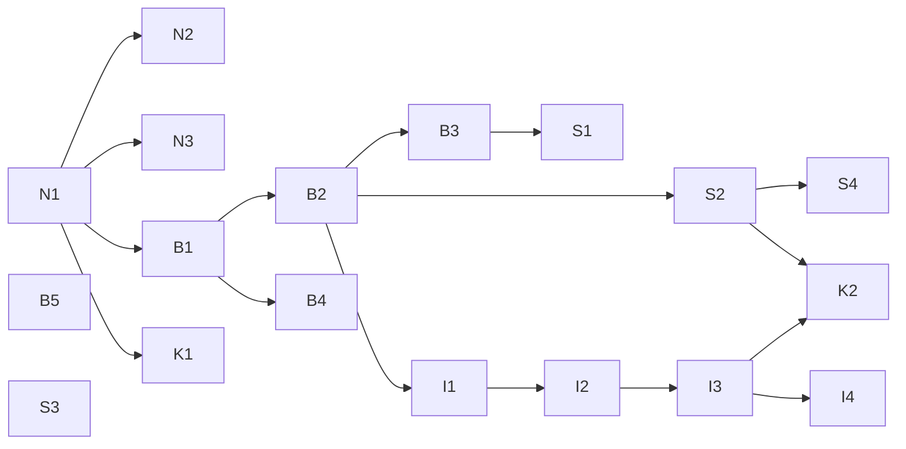

# Delivery — Bề mặt sản phẩm: thứ tự xây, theo pull request

Danh sách graduate của plan (phase Converge, 2026-10-20). Mỗi PR **một mục đích**, mang ADR + docs của nó (spec trước, trong
cùng PR), chạy `pnpm verify` trước khi mở; owner review và merge từng PR. Số ADR được cấp khi PR mở (tiếp sau 0040). Lên
UAT/prod theo E-01: owner nói "deploy" → tag `uat-…`; "lên prod" → tag `prod-…`.

## Các lane và PR

| PR | Lane | Nội dung | ADR | Cần trước | Items |
|---|---|---|---|---|---|
| **N1** | Nền | `docs/guides/environments.md` (bốn môi trường, `main` + tag, ba lời khoá, tầng kiểm thử, dev local, dữ liệu và quay lui); `AGENTS.md` dòng prod; *Environment rules*; sửa sự thật ở `uat.md`, `index.md`, roadmap | **Environments, tags and promotion** (sửa 0010, 0021 §5) | — | E-01, E-04a |
| N2 | Nền | `tools/env-check`: `pnpm check:uat`, `pnpm check:prod`, `pnpm release:check <tag>` | — | N1 | E-01 §2, §6 |
| N3 | Nền | Dev Mode C `pnpm stack:image <tag\|sha>` + lệnh dữ liệu mẫu (chỉ dev) | — | N1 | E-01 §4 |
| **B1** | Bố cục | Chuẩn bố cục thành spec (`docs/architecture/hosts-and-paths.md`); gói `@tohe/routes` + codegen: route của Caddy, danh sách app shell, robots, `HubPaths` cho API, proxy Vite; test va chạm; 404 thật; `robots.txt`/`sitemap.xml`/`security.txt`; HSTS `includeSubDomains`; cờ Scalar (tắt mặc định ngoài dev) | **Layout standard: one domain, hosts by trust, namespaces by component** (sửa 0040, 0021, 0027) | N1 | D-01 |
| B2 | Bố cục | Route của app: danh mục `/play`, `/play/<g>/rooms/…`, `/account/…`; manifest `id "/"`, `start_url "/play"`; 301 cho đường dẫn trong link email còn hạn; e2e | (B1) | B1 | D-01 Q2, Q7 |
| B3 | Bố cục | `apps/web` (Astro) build vào image hub: trang giới thiệu dời từ `apps/site`, script đưa người quay lại tới `/play`; `apps/site` → `apps/docs` ở gốc `docs.` (`/docs/*` → 301); key chart `site` → `docs` (`publicUrls.docs`) | (B1) | B2 | D-01 Q3, Q6, Q8 |
| B4 | Bố cục | `console.toheplay.io.vn`: site thứ hai trong Caddy của hub, đăng nhập riêng (email + mật khẩu + TOTP), cookie `__Host-tohe.console` (`SameSite=Strict`), chỉ chuyển `/api/admin/…` + đăng nhập; `apps/admin` → `apps/console`; key chart `console`, `publicUrls.console`, ingress | (B1) | B1 | D-01 Q9 |
| B5 | Bố cục | `notify.` là người gửi thư (docs, ví dụ cấu hình); `status.` (docs, danh sách thứ cần theo dõi) | — | — | D-01 Q10, Q11 |
| **S1** | Bề mặt | Nội dung công khai user-first: `/`, `/games/<gameId>`, `/guides/…`, `/faq`, `/about`, `/terms`, `/privacy` (tĩnh, cùng nguồn `documents.ts`); ảnh OG, JSON-LD, kiểm SEO trong build; `/new-game` + DoD thêm trang công khai | — | B3 | E-02 |
| S2 | Bề mặt | Hub, những chạm đầu tiên: vào là chơi, lời chào, component cài app (Android · iOS 26 · WebView), manifest `screenshots`/`shortcuts`, `og:` của hub, Góp ý; e2e hành trình | — | B2 | E-03 |
| S3 | Bề mặt | Google trên prod: hướng dẫn từng bước, kiểm luồng (owner tạo client) | — | — | D-05 |
| S4 | Bề mặt | Bộ đếm phễu người mới trong metrics (không định danh) | — | S2 | D-04 |
| **I1** | Định danh | Hồ sơ máy ở hub (thay khách, chuyển dữ liệu khách tự động), màn tên, liên kết vào account giữ id (S1–S4, S13) | **Device profiles and identity levels** (sửa 0023, 0024) | B2 | D-06, D-07 |
| I2 | Định danh | Hồ sơ máy trên server (khoá thiết bị, proof-of-work, giới hạn, dọn 90 ngày, câu tuổi/đồng ý), bàn mở cho `named`, độ tin thấp nhất, mã chuyển máy (S8) | (I1; sửa 0016, 0025, 0029) | I1 | D-06 §4, D-07 S8 |
| I3 | Định danh | Đường ống lối vào ở hub, module `Links`, `/s/`, thẻ xem trước cho `/r/` và `/s/`, ô "Nhập mã" | **Entry links** | I2 | D-08 |
| I4 | Định danh | Game Contract: `identity`, `entries`, `init.entry`, `entry`, `identity.require`, `share`; SDK + kit + conformance; Ghép Khối "Thách bạn" | **Game Contract: identity, entries and sharing** | I3 | D-06 §5, D-08 §6 |
| K1 | Kết | Viết lại `docs/vision.md` (owner duyệt từng câu) | — | N1 | E-04b |
| K2 | Kết | Vòng thử thiết bị của owner trên prod (Android, iPhone iOS 26 + app đã cài, Zalo, Messenger, máy tính) + sửa lỗi | — | S2, I3 | E-03 §14 |

## Chạy song song thế nào

- **Bắt đầu ngay khi owner nói "làm"**: N1. Sau N1: N2, N3, B1, K1 song song. B5 và S3 chủ yếu là việc của owner, lúc nào
  cũng được.
- **Không song song được**: PR thêm migration EF Core (I1 nếu cần, I2, I3) đụng chung `ToheDbContextModelSnapshot.cs` — merge
  từng cái, cái sau rebase lên cái trước; file sinh (`services/api/openapi/`, `apps/hub/src/api/schema.gen.ts`, và từ B1 cả
  route sinh từ `@tohe/routes`) sinh lại sau khi rebase.
- **B2 → B3 → S1** cùng đụng router/Caddy của hub — tuần tự.
- Mỗi PR một nhánh + worktree; plan này là bảng điều phối.

## Việc chỉ owner làm được

| Khi | Việc |
|---|---|
| Mỗi PR | Review và merge |
| Mỗi lần lên UAT / prod | Nói "deploy" / "lên prod" — agent gắn tag và làm phần còn lại (E-01) |
| B3, B4 lên prod | Merge PR `platform-infra` đổi values (key `docs`, `console`, host `console.`) cùng bản chart — không chỉ là `targetRevision` nên chờ owner |
| B4 | DNS `console` (proxied) + Cloudflare Access: một application cho `console.toheplay.io.vn`, chính sách cho phép email của owner |
| B5 | Thêm `notify.toheplay.io.vn` ở Resend (Cloudflare tự thêm DNS), đổi người gửi trong Infisical `/tohe` và `uat.env`; chọn dịch vụ trang trạng thái, CNAME `status` DNS-only |
| S1 | Duyệt giọng văn trang công khai; sau khi lên: xác minh Search Console + Bing (TXT) |
| S3 | Tạo OAuth client Google, secret vào Infisical `/tohe` |
| I2 | Duyệt câu tuổi/đồng ý cùng Điều khoản + Quyền riêng tư |
| K1 | Duyệt từng câu của vision |
| K2 | Thử trên thiết bị thật |

## Trạng thái

| PR | Nhánh | Trạng thái |
|---|---|---|
| N1 | — | chờ owner nói "làm" |
