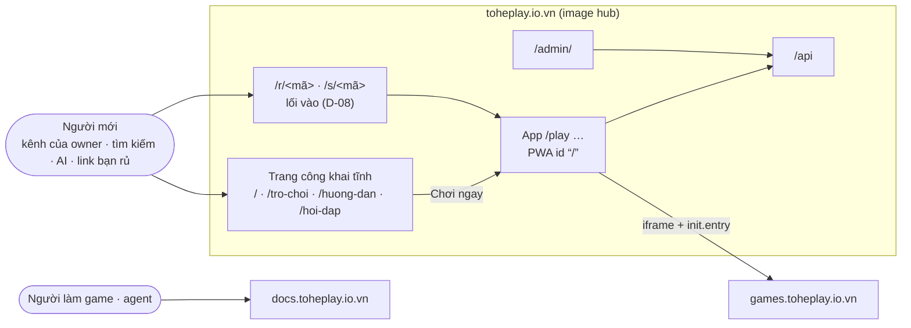
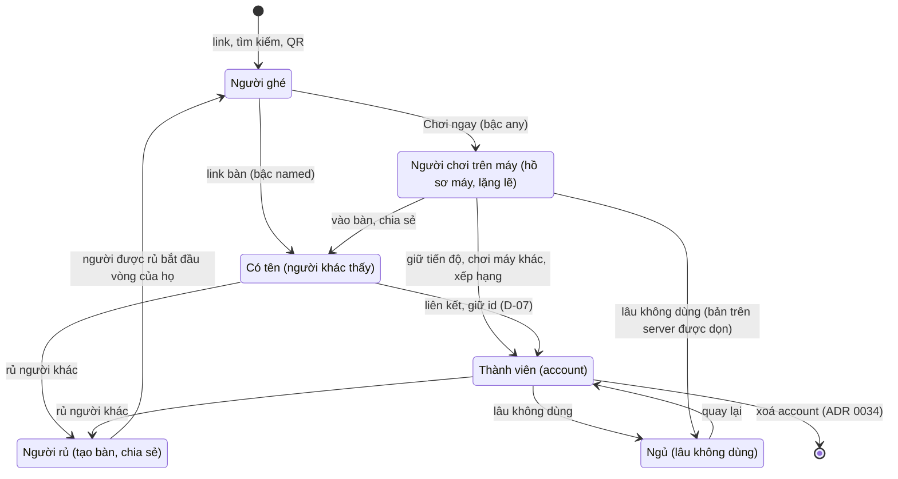

# Design — Bề mặt sản phẩm: thiết kế đích (v2, đang thành hình)

Trang này **ghép** các item thành một bức tranh. Nó không quyết gì: mỗi ý chỉ về item quyết nó, *(proposed)* là item chưa
`decided`. Item nào quyết khác thì sửa trang này trong cùng phiên. Ngày: 2026-10-19.

## Trả lời ngắn: đã chắc tới đâu?

Đã chốt: domain duy nhất `toheplay.io.vn` (D-02), user-first theo vòng đời một người dùng (D-03), luồng môi trường —
`main` + build một lần + tag `uat-…`/`prod-…` là deploy, agent làm tay phía sau (cầu nối tạm), migration chỉ tiến (E-01).
Cũng đã chốt ("theo đề xuất", 2026-10-19): nền định danh + lối vào (D-06…D-08, D-05 Google) — phần lớn nhất, đổi Game
Contract và vài ADR —, đo lường (D-04), trang công khai (E-02), người mới (E-03). Còn đề xuất: **bố cục host (D-01)** — owner
đang review v2.

## 1. Bức tranh

Host và đường dẫn: D-01 *(proposed)*; domain: D-02 *(decided)*; lối vào: D-08 *(decided)*.

## 2. Các mảnh, chuẩn đứng sau, và nơi ở

| Mảnh | Làm gì | Chuẩn / tiền lệ | Ở đâu | Item |
|---|---|---|---|---|
| Trang công khai | giới thiệu, trang game, hướng dẫn cài, hỏi đáp, pháp lý | HTML tĩnh (crawler AI không chạy JS); Open Graph; schema.org | `apps/web` → image hub | E-02 *(decided)*, D-01 *(proposed)* |
| Hồ sơ máy + ba bậc | ai cũng chơi được ngay; tên khi người khác thấy; account khi cần đồng bộ/độ tin | Firebase/Supabase anonymous → link; Kahoot nickname; Lichess casual/rated | hub + API (`DeviceProfiles`) + Game Contract `identity` | D-06 *(decided)* |
| Liên kết | hồ sơ máy → account giữ id; gộp khi cần; mã chuyển máy | Firebase `linkWithCredential`, Supabase reassign | hub + API | D-07 *(decided)* |
| Lối vào | một mô hình ý định, một đường ống, link chia sẻ là đối tượng | Discord invites (hạn, giới hạn, thu hồi) | hub + API (`Links`) + Game Contract `entries`, `init.entry`, `share` | D-08 *(decided)* |
| Cài app | ba lối: Android prompt · hướng dẫn iOS 26 · mở bằng trình duyệt từ WebView | web.dev install criteria; WebKit | hub | E-03 *(decided)* |
| Đăng nhập nhanh | Google một chạm (đã xây) | ADR 0026 | API + hub | D-05 *(decided)* |
| Đo lường | Search Console, Bing, bộ đếm tổng hợp (cả đếm theo link) | không cookie, không bên thứ ba | metrics ADR 0036 | D-04 *(decided)* |
| Luồng môi trường | `main` + build một lần + tag `uat-*`/`prod-*` là deploy; agent làm tay phía sau | trunk-based; build once, promote | `docs/guides/environments.md` + ADR | E-01 *(decided)* |

## 3. Các luồng chính

1. **Từ kênh của owner / Google**: trang game tĩnh → "Chơi ngay" → game với hồ sơ máy lặng lẽ → xong ván → "Cài Tò He"
   (Android) → app mở `/play`. (E-02, E-03, D-06)
2. **Được rủ vào bàn qua Zalo** (iPhone): WebView → "Mở bằng trình duyệt" → `/r/<mã>` → màn tên → ngồi bàn — không email,
   không mật khẩu → sau ván: Google một chạm giữ tiến độ (cùng id) → hướng dẫn thêm vào màn hình chính. (D-08, D-06, D-07)
3. **Thách bạn** (game một người): game xin `share` → hub tạo `/s/<mã>` → bạn mở → game nhận `init.entry` cùng seed → "đến
   lượt bạn". (D-08)
4. **Một thay đổi của agent**: nhánh → PR → "merge" → image `sha-…` → "deploy" (agent: tag `uat-…`, `deploy.sh`,
   `check:uat`) → "lên prod" (agent: tag `prod-…`, GitHub Release, mở + merge PR `targetRevision` ở `platform-infra`,
   `check:prod`). (E-01)

## 4. Còn mở

D-01 Q1–Q6 (bố cục host, owner đang review) · E-02 Q2 (cho AI huấn luyện?). Câu chữ tuổi/đồng ý của D-06 Q6 duyệt cùng văn
bản pháp lý (E-05).

## 5. Rủi ro chưa có câu trả lời

- Hành vi thật của WebView Zalo (mở trình duyệt, thẻ xem trước) và iOS 26 (mở như web app, chép cookie, không mở app từ
  link) — trả lời ở vòng thử thiết bị (E-03 §14).
- Tuổi và sự đồng ý khi hồ sơ máy lên server (Nghị định 13/2023 Điều 20) — D-06 Q6, owner duyệt câu chữ cùng văn bản
  pháp lý (E-05).
- Zalo có trả email không — quyết định Zalo (Phase 2) phụ thuộc vào nó (D-05 Q2).
- Hồ sơ máy là danh tính rẻ: lạm dụng bàn/link — proof-of-work, giới hạn, dọn dẹp (D-06 §4, D-08 §7); đo lại sau khi mở cửa.

## 6. Vòng đời một người dùng

Trục của plan theo D-03 ("tập trung vòng đời 1 user"). Mỗi bước chuyển chỉ cần **đúng một hành động** của người dùng, và
không bước nào bắt quay lại từ đầu.

Cài app không phải một trạng thái mà là một **thuộc tính của thiết bị**: gợi ý ở bất kỳ trạng thái nào sau ván đầu (E-03).
