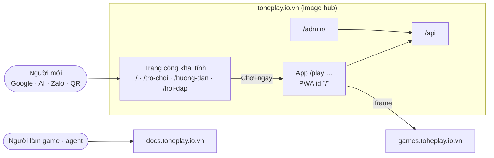

# Design — Bề mặt sản phẩm: thiết kế đích (v1, đang thành hình)

Trang này **ghép** các item thành một bức tranh. Nó không quyết gì: mỗi ý chỉ về item quyết nó, *(proposed)* là item chưa
`decided`. Item nào quyết khác thì sửa trang này trong cùng phiên. Ngày: 2026-10-19.

## Trả lời ngắn: đã chắc tới đâu?

Mọi item đều đang `proposed` hoặc `open`. Phần vững nhất là luồng môi trường (E-01) — nó chỉ viết ra cái đang chạy. Bố
cục host (D-01) có lý do chắc từ R-02, nhưng tên domain lâu dài (D-02) và đối tượng (D-03) là câu hỏi của owner, và lời
trên trang công khai chờ D-03.

## 1. Bức tranh

Host và đường dẫn: D-01 *(proposed)*; tên domain: D-02 *(proposed)*.

## 2. Các mảnh, chuẩn đứng sau, và nơi ở

| Mảnh | Làm gì | Chuẩn / tiền lệ | Ở đâu | Item |
|---|---|---|---|---|
| Trang công khai | giới thiệu, trang game, hướng dẫn cài, hỏi đáp, pháp lý | HTML tĩnh (Google JS SEO, crawler AI không chạy JS); Open Graph; schema.org `VideoGame` | `apps/web` → image hub | E-02, D-01 *(proposed)* |
| App (hub) | chơi, account, bàn | PWA: manifest `id`, `start_url /play`, `beforeinstallprompt` | `apps/hub`, `/play…` | D-01, E-03 *(proposed)* |
| Cài app | ba lối: Android prompt · hướng dẫn iOS 26 · mở bằng trình duyệt từ WebView | web.dev install criteria; WebKit (iOS 26) | component trong hub + `/huong-dan/cai-dat` | E-03 *(proposed)* |
| Đăng ký khi công khai | chế độ + bảo lãnh qua link bàn + Google | ADR 0028, 0026 | API + hub | D-05 *(proposed)* |
| Đo lường | Search Console, Bing, bộ đếm tổng hợp | không cookie, không bên thứ ba | metrics ADR 0036 | D-04 *(proposed)* |
| Luồng môi trường | dev → CI → UAT → prod, ba lời khoá | ADR 0009, 0010, 0021 | `docs/guides/environments.md` + ADR mới | E-01 *(proposed)* |

## 3. Các luồng chính

1. **Từ Google**: tìm "game ghép số không quảng cáo" → `/tro-choi/ghep-khoi` (HTML tĩnh) → "Chơi ngay" → `/play/merge-block`
   là khách → xong ván → "Cài Tò He" (Android) → app mở `/play`. (E-02, E-03)
2. **Từ link bàn trong Zalo** (iPhone): mở trong WebView của Zalo → dải "Mở bằng trình duyệt" → Safari `/r/<code>` → xem
   trước bàn → đăng ký nhanh (Google, hoặc email qua bảo lãnh của người rủ) → ngồi vào bàn → sau ván: hướng dẫn thêm vào
   màn hình chính (cookie phiên theo vào app). (E-03, D-05)
3. **Một thay đổi của agent**: nhánh → PR → CI → "merge" → GHCR → "deploy" (UAT, `check:uat`) → "lên prod" (PR
   `platform-infra`, owner merge, `check:prod`, tag `prod-…`). (E-01)

## 4. Còn mở

D-02 Q1–Q2 · D-03 Q1–Q3 · D-05 Q1–Q2 · D-04 Q1 · D-01 Q1–Q5 · E-01 Q1–Q3 · E-02 Q2.

## 5. Rủi ro chưa có câu trả lời

- Hành vi thật của WebView Zalo (mở trình duyệt, xem trước link) — trả lời ở vòng thử thiết bị (E-03 §10).
- iOS 26 trên iPhone của owner có đúng như báo cáo (mở như web app mặc định, chép cookie lúc thêm) — cùng vòng thử.
- Crawler AI có còn không chạy JS — không ảnh hưởng thiết kế (HTML tĩnh đúng trong cả hai trường hợp).
