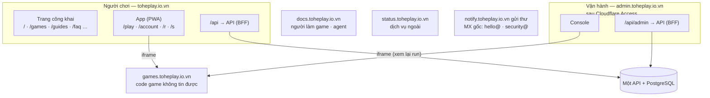
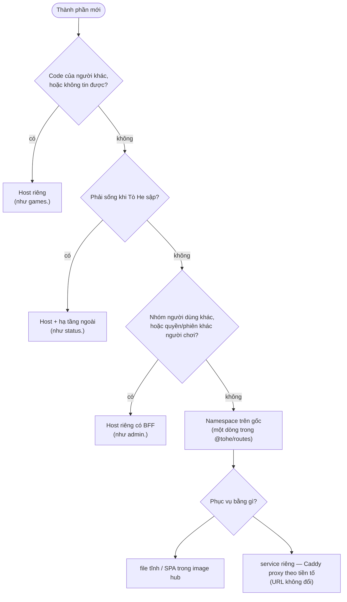

# D-01 — Chuẩn bố cục Tò He: host, đường dẫn, và luật thêm thành phần

- Status: **proposed v4** (2026-10-19) — chọn lại từ đầu theo yêu cầu owner; Q2–Q6 đã chốt vẫn giữ (đều khớp chuẩn)
- Kind: decision — origin mới (`admin.`), đường dẫn công khai, phiên theo origin → ADR (sửa ADR 0040, 0021, 0027)
- Blocks: E-02, E-03 · Blocked by: — (D-02 decided: `toheplay.io.vn` là domain duy nhất)
- Research: [R-06 chuẩn bố cục](../research/R-06-layout-standard.md), [R-02 host, SEO, GEO](../research/R-02-hosts-seo-geo.md)
- Decided: Q2–Q6 — owner, 2026-10-19, chat — xem *Decision*

## Vì sao

Owner (2026-10-19): "hiện tại ta có thể chọn 1 thiết kế tùy ý, nhưng hiểu quả cho nền tảng luôn, tại giờ rất rẻ nè, đừng
lo về việc sửa cái cữ hay ngoại thêm subdomain, tôi cần 1 chuẩn hợp lý và hiệu quả, bạn cứ research r đề xuất cho tôi
thiết kế bố cục sản phẩm để phân chia hợp lý + mở rộng kỹ thuật tốt cho các nhu cầu của sản phảm tốt nhé".

## 1. Chuẩn có bốn tầng

| Tầng | Quy tắc | Đổi khi nào |
|---|---|---|
| **1. Domain** | Một: `toheplay.io.vn` (D-02) | không |
| **2. Host** | Mỗi host là **một ranh giới niềm tin + một nhóm người dùng** | hiếm — mỗi host mới là một ADR |
| **3. Namespace path** | Trong một host, mỗi **thành phần** sở hữu vài tiền tố, ghi trong **một bản đồ** | khi thêm thành phần — một dòng, có review |
| **4. Luật chung** | phiên, API, HSTS, CSP, index, PWA, thư, môi trường, cấu hình (§5) | gần như không |

Vì sao chia như vậy (R-06): trình duyệt cô lập cookie, storage, service worker và quyền theo **origin** — nên ranh giới
bảo mật và ranh giới người dùng phải trùng với host. Trong cùng một nhóm người dùng, nhiều host chỉ thêm CORS, thêm phiên,
thêm bước chuyển hướng; đường dẫn thì không.

## 2. Ba bố cục, chấm theo nhu cầu của Tò He

| Nhu cầu ([R-06](../research/R-06-layout-standard.md)) | **L1 ⭐ Cửa trước ở gốc + host theo vai** | L2 Gốc = giới thiệu, app ở `play.` | L3 Mỗi thứ một host (`app.`, `api.`, `auth.`…) |
|---|---|---|---|
| N1 chơi trong vài giây | ✔ giới thiệu → app cùng origin, nhận ra người quay lại | ~ thêm một bước sang `play.`; giới thiệu không biết ai quay lại | ~ |
| N2 link ngắn | ✔ `toheplay.io.vn/r/482913` | ~ gốc chuyển hướng sang `play.` | ~ |
| N3 PWA, hồ sơ máy, phiên | ✔ một origin | ✔ (ở `play.`) | ✗ API khác origin → CORS, cookie qua site |
| N4 SEO/GEO | ✔ | ✔ | ✔ |
| N5 cô lập game | ✔ `games.` | ✔ | ✔ |
| N6 bảo vệ admin | ✔ `admin.` + Cloudflare Access | ✔ | ✔ |
| N7 tài liệu | ✔ `docs.` | ✔ | ✔ |
| N8 thư | ✔ `notify.` + MX gốc | ✔ | ✔ |
| N9 môi trường giống nhau | ✔ | ✔ | ~ nhiều host hơn ở mỗi môi trường |
| N10 mở rộng | ✔ luật path hay host (§6) | ✔ | ✔ nhưng mỗi thứ tốn một host |
| Độ phức tạp | một cửa cho người chơi; cần bản đồ path vì web + app chung host | hai cửa cho người chơi | nhiều nhất; ngược RFC 10017 (BFF cùng origin) |

L2 có một điểm hơn thật: trang giới thiệu tách hẳn khỏi app, có thể đặt ở edge và vẫn sống khi cluster sập. L1 lấy lại được
điều đó sau này bằng định tuyến theo đường dẫn ở Cloudflare mà không đổi URL — nên không đáng đổi lấy N1–N3.

## 3. Bản đồ host (tầng 2)

| Host | Vai | Ai dùng | Phiên | Index | Phục vụ | So với hôm nay |
|---|---|---|---|---|---|---|
| `toheplay.io.vn` | cửa trước của người chơi: trang công khai + app + API | mọi người | `__Host-tohe.session` (`SameSite=Lax`) | chỉ trang công khai | image hub (Caddy) → API | sửa đường dẫn (§4) |
| `admin.toheplay.io.vn` | vận hành: console + API admin | owner, admin | `__Host-tohe.admin` **riêng** (`SameSite=Strict`) + Cloudflare Access trước cửa | không | Caddy của image hub (site thứ hai) → API | **mới** — rời `/admin/` |
| `games.toheplay.io.vn` | build game | iframe của app và console | không cookie | không | image games | giữ |
| `docs.toheplay.io.vn` | tài liệu kỹ thuật, API reference, `llms.txt` | người làm game, agent | không | có | image docs | lên gốc host (Q6) |
| `status.toheplay.io.vn` | trạng thái, sự cố | mọi người | không | có | **dịch vụ ngoài** (CNAME DNS-only) | **mới** |
| `notify.toheplay.io.vn` | gửi thư giao dịch (không có web) | — | — | — | Resend | **mới** — thay gửi từ gốc |
| gốc (MX) | nhận `hello@`, `security@` | — | — | — | Cloudflare Email Routing | ✔ đã bật |
| `www.` | 301 → gốc | — | — | — | Cloudflare | giữ |

**Để dành** (không tạo DNS): `api.` (chỉ khi có API cho bên thứ ba) · `account.` (đăng nhập tập trung, chỉ khi ≥ 3 origin của
Tò He cần chung một lần đăng nhập) · `studio.` (xưởng tạo game, nếu cần phiên/quyền khác người chơi) · `media.` (ảnh người
dùng tải lên — không cookie; nếu rủi ro cao thì domain riêng) · `uat.` (vùng tên của UAT, §5.8).

## 4. Namespace trong từng host (tầng 3)

**Gốc** — bản đồ `@tohe/routes` (Q2, Q3, Q7):

| Namespace | Thành phần | Phục vụ | Index |
|---|---|---|---|
| `/` (đúng gốc), `/games/`, `/guides/`, `/faq`, `/about`, `/terms`, `/privacy`, `/_astro/` | web (`apps/web`) | file tĩnh | có |
| `/play`, `/play/<gameId>/…` — **dưới `/play/` chỉ có id game** (`/play/<g>/rooms/<roomId>/replay/<hand>`) | hub | SPA | không |
| `/account/…` — đăng nhập, đăng ký, mật khẩu, email, hồ sơ, cài đặt, dữ liệu thiết bị | hub | SPA | không |
| `/r/<mã bàn>`, `/s/<mã chia sẻ>` | hub (link ngắn, D-08) | SPA + thẻ xem trước | không |
| `/assets/`, `/manifest.webmanifest`, `/sw.js`, icon | hub | file tĩnh | — |
| `/api/…` | API | proxy | — |
| `/.well-known/`, `/robots.txt`, `/sitemap.xml` | nền tảng | sinh lúc build | — |
| để dành: `/blog/`, `/en/`, `/help/` (web) · `/studio/` (nếu cùng niềm tin) | — | — | — |
| mọi thứ khác | — | **404 thật** | — |

**`admin.`**: `/` console (SPA) · `/api/admin/…` và các endpoint đăng nhập → API (chỉ chuyển đúng những tiền tố đó) · `/assets/`.
**`games.`**: `/<gameId>/<version>/…`, `/catalog.json`; `/` → 302 về gốc (giữ). **`docs.`**: mọi trang ở gốc host,
`/reference/api/`, `/reference/admin-api/`, `/llms.txt`; `/docs/*` cũ → 301.

**Một bản đồ, sinh ra mọi cấu hình** — `@tohe/routes` khai báo host + namespace và sinh: route của Caddy (cả hai site),
danh sách app shell của service worker, `robots.txt`/`X-Robots-Tag`, proxy của Vite khi dev, `HubPaths`/`AdminPaths` cho API
(link email, redirect OAuth — hôm nay viết tay ở ~10 chỗ); CI báo lệch như với OpenAPI; một test chặn namespace chồng nhau
và route của app nằm ngoài namespace của nó.

## 5. Luật chung (tầng 4)

1. **Phiên (BFF, RFC 10017)**: mỗi cửa vào có `/api` cùng origin; cookie `__Host-…`, `HttpOnly`, `Secure`, `Path=/`,
   **không bao giờ đặt `Domain`**; `SameSite=Lax` cho người chơi (link email, OAuth), `Strict` cho admin.
2. **Một API, nhiều cửa vào**: không CORS; `SameOriginGuard` theo từng origin; API biết các origin của nó từ cấu hình
   (`publicUrls.hub`, `publicUrls.admin`). Tách `api.` chỉ khi có khách hàng bên thứ ba.
3. **Không script bên thứ ba** trên gốc và `admin.`; CSP riêng cho từng host và từng namespace.
4. **HSTS** `max-age=31536000; includeSubDomains` (cả domain là của Tò He, mọi host đều HTTPS); không preload.
5. **Index**: chỉ trang công khai ở gốc và `docs.`; còn lại `noindex`; `robots.txt` sinh từ bản đồ.
6. **PWA**: một app ở origin gốc — `id "/"`, `start_url "/play"`, `scope "/"`; `/.well-known/assetlinks.json` khi có app
   Android (TWA).
7. **Thư**: giao dịch gửi từ `notify.`; người thật dùng `hello@`, `security@` ở gốc; nếu có thư marketing thì một subdomain
   khác nữa.
8. **Môi trường cùng tên vai, khác tầng**: prod `<vai>.toheplay.io.vn` (một tầng — chứng chỉ miễn phí của Cloudflare); UAT
   nếu có HTTPS (D-15) `uat.toheplay.io.vn` + `<vai>.uat.toheplay.io.vn`, DNS-only tới 10.100.0.2, chứng chỉ Let's Encrypt
   DNS-01; dev `localhost:47xx`.
9. **Cấu hình, không mã**: mọi host đi từ `publicUrls` của chart; code không chứa tên domain.
10. **Host mới = ADR** (luật repo: origin mới); **namespace mới = một dòng trong bản đồ** + review.

## 6. Thêm thành phần sau này

| Ví dụ tương lai | Nơi |
|---|---|
| Blog, trang tiếng Anh, trợ giúp | `/blog/`, `/en/`, `/help/` trên gốc |
| Phòng chơi tách thành service riêng | vẫn `/api/rooms/…` — proxy sang service mới |
| Xưởng tạo game cho người dùng | `/studio/` nếu dùng phiên người chơi; `studio.` nếu cần quyền riêng — bản chạy thử game luôn ở `games.` |
| API cho bên thứ ba | `api.` (khoá API, không cookie) |
| Ảnh người dùng tải lên | `media.` không cookie (hoặc domain riêng nếu rủi ro cao) |
| Đăng nhập chung cho nhiều origin | `account.` (OIDC) — chỉ khi thật cần |

## 7. Đi từ hôm nay tới chuẩn

| Việc | Ai | PR |
|---|---|---|
| Bản đồ `@tohe/routes` + codegen; `apps/web`; gốc `/play`, `/account`, `/r`, `/s`; 404 thật; robots/sitemap/`security.txt`; manifest `id`; cờ Scalar | agent | P1-1a |
| `docs.` lên gốc; `apps/site` → `apps/docs` (Q8) | agent | P1-1a |
| `admin.`: site thứ hai trong Caddy của hub, đăng nhập riêng trên admin (email + mật khẩu + TOTP sẵn có), cookie `__Host-tohe.admin`, `publicUrls.admin` trong chart, ingress | agent | P1-1b |
| DNS `admin.` + Cloudflare Access (cho phép email của owner) + host ở `platform-infra` | owner (DNS, Access) + agent (PR `platform-infra`, owner merge) | P1-1b |
| `notify.`: thêm domain ở Resend (DNS tự thêm), đổi người gửi ở Infisical `/tohe` + `uat.env` | owner + agent (docs, chart) | P1-1c |
| `status.`: chọn dịch vụ ngoài (UptimeRobot / Better Stack / Instatus…), CNAME DNS-only; agent liệt kê thứ cần theo dõi | owner + agent | P1-1c |
| HSTS `includeSubDomains` (header của Caddy) | agent | P1-1a |

## Câu hỏi cho owner

| Q | Câu hỏi | Đề xuất / trạng thái |
|---|---|---|
| Q1 | Chuẩn bốn tầng, bố cục **L1**? | **L1** |
| ~~Q2–Q6~~ | `/play`, route tiếng Anh, Email Routing, cờ Scalar, tài liệu lên gốc `docs.` | **chốt** — giữ nguyên trong chuẩn |
| Q7 | Namespace của app trên gốc: `/play/…` (chỉ id game) + `/account/…` + `/r/`, `/s/` | **có** |
| Q8 | `apps/site` → `apps/docs`, giữ key chart `site` | **có** |
| Q9 | Console ra `admin.toheplay.io.vn`, phiên riêng, Cloudflare Access trước cửa | **có** — ranh giới bảo mật lớn nhất còn thiếu |
| Q10 | Gửi thư từ `notify.toheplay.io.vn` | **có** — làm khi lượng thư còn bằng không |
| Q11 | Trang trạng thái `status.toheplay.io.vn` ở dịch vụ ngoài | **có** — chấp nhận chung DNS Cloudflare (một domain, D-02) |
| Q12 | HSTS `includeSubDomains`, không preload | **có** |

## Decision

**owner** (2026-10-19, chat): "Q1. uh thôi thấy cũng rất hợp lý về hình thức lẫn sạch, nhưng k biết về kỹ thuật hay tính mở
rộng sau này cho các thành phần hay thêm thành phần có tốt k th · Q2. /play hợp lý nha, các route khác cũng dùng english
luôn giúp tôi · Q3 các route dùng english luôn giúp tôi, ổn chứ · Q4 ổn, tôi cần làm gì thêm · Q5 Tắt, nhưng có cờ bật đc
nha (default tắt ở prod) · Q6 dời đi cho chung khung". Sau đó: "Q4 toi setup r nha" (Email Routing — agent kiểm DNS
2026-10-19: 3 MX `route1–3.mx.cloudflare.net`, SPF gốc, DKIM `cf2024-1`, DMARC; `send.` của Resend nguyên vẹn).

## Discussion

**agent** (2026-10-19, v1–v3): gốc là cửa trước; một bản đồ namespace; luật path hay subdomain.

**owner** (2026-10-19): muốn một chuẩn chọn tự do theo hiệu quả, không ngại sửa cái cũ hay thêm subdomain.

**agent** (2026-10-19, v4): chấm lại ba bố cục theo N1–N10 (R-06). L1 vẫn thắng ở phía người chơi (một origin cho giới
thiệu, app, phiên, hồ sơ máy, link ngắn — đúng mẫu BFF của RFC 10017). Tự do thêm subdomain được dùng đúng chỗ chuẩn
khuyên: `admin.` (ranh giới đặc quyền), `status.` (sống khi sập), `notify.` (uy tín thư) — chứ không chia nhỏ phía người
chơi.
