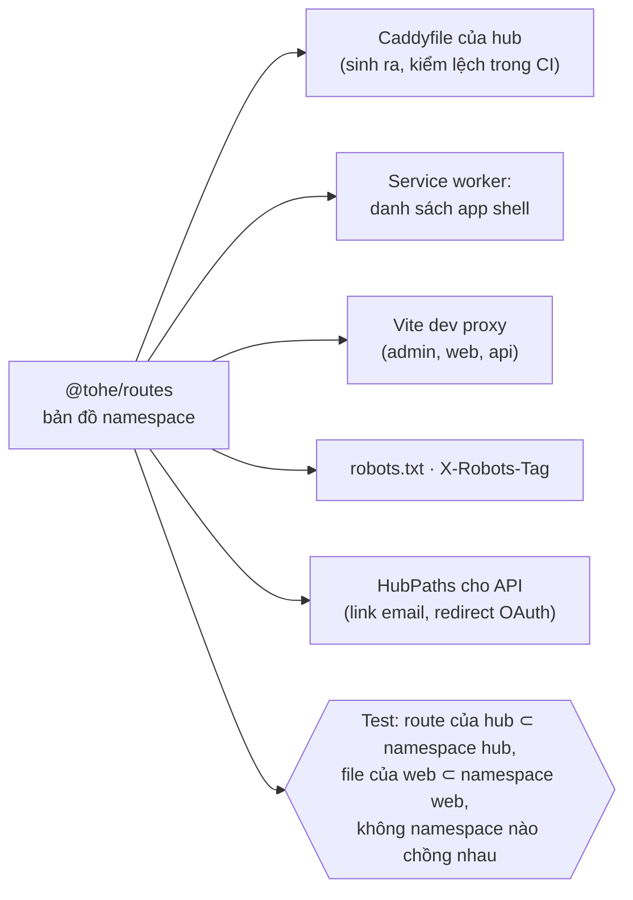
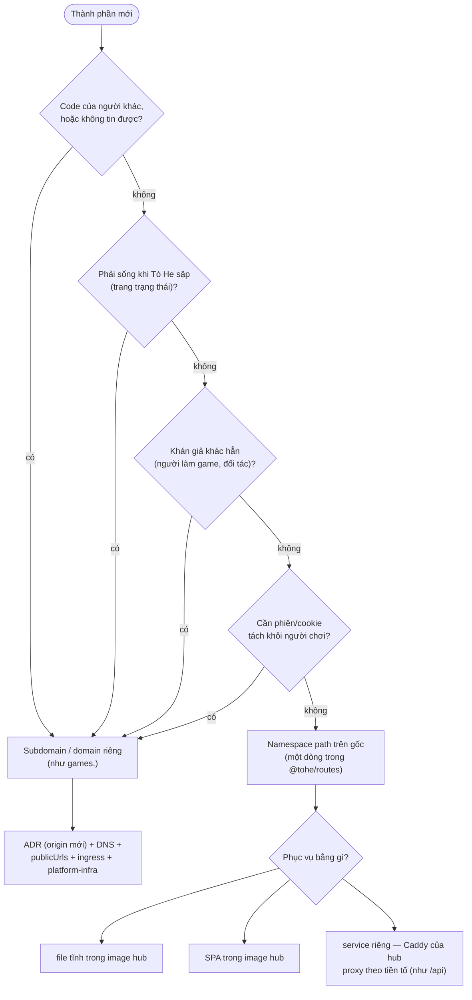

# D-01 — Mỗi thành phần nằm ở host và đường dẫn nào trên domain?

- Status: **proposed v3** (2026-10-19) — Q2–Q6 **decided**; Q1 owner đồng ý về hình thức, chờ xem phần mở rộng (§3–§5);
  Q7, Q8 mới
- Kind: decision — đường dẫn công khai trên origin của hub → ADR (sửa ADR 0040 về đường dẫn, ADR 0021 về vai trò site)
- Blocks: E-02, E-03 · Blocked by: — (D-02 decided: `toheplay.io.vn` là domain duy nhất, chia subdomain theo vai)
- Decided: Q2–Q6 — owner, 2026-10-19, chat — xem *Decision*

## Vì sao

Owner (2026-10-19): "bạn có thể cho tôi 1 đề xuất thay đổi subdomain cho các thành phần để ổn định mở rộng cho tương lai,
vì thay đổi bây giờ là siêu rẻ), các trang landing docs portal api cũng nghiêm túc tổ chức tốt trên domain này"; rồi
"việc sử dụng tiền tố bằng path ntn có dễ duy trì mở rộng cho các component hiện tại hay thêm sau này k, thiết kế đang ra
sao".

Vấn đề có thật trên prod ([R-01](../research/R-01-backlog-review.md) D1–D4, [R-02](../research/R-02-hosts-seo-geo.md)):
landing nằm ở `docs.` chung với tài liệu kỹ thuật; gốc là SPA trống với máy đọc, trả `200` cho mọi đường dẫn; manifest không
có `id`. Và một vấn đề duy trì: **đường dẫn của hub đang được viết tay ở năm nơi** — router của hub, ~10 chỗ trong module
Identity của API (link trong email, redirect OAuth: `/welcome`, `/register/confirm`, `/password/reset`, `/account/email`…),
Caddyfile, cấu hình service worker, e2e.

## 1. Nguyên tắc

1. **Chỉ vài thứ đắt khi đổi** (R-02): origin của hub, `id` của manifest, URL trang công khai, domain gửi thư.
2. **Subdomain theo vai, path theo thành phần** (D-02): cùng sản phẩm, cùng người dùng, cùng phiên → **một origin, mỗi
   thành phần một vài tiền tố path**. Khác niềm tin / khác khán giả / phải sống độc lập → **subdomain**.
3. **URL tách khỏi cách triển khai**: một tiền tố path hôm nay là file tĩnh trong image hub, mai có thể là một service riêng
   sau cùng URL đó. Tiền tố là hợp đồng; container phía sau thì đổi được.
4. **Một nguồn sự thật cho đường dẫn** (§3): không viết tay cùng một đường dẫn ở nhiều nơi.

## 2. Bố cục — trước → sau (route tiếng Anh, Q2, Q3)

| Thành phần | Hôm nay (prod) | Sau |
|---|---|---|
| **Trang công khai** (`apps/web`, mới) | landing ở `docs.toheplay.io.vn/` | `toheplay.io.vn/` · `/games` · `/games/<gameId>` · `/guides/install` · `/guides/profiles` · `/guides/play-together` · `/faq` · `/about` · `/terms` · `/privacy` |
| **App** (`apps/hub`) | `/` (danh mục), `/play/<g>`, `/rooms/<g>`, `/room/<id>`, `/replay/…`, `/welcome`, `/register…`, `/password/…`, `/profiles`, `/account…`, `/data`, `/legal/*` — 13 tiền tố gốc | **Q7**: `/play` (danh mục, `start_url`) · `/play/<gameId>` · `/play/<gameId>/rooms[/<roomId>[/replay/<hand>]]` · `/account/…` (đăng nhập, đăng ký, mật khẩu, email, hồ sơ, cài đặt, dữ liệu thiết bị) — **2 tiền tố** |
| **Link ngắn** (của hub) | `/r/<mã bàn>` | `/r/<mã bàn>` · `/s/<mã chia sẻ>` (D-08) |
| **Console admin** (`apps/admin`) | `/admin/` | giữ (`admin.` để dành) |
| **API** | `/api/*` | giữ cùng origin |
| Tài liệu API (Scalar, `/api/openapi/*`) | mở trên prod | **tắt mặc định ở prod, có cờ bật** (Q5) |
| **Tài liệu kỹ thuật** (`apps/site` → `apps/docs`, Q8) | `docs.toheplay.io.vn/docs/…` | **`docs.toheplay.io.vn/…`** (Q6); `/docs/*` cũ → 301 |
| **Game** | `games.toheplay.io.vn` | giữ |
| Nền tảng | — | `/robots.txt`, `/sitemap.xml`, `/.well-known/security.txt` (+ chỗ cho `assetlinks.json`), 404 thật |
| Thư | gửi `no-reply@` (Resend, return-path `send.`); không nhận | giữ gửi; nhận `hello@`, `security@` (Email Routing, Q4) |

Trang game công khai dùng **đúng id của game** (`/games/merge-block` ↔ `/play/merge-block` ↔ `games.…/merge-block/`): một id
ở mọi nơi. Chữ trong URL chỉ là tín hiệu xếp hạng "rất, rất nhẹ" — tiêu đề và nội dung tiếng Việt mới là chính
([SEJ](https://searchenginejournal.com/ranking-factors/urls),
[Search Laboratory](https://www.searchlaboratory.com/?p=2862)).

## 3. Không gian đường dẫn: một bản đồ duy nhất

Đường dẫn cấp gốc của `toheplay.io.vn` là tài nguyên chung của mọi thành phần → nó có **một bản đồ** (`@tohe/routes`, gói
nhỏ mới), mỗi dòng là một **namespace**:

| Namespace | Chủ | Phục vụ | Index | CSP | Service worker | Dev |
|---|---|---|---|---|---|---|
| `/` (đúng gốc), `/games/`, `/guides/`, `/faq`, `/about`, `/terms`, `/privacy`, `/_astro/` | web | file tĩnh trong image hub | có | `public` | đi mạng | dev server của `apps/web` |
| `/play`, `/play/`, `/account`, `/account/`, `/r/`, `/s/` | hub | SPA (`index.html`) | không | `hub` | app shell | Vite của hub |
| `/assets/`, `/manifest.webmanifest`, `/sw.js`, icon | hub | file tĩnh | — | — | precache | Vite của hub |
| `/admin/` | admin | SPA riêng | không | `admin` | ngoài | `:4721` |
| `/api/` | api | proxy | không | — | ngoài (trừ GET đã cache) | `:4740` |
| `/.well-known/`, `/robots.txt`, `/sitemap.xml` | nền tảng | sinh lúc build | — | — | — | — |
| *để dành*: `/blog/`, `/en/`, `/help/`, `/studio/` | — | — | — | — | — | — |
| mọi thứ khác | — | **404** | — | — | — | — |

- **Sinh ra, không viết tay** — đúng luật của repo cho file sinh: Caddyfile phần route, `HubPaths` của API, danh sách app
  shell, robots; CI báo lệch như với OpenAPI hôm nay (`tools/codegen`).
- **Test chặn va chạm**: thêm một trang hub ngoài namespace của hub, hay một trang web trùng `/play`, là CI đỏ.
- **Mỗi thành phần lớn lên bên trong namespace của nó**: thêm 20 trang vào `/account/…` hay `/guides/…` không đụng bản đồ.
  Bản đồ chỉ đổi khi thêm **thành phần** hoặc **namespace** — hiếm, có review.
- Vì sao Q7 (gom route app vào `/play/` + `/account/`): hôm nay hub chiếm 13 tiền tố gốc, mỗi trang mới của hub là một
  dòng mới trong bản đồ và một chỗ có thể va với trang công khai. Gom lại thì bản đồ gần như đứng yên. Dưới `/play/` **chỉ
  có id game** → không bao giờ va với một trang khác của app (game tên `account` cũng không sao).

## 4. Thêm một thành phần sau này

| Ví dụ tương lai | Nơi | Vì sao |
|---|---|---|
| Blog / tin tức, trang tiếng Anh | `/blog/`, `/en/` (web) | cùng sản phẩm, cần SEO cùng domain |
| Trung tâm trợ giúp | `/guides/`, `/help/` (web) | như trên |
| Phòng chơi tách thành service riêng | vẫn `/api/rooms/…` — proxy sang service mới | URL và cookie không đổi |
| Xưởng tạo game cho người dùng | `/studio/` (app của mình) — **nhưng** bản chạy thử game vẫn ở `games.` | công cụ là của mình; code game thì không tin được |
| Console admin cô lập phiên | `admin.toheplay.io.vn` | khác phiên; URL không công khai nên đổi lúc nào cũng rẻ |
| Trang trạng thái | `status.` (dịch vụ ngoài) | phải sống khi gốc sập |
| API cho bên thứ ba | `api.` | khách hàng khác, khoá API khác |
| Ảnh do người dùng tải lên | domain/subdomain riêng không cookie | nội dung không tin được |
| Diễn đàn bên thứ ba | `community.` | code của người khác |

Đi một chiều thì rẻ: một namespace path **tách** ra service riêng sau cùng URL (proxy) mà không ai nhận ra; còn một
subdomain **gộp** về gốc thì vỡ cookie, PWA, storage. Nên với thành phần của chính Tò He, bắt đầu bằng path là lựa chọn
đảo ngược được.

## 5. Giới hạn thật của cách này

- **Cùng origin = cùng niềm tin**: lỗi XSS ở bất kỳ phần nào trên gốc (trang công khai, hub, admin) dùng được phiên người
  chơi. Giữ bằng luật: **không script bên thứ ba trên gốc**, CSP riêng từng namespace, trang công khai gần như không JS;
  admin ra `admin.` khi đáng (đã để dành).
- **Một cửa vào**: Caddy của hub định tuyến mọi namespace — một chỗ cấu hình (sinh từ bản đồ), hợp quy mô một API instance.
  Khi cần, ingress của cluster chia theo tiền tố mà URL không đổi.
- **Phát hành chung**: trang công khai đi trong image hub → sửa một chữ trên landing là một lần phát hành (build một lần,
  qua UAT rồi prod — E-01). Khi muốn tách nhịp, chuyển `apps/web` ra service riêng sau cùng namespace.
- **Service worker phạm vi `/`** thấy mọi điều hướng → danh sách app shell sinh từ bản đồ để không nuốt trang công khai.

## 6. Ở mỗi môi trường

| | Dev | UAT | Prod |
|---|---|---|---|
| Gốc (web + app + `/api` + `/admin`) | `localhost:4720` (Vite của hub proxy theo bản đồ) | `10.100.0.2:4820` | `toheplay.io.vn` |
| Tài liệu kỹ thuật | `localhost:4710` | `10.100.0.2:4810` | `docs.toheplay.io.vn` |
| Game | `localhost:4730` | `10.100.0.2:4830` | `games.toheplay.io.vn` |

**Không đổi**: DNS, Cloudflare (trừ Email Routing), `platform-infra`, ingress và key của chart — vẫn ba host. Link bàn
`/r/…` giữ nguyên; link trong email đang còn hạn (`/register/confirm`, `/password/reset`, `/account/email`, `/welcome`) được
301 sang đường mới một thời gian.

## Phương án (bố cục host — Q1)

| | Cách | Được | Mất |
|---|---|---|---|
| A | Giữ ADR 0040; chỉ vá meta + robots | ít việc nhất | gốc vẫn trống với máy đọc; landing vẫn ở `docs.` |
| **B** ⭐ | Gốc là cửa trước; namespace theo thành phần, một bản đồ (§2–§3) | một sản phẩm một chỗ; SEO/GEO; không đổi hạ tầng; thêm thành phần theo một luật; tách service sau không đổi URL | gói `@tohe/routes` + codegen, `apps/web`, sửa Caddy/router/SW/API links, e2e, một ADR |
| C | Landing ở gốc, app ở `app.` | tách hẳn | link dài hơn; cài app ở host khác; landing không chuyển link vào app đã cài; thêm DNS + host hạ tầng |
| D | Hub render HTML phía server | một codebase | đổi framework hub |

## Câu hỏi cho owner

| Q | Câu hỏi | Trạng thái |
|---|---|---|
| Q1 | Bố cục B? | owner: hợp lý về hình thức; **chờ xem §3–§5** (kỹ thuật, mở rộng) |
| ~~Q2~~ | Danh mục game ở `/play`; route khác tiếng Anh | **chốt** |
| ~~Q3~~ | Route trang công khai tiếng Anh | **chốt** — `/games/<gameId>`, `/guides/…`, `/faq`, `/about`, `/terms`, `/privacy` |
| ~~Q4~~ | Email Routing `hello@`, `security@` | **chốt** — owner bật (các bước ở PLAN → Waiting) |
| ~~Q5~~ | Scalar trên prod | **chốt**: tắt mặc định ở prod, bật bằng cờ (`Api__Reference__Enabled`, value chart `api.reference.enabled`); dev bật sẵn |
| ~~Q6~~ | Tài liệu kỹ thuật | **chốt**: dời lên gốc của `docs.`, `/docs/*` → 301 |
| Q7 | Gom route của app vào `/play/…` + `/account/…` (+ link ngắn `/r/`, `/s/`) | **đề xuất: có** — bây giờ rẻ nhất (P1-1 đã sửa router), bản đồ gốc gần như không đổi về sau |
| Q8 | Đổi tên `apps/site` → `apps/docs`; giữ key chart `site` | **đề xuất: có** — tên trong repo khớp vai; key chart giữ để không phải sửa `platform-infra` |

## Decision

**owner** (2026-10-19, chat): "Q1. uh thôi thấy cũng rất hợp lý về hình thức lẫn sạch, nhưng k biết về kỹ thuật hay tính mở
rộng sau này cho các thành phần hay thêm thành phần có tốt k th · Q2. /play hợp lý nha, các route khác cũng dùng english
luôn giúp tôi · Q3 các route dùng english luôn giúp tôi, ổn chứ · Q4 ổn, tôi cần làm gì thêm · Q5 Tắt, nhưng có cờ bật đc
nha (default tắt ở prod) · Q6 dời đi cho chung khung".

## Discussion

**agent** (2026-10-19): ADR 0040 chọn "hub ở gốc vì đó là nơi người ta tới" — B giữ nguyên điều đó, chỉ thêm một lớp HTML
tĩnh phía trước cho người mới và cho máy đọc.

**agent** (2026-10-19, v3): trả lời câu hỏi mở rộng bằng §3 (một bản đồ namespace, sinh ra mọi cấu hình, test chặn va chạm),
§4 (luật path hay subdomain + ví dụ), §5 (giới hạn thật). Thêm Q7 (gom route app) và Q8 (tên `apps/docs`).
