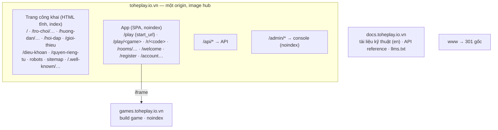

# D-01 — Mỗi thành phần nằm ở host và đường dẫn nào trên domain?

- Status: **proposed** (2026-10-19)
- Kind: decision — đổi origin/đường dẫn công khai → ADR (sửa ADR 0040 về đường dẫn, ADR 0021 về vai trò của site)
- Blocks: E-02, E-03 · Blocked by: D-02 (chỉ ở chỗ: tên domain là gì — bố cục thì giống nhau)
- Decided: —

## Vì sao

Owner (2026-10-19): "bạn có thể cho tôi 1 đề xuất thay đổi subdomain cho các thành phần để ổn định mở rộng cho tương lai,
vì thay đổi bây giờ là siêu rẻ), các trang landing docs portal api cũng nghiêm túc tổ chức tốt trên domain này".

Hai vấn đề có thật trên prod ([R-01](../research/R-01-backlog-review.md) D1–D4, [R-02](../research/R-02-hosts-seo-geo.md)):
- Trang giới thiệu (cho người chơi, tiếng Việt) nằm ở `docs.toheplay.io.vn/`, chung host với tài liệu kỹ thuật tiếng Anh;
  còn tên gốc — tên người ta gõ và chia sẻ — là một SPA mà crawler AI thấy trống, trả `200` cho mọi đường dẫn.
- Manifest không có `id`: danh tính app đang buộc vào `start_url "/"`.

## Nguyên tắc chọn

1. **Chỉ vài thứ đắt khi đổi** (R-02): origin của hub, `id` của manifest, URL trang công khai, domain gửi thư. Làm đúng
   bốn thứ đó trước khi có người cài app; phần còn lại để linh hoạt.
2. **Một sản phẩm, một host**: thứ người chơi thấy (giới thiệu, trang game, hướng dẫn, app) ở cùng host. Khán giả khác
   (người làm game, đọc tiếng Anh) → subdomain. Code không tin được (game) → subdomain (ADR 0040).
3. **Không gắn tên domain vào code**: mọi host đi từ `publicUrls` của chart (đã vậy); bố cục là "gốc / `games.` / `docs.`",
   chuyển sang domain khác chỉ là đổi cấu hình + redirect (D-02).

## Đề xuất: bố cục mục tiêu

| Host / đường dẫn | Là gì | Index | Đổi về sau |
|---|---|---|---|
| `toheplay.io.vn/` | **Trang giới thiệu** tĩnh. Ai đã đăng nhập, hoặc đang mở trong app đã cài, được đưa thẳng tới `/play` (một script nhỏ đọc cờ trong localStorage do hub đặt) | có | đắt (SEO) |
| `/tro-choi/`, `/tro-choi/<slug>` | Danh sách game và một trang cho mỗi game: ảnh, cách chơi, nút "Chơi ngay" → `/play/<id>` | có | đắt (SEO) |
| `/huong-dan/…`, `/hoi-dap`, `/gioi-thieu` | Cài app trên Android/iPhone, hồ sơ cho bé, chơi cùng bạn bè; hỏi đáp; giới thiệu | có | đắt (SEO) |
| `/dieu-khoan`, `/quyen-rieng-tu` | Văn bản pháp lý **tĩnh** (hôm nay nằm trong SPA ở `/legal/*`) | có | — |
| `/robots.txt`, `/sitemap.xml`, `/.well-known/security.txt` | thật, không còn rơi vào SPA. `/.well-known/` dành chỗ cho `assetlinks.json` (app Android qua TWA sau này) | — | — |
| `/play` | **Danh mục game = `start_url` của PWA**. Manifest có `id: "/"` để danh tính app không phụ thuộc `start_url` nữa | không | **đắt nhất** — chốt trước khi mời ai |
| `/play/<id>`, `/r/<code>`, `/rooms/…`, `/room/…`, `/replay/…`, `/welcome`, `/register…`, `/password/…`, `/profiles`, `/account…`, `/data` | Giữ nguyên như hôm nay → link đã gửi, QR, email không gãy | không (`X-Robots-Tag: noindex`) | — |
| đường dẫn lạ | **404 thật** (trang tĩnh) — Caddy chỉ trả SPA cho danh sách đường dẫn của app | — | — |
| `/api/*` | Giữ **cùng origin**: cookie first-party, không CORS, `SameOriginGuard` đơn giản. Không tách `api.` | — | rẻ |
| `/admin/*` | Giữ. Tách ra `admin.` (phiên admin riêng, hub có lỗi XSS cũng không chạm được) để **Sau** | — | rẻ |
| `games.toheplay.io.vn` | Giữ (ADR 0040) | không | rẻ |
| `docs.toheplay.io.vn` | **Chỉ** tài liệu kỹ thuật (en) + API reference sinh ra + `llms.txt`. `/` → `/docs/`; đường dẫn landing cũ → 301 về gốc | có | rẻ |
| `www.` | 301 → gốc (Cloudflare, giữ) | — | — |

**Tên để dành (không tạo DNS bây giờ):** `admin.` (console tách riêng), `status.` (trang trạng thái), `uat.` (D-15 nếu UAT
có HTTPS), `api.` (chỉ khi có API công khai cho bên thứ ba — không có trong kế hoạch), `mail.`/`notify.` (gửi thư từ
subdomain — D-02). `send.` **đã bị Resend dùng** làm return-path.

**Hộp thư nhận:** thêm Cloudflare Email Routing (MX ở gốc) → `hello@` / `security@toheplay.io.vn` chuyển về hộp thư của
owner. Cần cho "liên hệ người vận hành" (E-05) và `security.txt`. Không đụng `send.`.

### Phục vụ thế nào

- Trang công khai là một app Astro mới, `apps/web` (tiếng Việt, không Starlight, không JS trừ chỗ cần), **build vào image
  hub**: Caddy của hub phục vụ các đường dẫn công khai trước, rồi tới danh sách đường dẫn của app (SPA), rồi 404. Một image
  phục vụ cả gốc → UAT, compose và chart chạy y nhau, không thêm container.
- `apps/site` chỉ còn tài liệu kỹ thuật (đổi tên `apps/docs` để sau).
- Service worker của hub: `navigateFallback` chỉ cho đường dẫn của app; trang công khai không bị SPA nuốt.
- CSP riêng cho trang công khai (chặt hơn hub: không `connect-src` ngoài `'self'`, không frame).

## Phương án

| | Cách | Được | Mất |
|---|---|---|---|
| **A** | Giữ ADR 0040; chỉ thêm `og:`/description vào HTML của hub, robots/sitemap thật | ít việc nhất | gốc vẫn trống với crawler AI; landing vẫn ở `docs.`; người mới vẫn gặp form đăng nhập; đổi sau đắt hơn |
| **B** ⭐ | **Gốc là cửa trước**: trang công khai tĩnh + app cùng origin (bảng trên) | một sản phẩm một chỗ; SEO/GEO đọc được; landing → app không qua redirect; link cũ giữ nguyên; `id` manifest chốt sớm | app Astro mới, Caddy/router/service worker của hub, e2e, docs, một ADR |
| **C** | Landing ở gốc, app ở `app.`/`choi.toheplay.io.vn` | tách hẳn hai bên | URL app dài hơn ở mọi link; cài app phải sang host khác; landing không đưa link vào app đã cài được (khác origin); ADR 0040 đã loại vì hub nên giữ tên ngắn nhất |
| **D** | Hub render HTML phía server (SSR) | một codebase | đổi framework hub, phức tạp hơn nhiều so với nhu cầu |

## Đề xuất của agent

**B.** Đúng nguyên tắc "một sản phẩm, một host", giữ mọi link đang có, và chốt ngay hai thứ đắt nhất (origin + `id` của
manifest) khi chưa có ai cài app. Chi phí chấp nhận: một app Astro nhỏ và việc sửa Caddy/router của hub — gói trong một
PR có ADR (P1-1 ở PLAN).

## Câu hỏi cho owner

| Q | Câu hỏi | Đề xuất |
|---|---|---|
| Q1 | Bố cục B? | **B** |
| Q2 | Đường dẫn danh mục game (start_url): `/play`, `/choi` hay `/app`? | **`/play`** — khớp `/play/<id>` đang có và nút "Vào chơi" |
| Q3 | Slug trang công khai tiếng Việt không dấu (`/tro-choi/ghep-khoi`)? | **Có** — người Việt đọc được, khớp từ khoá |
| Q4 | Thêm Cloudflare Email Routing cho `hello@`/`security@`? | **Có** (owner làm trong Cloudflare, vài phút) |
| Q5 | Scalar `/api/docs` trên prod: giữ hay tắt? | **Tắt ở prod** (tài liệu API đã có ở `docs.`); không gấp |

## Discussion

**agent** (2026-10-19): ADR 0040 chọn "hub ở gốc vì đó là nơi người ta tới" — B giữ nguyên điều đó (gốc vẫn thuộc image
hub, app vẫn ở gốc của origin), chỉ thêm một lớp HTML tĩnh phía trước cho người mới và cho máy đọc.
