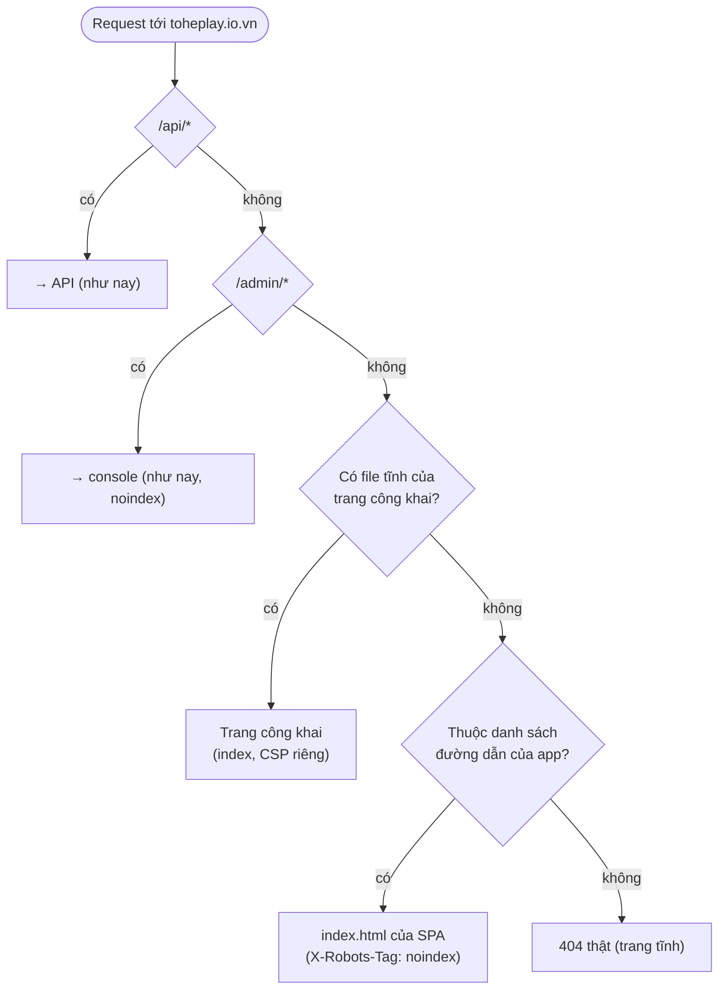

# D-01 — Mỗi thành phần nằm ở host và đường dẫn nào trên domain?

- Status: **proposed v2** (2026-10-19) — owner đang review ("về bố cục host .. các đề xuất ra sao, cho tôi review nào")
- Kind: decision — đổi đường dẫn công khai trên origin của hub → ADR (sửa ADR 0040 về đường dẫn, ADR 0021 về vai trò site)
- Blocks: E-02, E-03 · Blocked by: — (D-02 decided: `toheplay.io.vn` là domain duy nhất, chia subdomain theo vai)
- Decided: —

## Vì sao

Owner (2026-10-19): "bạn có thể cho tôi 1 đề xuất thay đổi subdomain cho các thành phần để ổn định mở rộng cho tương lai,
vì thay đổi bây giờ là siêu rẻ), các trang landing docs portal api cũng nghiêm túc tổ chức tốt trên domain này".

Hai vấn đề có thật trên prod ([R-01](../research/R-01-backlog-review.md) D1–D4, [R-02](../research/R-02-hosts-seo-geo.md)):
- Trang giới thiệu (cho người chơi, tiếng Việt) nằm ở `docs.toheplay.io.vn/`, chung host với tài liệu kỹ thuật tiếng Anh;
  còn tên gốc — tên người ta gõ và chia sẻ — là một SPA mà crawler AI thấy trống, trả `200` cho mọi đường dẫn.
- Manifest không có `id`: danh tính app đang buộc vào `start_url "/"`.

## Nguyên tắc chọn

1. **Chỉ vài thứ đắt khi đổi** (R-02): origin của hub, `id` của manifest, URL trang công khai, domain gửi thư. Làm đúng
   bốn thứ đó trước khi có người cài app; phần còn lại để linh hoạt.
2. **Subdomain theo vai** (D-02): thứ người chơi thấy (giới thiệu, trang game, hướng dẫn, app) ở **cùng một host** — PWA,
   cookie phiên và tiến độ của hồ sơ máy gắn với một origin. Khán giả khác (người làm game, tiếng Anh) → `docs.`. Code
   không tin được (game) → `games.` (ADR 0040).
3. **Không gắn tên domain vào code**: mọi host đi từ `publicUrls` của chart (đã vậy).

## Trước → sau, từng thành phần

| Thành phần | Hôm nay (prod) | Đề xuất | Đổi gì |
|---|---|---|---|
| **Giới thiệu** (landing) | `docs.toheplay.io.vn/` | `toheplay.io.vn/` | dời về gốc, HTML tĩnh |
| Trang mỗi game, hướng dẫn, hỏi đáp | — | `toheplay.io.vn/tro-choi/<slug>`, `/huong-dan/…`, `/hoi-dap`, `/gioi-thieu` | mới (E-02) |
| Điều khoản, quyền riêng tư | `toheplay.io.vn/legal/*` (trong SPA) | `/dieu-khoan`, `/quyen-rieng-tu` (tĩnh; `/legal/*` → 301) | tĩnh, đọc được không cần JS |
| **App** ("portal" người chơi) | `toheplay.io.vn/` (danh mục) | `toheplay.io.vn/play` (danh mục = `start_url`) | chỉ danh mục dời; mọi đường dẫn khác giữ nguyên |
| Link bàn, link chia sẻ (D-08) | `/r/<mã>` | `/r/<mã>`, `/s/<mã>` | thêm `/s/` |
| **Console admin** | `toheplay.io.vn/admin/` | giữ | — (`admin.` để dành) |
| **API** | `toheplay.io.vn/api/*` | giữ cùng origin | — |
| Tài liệu API (Scalar) | `toheplay.io.vn/api/docs` | tắt ở prod; bản đọc ở `docs.toheplay.io.vn/docs/reference/api/` | tắt một thứ trùng |
| **Tài liệu kỹ thuật** (en) | `docs.toheplay.io.vn/docs/…` | giữ; `docs.toheplay.io.vn/` → `/docs/` | landing rời khỏi host này |
| **Game** | `games.toheplay.io.vn` | giữ | — |
| `www` | 301 → gốc | giữ | — |
| Thư gửi | `no-reply@toheplay.io.vn` (Resend, return-path `send.`) | giữ | — |
| Thư nhận | không có (không MX) | `hello@`, `security@` → hộp thư owner (Cloudflare Email Routing) | owner bật |
| Máy đọc | soft-404, không robots/sitemap ở gốc | `robots.txt`, `sitemap.xml`, `/.well-known/security.txt` thật; 404 thật | mới |

**Tên để dành** (không tạo DNS bây giờ): `admin.` (console tách phiên riêng), `status.` (trang trạng thái), `uat.` (D-15),
`api.` (chỉ khi có API cho bên thứ ba), `notify.` (gửi thư từ subdomain). `send.` đã là của Resend.

## Hub quyết định trả gì

- **Danh sách đường dẫn của app sinh từ router của hub lúc build** (kèm một test so với Caddy) — thêm route mới không thể
  quên khai báo, không có soft-404.
- `/` cho người đã có hồ sơ/phiên, hoặc đang mở trong app đã cài: một script nhỏ trong `<head>` (chạy trước khi vẽ) đưa
  thẳng tới `/play` — người mới và máy đọc thấy trang giới thiệu.
- Service worker của hub: `navigateFallback` chỉ cho đường dẫn của app.
- Manifest: `id "/"`, `start_url "/play"`, `scope "/"`.

## Ở mỗi môi trường

| | Dev | UAT | Prod |
|---|---|---|---|
| Gốc (giới thiệu + app + `/api` + `/admin`) | `localhost:4720` — Vite của hub chuyển trang công khai sang dev server của `apps/web` (cổng mới, như `/admin` → 4721 hôm nay) | `10.100.0.2:4820` | `toheplay.io.vn` |
| Tài liệu kỹ thuật | `localhost:4710` | `10.100.0.2:4810` | `docs.toheplay.io.vn` |
| Game | `localhost:4730` | `10.100.0.2:4830` | `games.toheplay.io.vn` |

Trang công khai **build vào image hub** → UAT, compose và chart y nhau, không thêm container. `apps/site` chỉ còn tài liệu.

## Cái gì không đổi

DNS, Cloudflare (trừ Email Routing), `platform-infra`, ingress và host của chart: **vẫn ba host như hôm nay**. Mọi link đã
gửi (`/r/…`, link trong email) vẫn chạy. Việc nằm hết trong code của Tò He + một ADR.

## Phương án

| | Cách | Được | Mất |
|---|---|---|---|
| **A** | Giữ ADR 0040; chỉ thêm `og:`/description vào HTML của hub, robots/sitemap thật | ít việc nhất | gốc vẫn trống với crawler AI; landing vẫn ở `docs.`; đổi sau đắt hơn |
| **B** ⭐ | **Gốc là cửa trước**: trang công khai tĩnh + app cùng origin (trên) | một sản phẩm một chỗ; SEO/GEO đọc được; landing → app không qua redirect; link cũ giữ nguyên; `id` manifest chốt sớm; không đổi hạ tầng | app Astro mới, Caddy/router/service worker của hub, e2e, docs, một ADR |
| **C** | Landing ở gốc, app ở `app.`/`choi.toheplay.io.vn` | tách hẳn hai bên | URL app dài hơn ở mọi link; cài app ở host khác; landing không đưa link vào app đã cài được (khác origin); hồ sơ máy và phiên phải sống ở host app; thêm DNS + host ở `platform-infra` |
| **D** | Hub render HTML phía server (SSR) | một codebase | đổi framework hub, phức tạp hơn nhiều so với nhu cầu |

## Đề xuất của agent

**B.** Đúng "subdomain theo vai" của D-02, giữ mọi link đang có, không đụng hạ tầng, và chốt ngay hai thứ đắt nhất (origin
+ `id` của manifest) khi chưa có ai cài app. Chi phí: một app Astro nhỏ và việc sửa Caddy/router của hub — một PR có ADR
(P1-1).

## Câu hỏi cho owner

| Q | Câu hỏi | Đề xuất |
|---|---|---|
| Q1 | Bố cục B? | **B** |
| Q2 | Đường dẫn danh mục game (`start_url`): `/play`, `/choi` hay `/app`? | **`/play`** — khớp `/play/<id>` đang có và nút "Vào chơi" |
| Q3 | Slug trang công khai tiếng Việt không dấu (`/tro-choi/ghep-khoi`)? | **Có** — người Việt đọc được, khớp từ khoá |
| Q4 | Thêm Cloudflare Email Routing cho `hello@`/`security@`? | **Có** (owner làm trong Cloudflare, vài phút) |
| Q5 | Scalar `/api/docs` trên prod: giữ hay tắt? | **Tắt ở prod** (tài liệu API đã có ở `docs.`) |
| Q6 | Tài liệu kỹ thuật: giữ tiền tố `/docs/` (gốc `docs.` chuyển hướng) hay dời lên gốc host? | **Giữ `/docs/`** bây giờ (ít đổi nhất); dời sau nếu muốn — host này đổi lúc nào cũng rẻ |

## Discussion

**agent** (2026-10-19): ADR 0040 chọn "hub ở gốc vì đó là nơi người ta tới" — B giữ nguyên điều đó (gốc vẫn thuộc image
hub, app vẫn ở origin gốc), chỉ thêm một lớp HTML tĩnh phía trước cho người mới và cho máy đọc.

**owner** (2026-10-19): "ổn nha, theo đề xuất, mà về bố cục host .. các đề xuất ra sao, cho tôi review nào" → v2 thêm bảng
trước → sau, sơ đồ hub quyết định trả gì, bố cục ở từng môi trường, cái không đổi, Q6.
