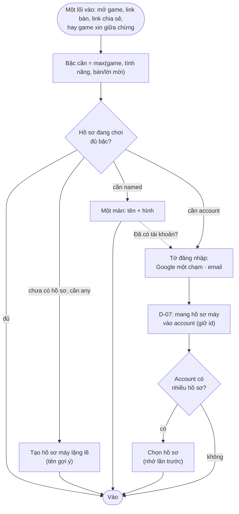
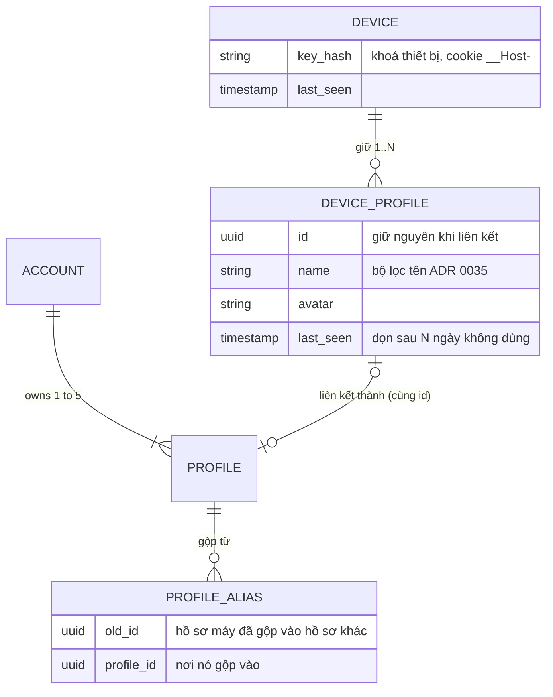

# D-06 — Định danh theo bậc: người chơi cần "là ai" tới mức nào, và ai quyết mức đó?

- Status: **proposed** (2026-10-19)
- Kind: decision — đổi mô hình định danh (sửa ADR 0023, 0024), bàn online (0016), độ tin (0029) và Game Contract → ADR
- Blocks: D-07, D-08, E-03 · Blocked by: D-03 (decided)
- Research: [R-05](../research/R-05-identity-and-entry-prior-art.md)

## Vì sao

Owner (2026-10-19): "ta có nhìu game, game có thể yêu cầu về định danh từ hub, case 1 game có thể cần user phải auth bằng
account r, case 2 game cần user đặt username và có profile tạm th cũng được (profile này có thể sẽ duy trì tạm ở local
thiết bị của user, user có thể login và liên kết nếu cần …) tôi nghĩ case 2 sẽ bao quát luôn case game offline và giúp
người mới tiếp cận nhanh theo hiệu ứng người này rủ người khác".

Hôm nay chỉ có hai trạng thái: **khách** (một hồ sơ "Khách" local mỗi thiết bị, không lên server) và **account**. Mọi thứ
có người khác (bàn online, bảng, mời) đều bắt account → người được rủ phải đăng ký, chờ mã email rồi mới chơi.

## Đề xuất

### 1. Mọi người chơi là một hồ sơ — có hai loại

| | **Hồ sơ máy** (owner gọi "profile tạm") | **Hồ sơ tài khoản** (như nay) |
|---|---|---|
| Thuộc về | một thiết bị (trình duyệt/app đã cài) | một account (1–5 hồ sơ, ADR 0023) |
| Có | tên (gợi ý sẵn, sửa được), hình, save + điểm local-first | thêm: ID 12 số, đồng bộ mọi thiết bị, độ tin cao |
| Lên server | **chỉ khi cần** (vào bàn, tạo link, chuyển máy): đăng ký bằng một khoá thiết bị → có id server, vẫn không có account | luôn |
| Không có | email, ID 12 số, bảng công khai, run xếp hạng, mời bằng ID | — |
| Chơi offline | có | có (đồng bộ sau) |
| Nâng cấp | liên kết vào account, **giữ nguyên id** → mọi lịch sử đi theo ([D-07](D-07-linking-device-profiles.md)) | — |

"Khách" hôm nay trở thành **hồ sơ máy đầu tiên** của thiết bị (chuyển tự động, không mất gì).

### 2. Ba bậc yêu cầu

| Bậc | Nghĩa | Chưa đủ thì hub làm gì |
|---|---|---|
| `any` | có một hồ sơ là đủ | tạo hồ sơ máy **lặng lẽ** với tên gợi ý — không hỏi gì |
| `named` | người khác sẽ thấy tên → người chơi đã tự xác nhận tên | **một màn**: tên gợi ý + hình → "Vào chơi" (kèm "Đã có tài khoản? Đăng nhập") |
| `account` | cần đồng bộ, ID, độ tin | **tờ đăng nhập**: Google một chạm / email; xong thì mang hồ sơ máy vào account (D-07) |

### 3. Ba nguồn yêu cầu — lấy mức cao nhất

| Nguồn | Ai đặt | Ví dụ |
|---|---|---|
| **Game** | `game.json` → `identity.play` (mặc định `any`), `identity.rooms` | Chạm Chấm `any`; một game kinh tế đồng bộ `account` |
| **Tính năng của nền tảng** | cố định trong spec | bàn online ≥ `named`; run xếp hạng, bảng công khai, mời/được mời bằng ID → `account` |
| **Bàn / lời mời** | người tạo chọn (như Kahoot cho host bắt account) | "Ai có link cũng vào" (`named`) · "Chỉ tài khoản" (`account`) · "Chỉ hồ sơ trong tài khoản tôi" (đã có) |

### 4. Hồ sơ máy trên server

- Tạo **lười**: chỉ khi cần server. Hub gọi API một lần, nhận một khoá thiết bị trong cookie httpOnly (`__Host-`), lưu
  `id, tên, hình, tạo lúc, dùng lần cuối, hash khoá` — không email, không dữ liệu cá nhân nào khác.
- Chống lạm dụng (R-05: Supabase khuyên CAPTCHA + giới hạn IP): proof-of-work sẵn có (ADR 0037) + giới hạn mỗi IP; bộ lọc
  tên (ADR 0035); giới hạn số hồ sơ máy mỗi thiết bị (Q3).
- Dọn dẹp: hồ sơ máy trên server không dùng quá N ngày thì xoá (Q4); bản local trên thiết bị vẫn còn và lên lại khi cần.
- Độ tin thấp nhất (ADR 0029): kết quả của hồ sơ máy chỉ ở bàn và bảng của chính nó, **không** lên bảng công khai.
- Trẻ em: hồ sơ trẻ em trong account với công tắc "chơi với người ngoài" tắt thì không bao giờ ngồi cùng hồ sơ máy lạ (hồ
  sơ máy luôn là "người ngoài").

### 5. Game nói gì với hub (Game Contract, thêm vào protocol 1)

- `game.json`: `identity: { play: "any" | "named" | "account", rooms?: "named" | "account" }`.
- `init.profile` thêm `kind: "device" | "account"` để game biết (vd ẩn nút xếp hạng khi chưa có account).
- Game xin nâng bậc giữa chừng: `session.identity.require("named" | "account", reason)` → hub hiện màn/tờ tương ứng →
  resolve với hồ sơ mới (`session.profile` đổi) hoặc reject (người chơi bỏ qua) → game chơi tiếp bình thường. Game **không
  bao giờ** tự làm đăng nhập (giữ luật "game không gọi API").

## Phương án

| | Cách | Được | Mất |
|---|---|---|---|
| **A** | Giữ khách + account, chỉ thêm OAuth | ít việc | không có case 2 online; link bàn vẫn bắt account |
| **B** ⭐ | Hồ sơ máy + ba bậc + ba nguồn (trên) | bao được case 1, case 2, offline, rủ nhau; một luật cho mọi game; nâng cấp giữ id | sửa vài ADR, Game Contract, API, hub — chia làm nhiều PR |
| **C** | Ai ghé cũng có một account ẩn danh trên server ngay (kiểu Firebase anonymous cho mọi người) | một mô hình dữ liệu | bản ghi server cho mọi lượt ghé (lạm dụng, dọn dẹp), trái offline-first và tối thiểu dữ liệu; game offline không cần server |

## Đề xuất của agent

**B.** Tò He giữ được offline-first và "không dữ liệu thừa": hồ sơ máy chỉ lên server khi người chơi làm việc cần server.
Bậc yêu cầu là một luật duy nhất cho game hôm nay và game sau này; game chỉ khai báo, hub lo phần còn lại.

## Câu hỏi cho owner

| Q | Câu hỏi | Đề xuất |
|---|---|---|
| Q1 | Phương án B? | **B** |
| Q2 | Tên trong giao diện cho hồ sơ không có account | "**Hồ sơ trên máy này**" (rõ nó ở đâu); "tạm" dễ làm người ta sợ mất |
| Q3 | Mỗi thiết bị tối đa bao nhiêu hồ sơ máy? | **5** (như account; đủ cho máy tính bảng cả nhà) |
| Q4 | Hồ sơ máy trên server không dùng bao lâu thì xoá? | **90 ngày** (bản trên thiết bị vẫn còn) |
| Q5 | Bàn mới mặc định "Ai có link cũng vào" (`named`)? | **Có**; người tạo đổi sang "Chỉ tài khoản" được |
