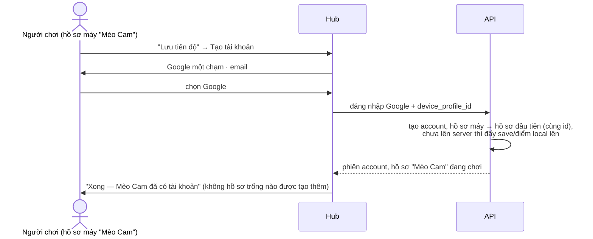
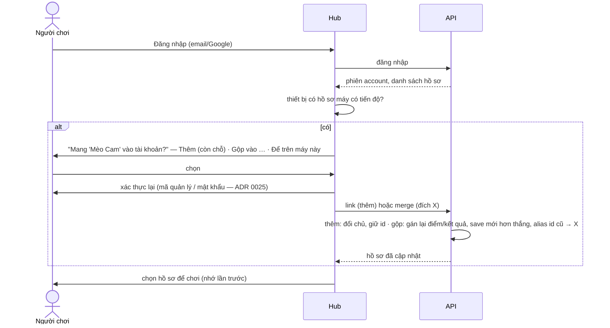
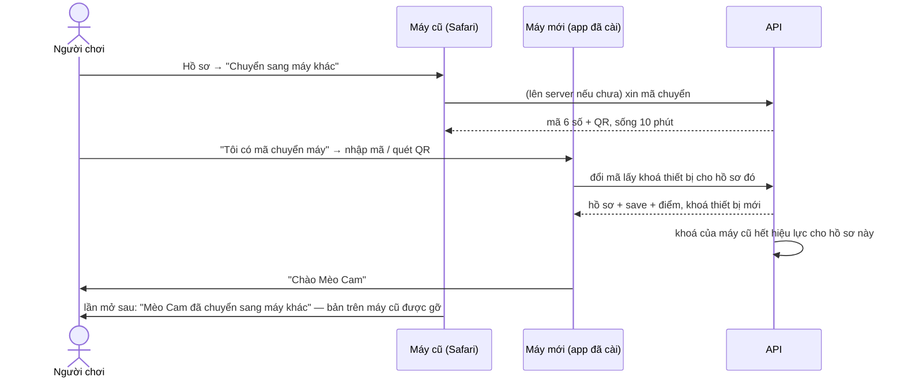

# D-07 — Hồ sơ máy liên kết vào account thế nào cho mượt, trong mọi trường hợp?

- Status: **decided** (2026-10-19, chat) — B: ma trận S1–S13, mã chuyển máy = di chuyển
- Kind: decision — sửa ADR 0023 (hồ sơ mặc định), luồng khách → hồ sơ trong `identity.md`
- Blocks: E-03, D-08 · Blocked by: D-06
- Research: [R-05](../research/R-05-identity-and-entry-prior-art.md)

## Vì sao

Owner (2026-10-19): "user có thể login và liên kết nếu cần, ở đây phải xử lý tất các case mượt mà về profile link vào
account nhé".

Hôm nay: một khách mỗi thiết bị; lần đầu chọn hồ sơ thật thì hub **đề nghị chuyển tiến độ** của khách sang hồ sơ đó; đăng
ký luôn tạo một hồ sơ mặc định mới (ADR 0023).

## Nguyên tắc

1. **Giữ nguyên id khi có thể** (Firebase/Supabase): hồ sơ máy *trở thành* hồ sơ tài khoản → save, điểm, kết quả bàn, link
   đã tạo tự đi theo, không phải sao chép.
2. **Khi phải gộp** (account đã có hồ sơ cho người này), hub hỏi **một lần cho mỗi hồ sơ máy**, có mặc định hợp lý, và không
   bao giờ tự gộp hồ sơ của người khác trên máy dùng chung.
3. **Không gì mất trong im lặng**: cái gì bị thay thì giữ bản cũ (server đã giữ `previous_data` cho save — ADR 0005).
4. Liên kết là thao tác **quản lý account** → cần bậc xác thực lại như "thêm hồ sơ" hôm nay (ADR 0025).

## Ma trận

| # | Tình huống | Mặc định | Lựa chọn khác |
|---|---|---|---|
| S1 | Hồ sơ máy **đăng ký** account mới | hồ sơ máy **trở thành hồ sơ đầu tiên** của account (thay cho hồ sơ mặc định trống) | — |
| S2 | Hồ sơ máy **đăng nhập** account đã có, account còn chỗ (< 5) | **Thêm vào tài khoản** thành hồ sơ mới (giữ id) | Gộp vào hồ sơ X · Để trên máy này |
| S3 | Như S2 nhưng account đã đủ 5 hồ sơ | **Gộp vào hồ sơ X** (hub gợi ý hồ sơ trùng tên/hình) | Để trên máy này |
| S4 | Máy dùng chung có nhiều hồ sơ máy (anh, em) | hỏi **từng hồ sơ có tiến độ**; mặc định chỉ hồ sơ **đang chơi** | các hồ sơ khác "Để trên máy này" |
| S5 | Hồ sơ máy đã ngồi bàn online (có trên server) | như S2/S3; kết quả bàn và lịch sử đi theo id (S2) hoặc theo alias (gộp) | — |
| S6 | Cùng một người có hồ sơ máy ở hai thiết bị | máy thứ hai: **Gộp vào** hồ sơ đã liên kết từ máy thứ nhất | — |
| S7 | iPhone: chơi trong Safari rồi cài app (storage tách, chỉ cookie được chép một lần) | trước khi cài: gợi ý **liên kết account** (cookie phiên theo vào app) | **Mã chuyển máy** (S8) nếu chưa muốn account |
| S8 | Đổi máy / xoá dữ liệu trình duyệt mà chưa có account | **Mã chuyển máy**: 6 số / QR, sống 10 phút, chỉ cho hồ sơ máy đã lên server | — (chưa lên server và xoá dữ liệu = mất; hub cảnh báo trước) |
| S9 | Đăng xuất account trên thiết bị | hồ sơ tài khoản rời thiết bị; hồ sơ máy còn nguyên | — |
| S10 | Xoá account (ADR 0034) | hồ sơ đã liên kết bị xoá như hồ sơ tài khoản | hồ sơ máy chưa liên kết không bị ảnh hưởng |
| S11 | Account bị tạm khoá | không liên kết được (như mọi lối vào account) | hồ sơ máy vẫn chơi được |
| S12 | Thêm hồ sơ máy của bé vào account | người lớn chọn mẫu người lớn / trẻ em ngay lúc thêm (ADR 0025) | — |
| S13 | Người chơi xoá hồ sơ máy | xoá trên thiết bị **và** bản trên server (nếu có), như xoá hồ sơ ngay của ADR 0034 | — |

### Gộp dữ liệu (S2 "gộp", S3, S6)

| Dữ liệu | Quy tắc |
|---|---|
| Save (mỗi game) | một bên có → lấy; cả hai có → bản **mới hơn** thắng, bản kia giữ ở `previous_data` (như xung đột hôm nay, ADR 0005) |
| Điểm | không xung đột (mỗi run một dòng) → gán lại hết sang hồ sơ đích |
| Kết quả bàn, replay | gán lại; replay cũ vẫn mở được qua `PROFILE_ALIAS` |
| Link đã tạo (D-08) | người tạo chuyển sang hồ sơ đích |
| Bảng công khai | **không** tính lùi: kết quả từ lúc còn là hồ sơ máy không lên bảng công khai (độ tin lúc tạo) |
| Tên, hình | hồ sơ đích giữ của nó; tên của hồ sơ máy vào lịch sử tên |

## Luồng

**S1 — hồ sơ máy đăng ký** (người được rủ vào bàn, sau đó muốn giữ tiến độ):

**S2/S3 — hồ sơ máy đăng nhập account đã có:**

**S8 — mã chuyển máy** (iPhone Safari → app đã cài, hoặc máy mới):

## Phương án

| | Cách | Mất |
|---|---|---|
| A | Luôn thêm thành hồ sơ mới | account đầy (5) là kẹt; trùng người trên hai máy thành hai hồ sơ |
| **B** ⭐ | Ma trận trên: S1 giữ id; đăng nhập thì hỏi từng hồ sơ có tiến độ, mặc định hợp lý | thêm màn hỏi và API gộp |
| C | Tự gộp mọi hồ sơ máy vào hồ sơ đang chọn | sai trên máy dùng chung (gộp tiến độ của em vào anh) |

## Đề xuất của agent

**B.** Ít hỏi nhất ở đường phổ biến (S1: không hỏi gì; S2: một câu), và an toàn ở máy dùng chung.

## Câu hỏi cho owner

| Q | Câu hỏi | Đề xuất |
|---|---|---|
| Q1 | Phương án B? | **B** |
| Q2 | Có làm **mã chuyển máy** (S8) không, hay chỉ "tạo tài khoản để mang theo"? | **Có** — iPhone (≈ 40 % VN) tách storage khi cài app; trẻ em không cần account vẫn đổi máy được |
| Q3 | Mã chuyển máy là **di chuyển** (máy cũ gỡ bản của nó) hay **sao chép** (hai máy cùng một hồ sơ, không đồng bộ)? | **Di chuyển** — không có hai bản lệch nhau cùng một id; chơi nhiều máy cùng lúc là giá trị của account |

## Decision

**owner** (2026-10-19, chat): "ổn nha, theo đề xuất" — trả lời lượt gom câu hỏi ở PLAN → *Waiting on the owner*.

Q1 = **B** · Q2 = **có** mã chuyển máy · Q3 = **di chuyển** (máy cũ gỡ bản của nó).
