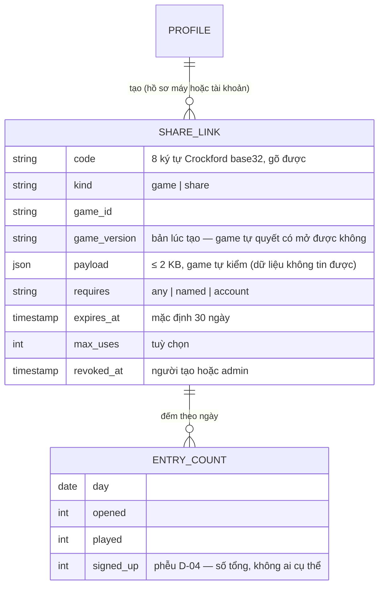
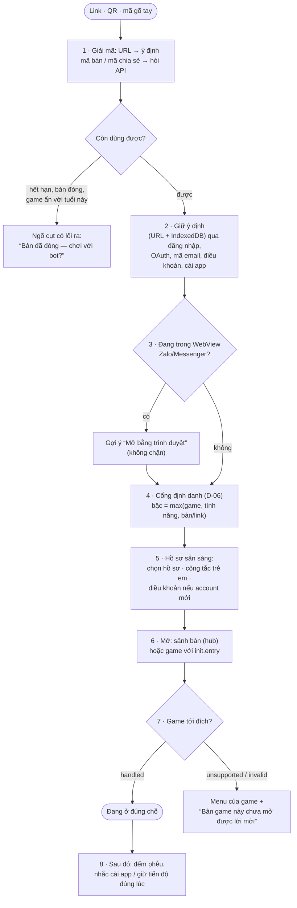
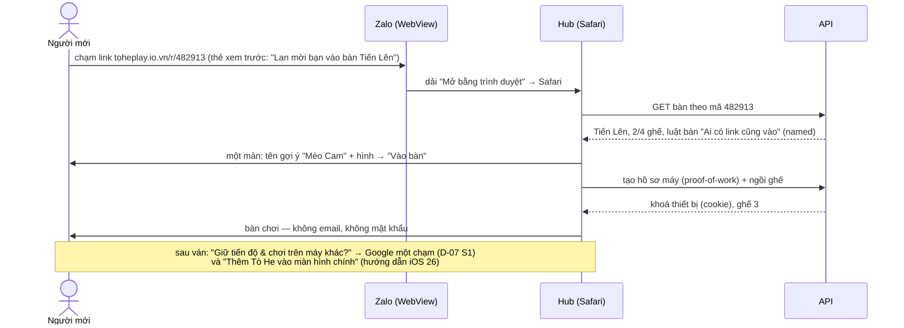
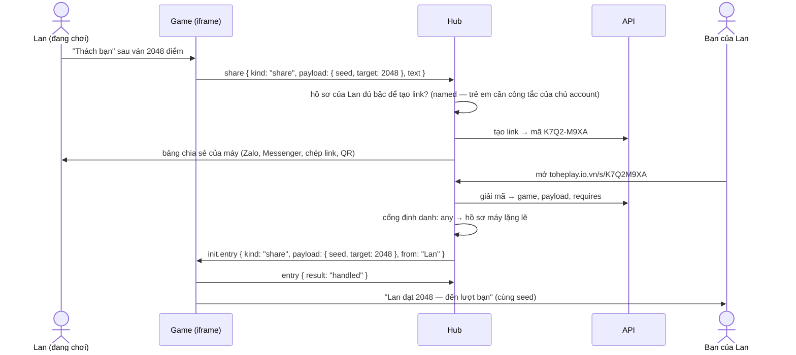
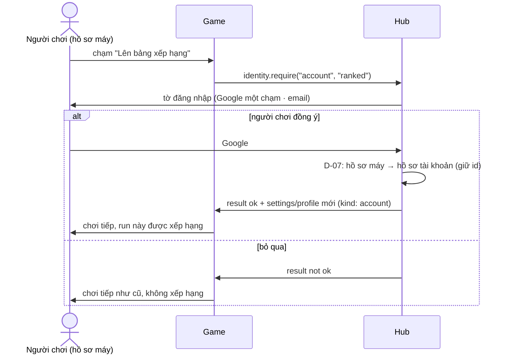

# D-08 — Lối vào: một mô hình cho mọi link mời và link chia sẻ

- Status: **proposed** (2026-10-19)
- Kind: decision — module mới ở API, đường ống ở hub, thêm vào Game Contract → ADR
- Blocks: E-03 · Blocked by: D-06, D-07
- Research: [R-05](../research/R-05-identity-and-entry-prior-art.md), [R-03](../research/R-03-pwa-install-newcomer.md)

## Vì sao

Owner (2026-10-19): "với game cần khả năng mời người khác vào lobby trong game, thì link có thể giúp user và đúng lobby cần
đó, với game dạng 1 user muốn share cho người khác thì link share sẽ giúp user tiếp cận game"; "luồng mời user cần được
luôn quan tâm, hub phải đảm bảo luồng auth user hay profile sẳn sàng trước, các game cũng phải quan tâm luồng user khi vào
game và đến nơi game muốn".

Hôm nay mỗi lối vào tự làm một kiểu: `/r/<code>` (bàn, bắt account), `/register?invite=` (mã cộng đồng), `/play/<id>`
(không biết ai rủ), mời bằng ID (trong app). Game không có cách nào được mở thẳng vào một chỗ bên trong nó, và không tự tạo
link được (game không gọi mạng).

## Đề xuất

### 1. Mọi lối vào là một **ý định** (entry intent)

| Loại | URL | Ai tạo | Đưa tới | Bậc tối thiểu (D-06) | Ai xử lý chỗ đến |
|---|---|---|---|---|---|
| `site` | `/`, `/tro-choi/<slug>` | công khai | trang giới thiệu, trang game | — | trang tĩnh |
| `game` | `/play/<gameId>` | ai cũng được | menu của game | `identity.play` của game | hub mở game |
| `room` | `/r/<mã 6 số>` (đã có) | người ở bàn | sảnh của đúng bàn đó | max(`identity.rooms`, luật của bàn) — mặc định `named` | hub (sảnh do hub vẽ, ADR 0016) |
| `share` | `/s/<mã>` (mới) | game, qua hub | game, kèm một **đích bên trong game** (thử thách cùng seed, một màn, "vượt điểm của tôi") | `identity.play` | **game** (`init.entry`) |
| `community` | `/register?invite=` (đã có) | admin | đăng ký vào một cộng đồng | tạo account | hub |
| `profile` | trong app, ID 12 số (ADR 0033) | account | lời mời trên danh mục | `account` | hub |

Mọi link có một **mã gõ được** (mã bàn 6 số, mã chia sẻ 8 ký tự): iPhone không mở app đã cài từ link (link luôn mở
Safari, storage riêng — R-03), nên người đã cài app cần ô "Nhập mã" trong app.

### 2. Link chia sẻ là một **đối tượng**, không chỉ là URL (như link mời của Discord)

### 3. Một đường ống ở hub cho mọi lối vào

### 4. Ba luồng tiêu biểu

**Người mới được rủ vào bàn qua Zalo** (iPhone, chưa có gì):

**Một người chơi chia sẻ thử thách** (game một người):

**Game xin nâng bậc giữa chừng** (bật xếp hạng khi đang là hồ sơ máy):

### 5. Ai làm gì

| Bên | Trách nhiệm |
|---|---|
| **Hub** | giải mã link, giữ ý định qua mọi bước, cổng định danh, hồ sơ sẵn sàng (chọn hồ sơ, trẻ em, điều khoản), mở sảnh/game, ngõ cụt có lối ra, bảng chia sẻ của máy + QR, ô "Nhập mã", nhắc đúng lúc |
| **Game** | khai báo `identity` và `entries` trong `game.json`; nhận `init.entry`, tới đích hoặc về menu; trả `entry.result` trong vài giây; xin `identity.require` / `share` qua hub; **không** tự đăng nhập, không gọi mạng |
| **Kit** (`@tohe/game-kit`) | `createShell` có sẵn đường đi mặc định: có `init.entry` thì bỏ màn tiêu đề và tới đích; không hiểu thì về menu kèm thông báo |
| **API** | module `Links` (tạo, giải mã, hết hạn, giới hạn, thu hồi, đếm); hồ sơ máy (D-06); luật vào bàn; nội dung thẻ xem trước; bảo lãnh đăng ký qua link (D-05) |
| **Conformance** | game nhận `init.entry` lạ không lỗi, luôn trả `entry.result`; loại đã khai báo thì xử lý được |

### 6. Thêm vào Game Contract (protocol 1, thêm không phá — như `shell`, `ranked`)

| Chỗ | Thêm |
|---|---|
| `game.json` | `identity` (D-06); `entries: ["share"]` — loại lối vào game tự xử lý |
| `init` | `entry?: { kind, payload?, from?, version }` |
| game → host | `entry` (`result`: `handled` · `unsupported` · `invalid`) · `identity.require` (`level`, `reason`) · `share` (`payload`, `text`) |
| SDK | `session.entry`, `session.identity.require()`, `session.share()` |

### 7. Thẻ xem trước, chống lạm dụng, đo lường

- **Thẻ xem trước**: `/r/<mã>` và `/s/<mã>` trả HTML có `og:` theo link ("Lan mời bạn vào bàn Tiến Lên", ảnh của game) —
  Caddy của hub lấy nội dung từ API rồi trả về SPA như thường. Hồ sơ trẻ em: thẻ không hiện tên/hình trừ khi chủ account cho.
- **Chống lạm dụng**: mỗi hồ sơ tạo tối đa N link/ngày; payload ≤ 2 KB; hết hạn mặc định; người tạo và admin thu hồi được;
  giải mã link có giới hạn theo IP; tên qua bộ lọc (ADR 0035).
- **Đo lường** (D-04): mỗi link đếm mở / chơi / tạo account theo ngày — số tổng, không gắn với ai.

## Phương án

| | Cách | Mất |
|---|---|---|
| A | Giữ mỗi lối vào một kiểu, thêm dần | mỗi game mới lại tự nghĩ; luồng định danh lệch nhau; không đo được |
| **B** ⭐ | Một mô hình ý định + một đường ống + link chia sẻ là đối tượng ở server (trên) | module `Links`, đường ống ở hub, thêm contract — làm theo giai đoạn |
| C | Link không trạng thái: payload ký HMAC ngay trong URL | không thu hồi, không giới hạn, không đếm, URL dài; chỉ hợp cho `game` (mà `game` vốn không cần token) |

## Đề xuất của agent

**B.** Mọi lối vào — hôm nay và game sau này — đi qua một đường ống, nên "hub đảm bảo định danh sẵn sàng trước" là luật của
nền tảng chứ không phải việc của từng màn hình. Game chỉ khai báo và tới đích. Mở rộng = thêm một loại ý định.

## Câu hỏi cho owner

| Q | Câu hỏi | Đề xuất |
|---|---|---|
| Q1 | Phương án B? | **B** |
| Q2 | Link chia sẻ hết hạn mặc định sau bao lâu? | **30 ngày**, người tạo đổi được |
| Q3 | Game đầu tiên dùng `share`? | **Ghép Khối**: "Thách bạn" cùng seed, vượt điểm của tôi |
| Q4 | Mỗi hồ sơ tạo tối đa bao nhiêu link/ngày? | **30** |
