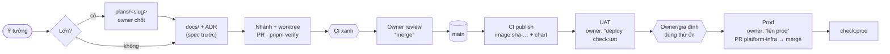

# E-01 — Chốt luồng phát triển · kiểm thử · môi trường thành spec

- Status: **proposed** (2026-10-19)
- Kind: enhancement — luồng đã chạy tốt, chỉ chưa nằm trong spec ở một chỗ; thêm luật cho production
- Blocks: mọi item khác (nền) · Blocked by: —
- Decided: —

## Vì sao

Owner (2026-10-19): "ta cần align chốt lại luồng phát triển, kiểm thử, môi trường 1 cách rõ ràng và phù hợp, k cần cầu
kỳ, bám sát luồng ta đang làm tốt là đc, chỉ là spec rõ ra để agent hay tôi nắm sát, sau này có enhance cũng dễ, hãy đề
xuất cái này trước để làm nền tảng".

Hôm nay luồng nằm rải ở ADR 0009 (dev), 0010 (UAT), 0021 (prod qua chart), `docs/guides/uat.md`,
`docs/guides/local-development.md`, `docs/guides/self-hosting.md`, `.github/workflows/ci.yml`, memory của agent và vài
script trong thư mục tạm. Production đã chạy mà spec chưa có một dòng nào nói agent được làm gì với nó.

## Hiện trạng (sự thật)

- **Dev**: compose project `tohe`, cổng 47xx, `pnpm dev`; agent làm gì cũng được (ADR 0009, 0010).
- **CI** (`.github/workflows/ci.yml`): mỗi PR và push chạy `verify` (Biome, typecheck, test, build, conformance, file
  sinh không lệch), `chart` (lint, guard, cài lên kind, `helm test`, upgrade), `stack` (dựng image, e2e smoke, phòng chơi
  ba điện thoại); push lên `main` thêm `publish`: image `ghcr.io/vinh466/tohe-play/<api|hub|games|site>:sha-<commit>` và
  chart `oci://ghcr.io/vinh466/charts/tohe` bản `<version>-g<sha7>` (ADR 0021).
- **UAT**: `tohe-uat` trên 10.100.0.2, cổng 48xx, HTTP trong WireGuard, **dữ liệu thật của gia đình**; chỉ deploy bằng
  `deploy/uat/deploy.sh <sha>` (kéo đúng image GHCR, backup trước, chờ health) khi owner nói "deploy"; migration đã
  lên UAT không sửa nữa.
- **Production**: `toheplay.io.vn` trên cluster của `platform-infra`; `apps/tohe` ghim chart theo `targetRevision`
  (ADR 0021, 0040); secret ở Infisical `/tohe`; Postgres dùng chung (CNPG, backup R2). Lên bản mới = PR đổi
  `targetRevision` ở `platform-infra`, owner merge, ArgoCD đồng bộ. Hiện chỉ owner dùng (2026-10-19).
- Kiểm sau deploy: UAT dùng `uat-step2.sh` (phiên bản, migration, số liệu của nhà, log API, redirect games), prod dùng
  `prod-check.sh` (health, config, 4 game, CSP, HSTS, redirect, docs) — **cả hai chỉ nằm trong thư mục tạm của agent**.
- `AGENTS.md` có luật UAT, không có luật production.

## Đề xuất

### 1. Bốn môi trường, mỗi cái một vai

| | Dev | CI | UAT | Production |
|---|---|---|---|---|
| **Để làm gì** | xây và thử | cổng tự động | gia đình dùng hằng ngày; là chỗ **thử đúng image sẽ lên prod** | công khai; hôm nay = owner tự thử |
| **Ở đâu** | máy dev, `localhost:47xx` | GitHub Actions | homelab `10.100.0.2:48xx` (HTTP, VPN) | `toheplay.io.vn` (HTTPS, Cloudflare) |
| **Chạy gì** | mã nguồn đang sửa | mã của PR / `main` | image GHCR của một commit trên `main` | **cùng image đó**, qua chart |
| **Dữ liệu** | vứt đi được | tạm (Testcontainers, kind) | thật, của gia đình — quý | hôm nay chưa quý; từ lúc qua Cổng (E-05) là thật |
| **Cấu hình ở** | `compose.yaml`, mặc định dev | workflow | `~/.config/tohe-uat/uat.env` | values ở `platform-infra` + Infisical `/tohe` |
| **Ai được làm gì** | agent: mọi thứ | — | agent: chỉ `deploy.sh` khi owner nói "deploy"; đọc log | agent: **chỉ đọc từ ngoài**; mọi thay đổi là PR ở `platform-infra`, owner merge; không `kubectl` ghi |

### 2. Một thay đổi đi từ ý tưởng tới người dùng

Ba lời khoá của owner, mỗi lời mở một bước agent không tự làm: **"merge"** (PR vào `main`), **"deploy"** (UAT),
**"lên prod"** (agent mở PR đổi `targetRevision` ở `platform-infra`; owner merge PR đó — không auto-merge).

Luật: **prod chỉ chạy commit đã chạy trên UAT** (cùng image). Ngoại lệ duy nhất là sửa gấp — vẫn đi `main` → UAT → prod,
chỉ rút ngắn thời gian thử.

### 3. Kiểm thử theo tầng — chạy ở đâu, ai xem

| Tầng | Kiểm gì | Ở đâu | Đã có? |
|---|---|---|---|
| Unit | logic thuần (Vitest), endpoint (xUnit + PostgreSQL thật) | `pnpm verify`, CI `verify` | có |
| Game | Game Contract, ảnh chụp, sáng/tối | conformance (tuần tự) | có |
| Stack | e2e smoke, phòng chơi ba điện thoại | CI `stack`, local với `docker compose` | có |
| Chart | lint, guard, cài từ đầu, upgrade | CI `chart` (kind) | có |
| Hành trình người mới | vào lần đầu → chơi thử → đăng ký → nhắc cài app | e2e mới (E-03) | **chưa** |
| Trang công khai | title/description/OG/canonical, robots, sitemap, 404 thật, đọc được không cần JS | kiểm trong build của site (E-02) | **chưa** |
| Sau deploy | phiên bản, migration, health, CSP, redirect, số liệu của nhà (UAT) | `pnpm check:uat` / `pnpm check:prod` — chỉ đọc | **script nằm ngoài repo** |
| Thiết bị thật | Android Chrome, iPhone Safari + app trên màn hình chính, trình duyệt trong Zalo/Messenger | owner, theo checklist | **chưa có checklist** |

### 4. Thử trên điện thoại thật

- **Dev**: `TOHE_PUBLIC_HOST` cho máy khác trong LAN (HTTP — không cài PWA được). Android qua USB:
  `adb reverse tcp:4720 tcp:4720` rồi mở `http://localhost:4720` — `localhost` là secure context nên service worker và cài
  app chạy được. iPhone không có cách tương đương rẻ.
- **UAT**: HTTP → không service worker, không cài app (giữ nguyên, D-15 vẫn `deferred`).
- **Prod**: trong lúc chỉ owner dùng, prod là chỗ thử HTTPS/PWA/iPhone. Khi qua Cổng (E-05) thì mở lại D-15 (UAT có
  HTTPS: tên DNS-only trỏ 10.100.0.2, cert DNS-01), để không thử trên người dùng thật.

### 5. Dữ liệu, migration, quay lui

- Migration **chỉ tiến**: cùng một chuỗi migration lên UAT (dữ liệu gia đình) rồi lên prod, nên "prod chưa quý" **không**
  cho phép viết lại lịch sử migration. Sửa sai bằng migration mới (như hiện nay).
- Đổi schema có xoá/đổi tên cột: bỏ dùng trong một bản, xoá ở bản sau — để quay lui về commit trước vẫn chạy được.
- Quay lui: UAT `deploy/uat/deploy.sh <sha cũ>`; prod PR đổi `targetRevision` về chart cũ.
- "Enhance mạnh" (owner 2026-10-19) áp dụng cho **hành vi sản phẩm**: bỏ tính năng cũ gọn gàng, không giữ tương thích
  cho người dùng prod — chưa có ai ngoài owner.

### 6. Dấu vết phát hành

- Phiên bản = commit (`GET /api/config` → `apiVersion`); chart `<version>-g<sha7>`; game theo semver riêng (ADR 0007).
- Khi lên prod: agent gắn git tag `prod-YYYY-MM-DD[.N]` vào commit đó và tạo GitHub Release ghi những PR đi kèm — biết
  ngay prod đang chạy gì, có gì mới, quay lui về đâu.

### 7. Script kiểm môi trường vào repo

`tools/env-check` (TypeScript, chỉ đọc, không cần secret): `pnpm check:uat` (gộp `uat-step2.sh`) và
`pnpm check:prod` (gộp `prod-check.sh` + `check-hosts.sh` + `mail-dns.sh`), sau này thêm kiểm SEO của trang công khai.

## Spec sẽ viết (khi chốt)

- `docs/guides/environments.md` (mới): bảng §1, sơ đồ §2, ba lời khoá, tầng kiểm thử §3, thử thiết bị §4, dữ liệu và quay
  lui §5, phát hành §6. `uat.md`, `local-development.md`, `self-hosting.md` link về đây thay vì tự nhắc lại.
- **ADR mới — Environments and promotion** (số cấp khi mở PR; sửa ADR 0010): vai trò bốn môi trường, prod chỉ chạy
  commit đã lên UAT, quyền của agent ở prod.
- `AGENTS.md` thêm một dòng production; `docs/guides/working-with-agents.md` → *Environment rules* thêm UAT/prod.
- `tools/env-check` + script trong `package.json`.

## Câu hỏi cho owner

| Q | Câu hỏi | Đề xuất |
|---|---|---|
| Q1 | Prod chỉ chạy commit đã chạy trên UAT? | **Có**, kể cả sửa gấp (chỉ rút ngắn thời gian thử). |
| Q2 | Lời khoá "lên prod" = agent mở PR `targetRevision` ở `platform-infra`, owner merge? | **Có.** |
| Q3 | Gắn tag `prod-…` + GitHub Release mỗi lần lên prod? | **Có** — một lệnh, đỡ phải nhớ. |
| Q4 | Gia đình ở UAT mãi, hay chuyển lên prod khi mở cửa (UAT thành staging thuần)? | **Chưa cần chốt** — quyết ở Cổng (E-05). Ghi để khỏi quên: chuyển lên prod thì UAT được reset tự do và thử migration phá huỷ được. |

## Chi phí

Một PR docs (trang mới + ADR + AGENTS) và một PR `tools/env-check`. Không đổi hành vi sản phẩm.

## Không làm

Môi trường preview cho từng PR, staging thứ ba, feature flag chung, release train theo lịch — chưa cần ở quy mô này.

## Discussion

**agent** (2026-10-19): giữ đúng luồng đang chạy, chỉ viết ra; thứ mới duy nhất là luật prod (§1, Q1, Q2) và việc đưa
script kiểm vào repo.
