# E-01 — Chốt luồng phát triển · kiểm thử · môi trường thành spec

- Status: **decided** (2026-10-19, chat) — trừ Q4 (để tới Cổng); xem *Decision*
- Kind: enhancement — luồng đã chạy tốt, chỉ chưa nằm trong spec ở một chỗ; thêm luật cho production và tag môi trường
- Blocks: mọi item khác (nền) · Blocked by: —
- Research: [R-04 mô hình giao hàng](../research/R-04-delivery-model.md)

## Vì sao

Owner (2026-10-19): "ta cần align chốt lại luồng phát triển, kiểm thử, môi trường 1 cách rõ ràng và phù hợp, k cần cầu
kỳ, bám sát luồng ta đang làm tốt là đc, chỉ là spec rõ ra để agent hay tôi nắm sát, sau này có enhance cũng dễ, hãy đề
xuất cái này trước để làm nền tảng".

Hôm nay luồng nằm rải ở ADR 0009 (dev), 0010 (UAT), 0021 (prod qua chart), `docs/guides/uat.md`,
`docs/guides/local-development.md`, `docs/guides/self-hosting.md`, `.github/workflows/ci.yml`, memory của agent và vài
script trong thư mục tạm. Production đã chạy mà spec chưa có một dòng nào nói agent được làm gì với nó.

## Hiện trạng (sự thật)

- **Dev**: compose project `tohe`, cổng 47xx, `pnpm dev`; agent làm gì cũng được (ADR 0009, 0010). Không có dữ liệu mẫu.
- **CI** (`.github/workflows/ci.yml`): mỗi PR và push chạy `verify`, `chart` (cài lên kind), `stack` (e2e smoke, phòng
  ba điện thoại); push `main` thêm `publish`: image `ghcr.io/vinh466/tohe-play/<api|hub|games|site>:sha-<commit>` và chart
  `oci://ghcr.io/vinh466/charts/tohe` bản `<version>-g<sha7>` (ADR 0021). Runner GitHub-hosted, không tới được UAT.
- **UAT**: `tohe-uat` trên 10.100.0.2, cổng 48xx, HTTP trong WireGuard, **dữ liệu thật của gia đình**; chỉ
  `deploy/uat/deploy.sh <sha>` (kéo image GHCR, backup trước) khi owner nói "deploy".
- **Production**: `toheplay.io.vn` trên cluster của `platform-infra`; `apps/tohe` ghim chart theo `targetRevision`;
  lên bản mới = PR ở `platform-infra`, owner merge, Argo CD đồng bộ. Hiện chỉ owner dùng.
- Kiểm sau deploy (`uat-step2.sh`, `prod-check.sh`) **chỉ nằm trong thư mục tạm của agent**. `AGENTS.md` không có luật prod.

## Đề xuất

### 1. Bốn môi trường, mỗi cái một vai

| | Dev | CI | UAT | Production |
|---|---|---|---|---|
| **Để làm gì** | xây và thử | cổng tự động | gia đình dùng hằng ngày; chỗ **thử đúng image sẽ lên prod** | công khai; hôm nay = owner tự thử |
| **Ở đâu** | máy dev, `localhost:47xx` | GitHub Actions | homelab `10.100.0.2:48xx` (HTTP, VPN) | `toheplay.io.vn` (HTTPS, Cloudflare) |
| **Chạy gì** | mã đang sửa | mã của PR / `main` | image của commit có tag `uat-*` mới nhất | image của commit có tag `prod-*` mới nhất |
| **Dữ liệu** | vứt đi được, có dữ liệu mẫu | tạm (Testcontainers, kind) | thật, của gia đình — quý | hôm nay chưa quý; từ Cổng (E-05) là thật |
| **Cấu hình ở** | `compose.yaml`, mặc định dev | workflow | `~/.config/tohe-uat/uat.env` | values ở `platform-infra` + Infisical `/tohe` |
| **Agent được** | mọi thứ | — | khi owner nói "deploy": gắn tag `uat-*` rồi **tự chạy** `deploy.sh` + `check:uat`; đọc log | **chỉ đọc từ ngoài**; khi owner nói "lên prod": gắn tag `prod-*`, **tự mở và tự merge** PR đổi `targetRevision` của `apps/tohe` ở `platform-infra`, rồi `check:prod`. Mọi thay đổi hạ tầng khác vẫn là PR chờ owner; không `kubectl` ghi |

### 2. Một nhánh, build một lần, tag là môi trường ([R-04](../research/R-04-delivery-model.md))

```mermaid
flowchart LR
  idea([Ý tưởng]) --> big{Lớn?}
  big -- có --> plan["plans/&lt;slug&gt;<br/>owner chốt"] --> spec
  big -- không --> spec["docs/ + ADR<br/>(spec trước)"]
  spec --> pr["Nhánh ngắn + worktree<br/>PR · pnpm verify"] --> ci{{CI xanh}}
  ci --> review["Owner: “merge”"] --> main[("main<br/>build một lần:<br/>image sha-…")]
  main --> uat["Owner: “deploy”<br/>agent: tag uat-YYYY-MM-DD.N<br/>deploy.sh · check:uat"]
  uat --> soak{{Owner/gia đình<br/>dùng thử ổn}}
  soak --> prod["Owner: “lên prod”<br/>agent: tag prod-YYYY-MM-DD.N"]
  prod --> rel["agent: kiểm luật tag<br/>GitHub Release"]
  rel --> merge["agent: mở + merge PR targetRevision<br/>ở platform-infra → Argo CD · check:prod"]
```

**Cầu nối tạm, rẻ** (owner, 2026-10-19): tag mang nghĩa *deploy*; phía sau agent làm tay — UAT tự chạy `deploy.sh`, prod tự
mở và merge PR ở `platform-infra`. Tự động hoá bằng workflow là việc **sau**, khi luồng đã ổn định (owner tự nối).

- `main` là nhánh duy nhất sống lâu; không `develop`, không nhánh theo môi trường.
- Tag annotated, **không di chuyển, không xoá**. Môi trường đang chạy = tag mới nhất cùng tiền tố; quay lui = tag mới trỏ
  vào commit cũ.
- Trước khi gắn tag, agent chạy `pnpm release:check <tag>` (trong `tools/env-check`): commit nằm trên `main`, CI xanh,
  image đã có; `prod-*` chỉ được trỏ vào commit đã có `uat-*`. Sai thì dừng.
- Khi gắn `prod-*`: `gh release create --generate-notes` (ghi chú tự sinh từ các PR kể từ tag `prod-*` trước).
- Sửa gấp: cùng đường, chỉ rút ngắn thời gian thử trên UAT.
- **Sau** (owner nối khi ổn định): workflow chạy khi push tag làm thay agent các bước trên.

### 3. Kiểm thử theo tầng — chạy ở đâu

| Tầng | Kiểm gì | Ở đâu | Đã có? |
|---|---|---|---|
| Unit | logic thuần (Vitest), endpoint (xUnit + PostgreSQL thật) | `pnpm verify`, CI `verify` | có |
| Game | Game Contract, ảnh chụp, sáng/tối | conformance (tuần tự) | có |
| Stack | e2e smoke, phòng chơi ba điện thoại | CI `stack`, local Mode B | có |
| Chart | lint, guard, cài từ đầu, upgrade | CI `chart` (kind) | có |
| Hành trình người mới / lối vào | vào lần đầu → chơi → hồ sơ → account; link bàn, link chia sẻ | e2e mới (E-03, D-08) | **chưa** |
| Trang công khai | title/description/OG/canonical, robots, sitemap, 404 thật, đọc được không cần JS | kiểm trong build (E-02) | **chưa** |
| Tag | luật `uat-*`/`prod-*` | workflow khi push tag | **chưa** |
| Sau deploy | phiên bản, migration, health, CSP, redirect, số liệu của nhà (UAT) | `pnpm check:uat` / `pnpm check:prod`, chỉ đọc | **ngoài repo** |
| Thiết bị thật | Android Chrome, iPhone Safari + app đã cài, WebView của Zalo/Messenger | owner, theo checklist | **chưa** |

### 4. Dev local ([R-04](../research/R-04-delivery-model.md#dev-local))

- **Mode A** hot reload và **Mode B** `docker compose up --build`: giữ như nay.
- **Mode C** (mới): `pnpm stack:image <tag|sha>` chạy đúng image GHCR của một tag/commit, project riêng — tái hiện lỗi
  UAT/prod trên máy.
- **Dữ liệu mẫu** (mới): lệnh chỉ chạy ở dev tạo vài account, hồ sơ người lớn/trẻ em, hồ sơ máy, điểm, một bàn chờ.
- **Điện thoại**: LAN `TOHE_PUBLIC_HOST`; Android `adb reverse tcp:4720 tcp:4720` (secure context → cài PWA được);
  iPhone: thử trên prod trong giai đoạn owner-only. Khi qua Cổng thì mở lại D-15 (UAT có HTTPS).
- **Nhiều lane song song**: mỗi máy một stack dev chạy cùng lúc; lane khác dựa vào `pnpm verify` và CI.
- Dữ liệu thật không bao giờ về máy dev; dump UAT chỉ để chạy thử migration rồi xoá.

### 5. Dữ liệu, migration, quay lui (owner đã chốt, 2026-10-19)

- Migration **chỉ tiến**: tạo ra là đã chốt, không sửa; muốn sửa thì thêm một migration mới.
- Đổi schema có xoá/đổi tên cột: bỏ dùng trong một bản, xoá ở bản sau — để quay lui về tag trước vẫn chạy được.
- "Mạnh tay" là về **hành vi sản phẩm và thiết kế luồng** — bỏ tính năng cũ gọn gàng, không giữ tương thích cho người dùng
  prod (chưa có ai ngoài owner).

### 6. Script kiểm môi trường vào repo

`tools/env-check` (TypeScript, chỉ đọc, không cần secret): `pnpm check:uat` (gộp `uat-step2.sh`) và `pnpm check:prod`
(gộp `prod-check.sh`, `check-hosts.sh`, `mail-dns.sh`), sau thêm kiểm SEO của trang công khai.

## Spec sẽ viết (khi chốt)

- `docs/guides/environments.md` (mới): §1–§6. `uat.md`, `local-development.md`, `self-hosting.md` link về đây.
- **ADR mới — Environments, tags and promotion** (số cấp khi mở PR; sửa ADR 0010, và 0021 §5: PR promote do agent mở và
  merge sau tag `prod-*` của owner): vai trò bốn môi trường, `main` + tag, prod chỉ chạy commit đã lên UAT, quyền của agent.
- `AGENTS.md` một dòng production; `docs/guides/working-with-agents.md` → *Environment rules*.
- `tools/env-check` (`check:uat`, `check:prod`, `release:check`); Mode C + dữ liệu mẫu.

## Câu hỏi cho owner

| Q | Câu hỏi | Đề xuất |
|---|---|---|
| ~~Q1~~ | Prod chỉ chạy commit đã lên UAT? | **chốt: có** |
| ~~Q2~~ | PR ở `platform-infra` khi có tag `prod-*` | **chốt: tag là deploy; agent tự mở + merge PR `targetRevision` (cầu nối tạm); workflow sau** |
| ~~Q3~~ | Tag khi lên prod? | **chốt: `prod-…`** (đề xuất thêm `uat-…` cho UAT — Q5) |
| Q4 | Gia đình ở UAT mãi, hay lên prod khi mở cửa? | quyết ở Cổng (E-05) |
| ~~Q5~~ | Gắn tag `uat-YYYY-MM-DD.N` cho mỗi lần deploy UAT? | **chốt: có** |
| ~~Q6~~ | Thêm Mode C + dữ liệu mẫu cho dev? | **chốt: có** ("theo đề xuất", 2026-10-19) — PR riêng sau P0-1 |

## Decision

**owner** (2026-10-19, chat):
- "đúng migration vẫn theo hướng phát triển thêm, 1 migration tạo là đã chốt r ta k chỉnh, muốn sữa thì là thêm 1 cái mới
  fix, và mạnh tay là về hành vi sản phảm hay thiết kế luồng cần thiết" → §5.
- "prod chỉ chạy commit đã lên UAT, lên prod sẽ là gắn tag prod-... nhé, nhánh main sẽ là nhánh chính" → Q1, Q3, `main`
  là nhánh chính; hỏi thêm "chia môi trường bằng tag" và dev local → trả lời ở R-04 và §2, §4.
- Lượt ba: "theo luồng gắn tag là ý nghĩa sẽ deploy, đằng sau bạn sẽ giúp tôi thủ công tạo và merge PR bên infra cho prod,
  và tự chạy deploy uat, đây là cách nối tạm và rẻ, sau này tôi sẽ nỗi workflow tự động khi ôn định sau" → Q2, §1, §2;
  "đồng ý" → Q5 (tag `uat-…`).
- Agent hiểu: **owner vẫn là người quyết lúc nào** ("deploy", "lên prod", hoặc tự gắn tag); agent không tự quyết thời điểm,
  chỉ làm hết phần cơ học sau đó. Quyền merge chỉ cho **một loại PR**: đổi `targetRevision` của `apps/tohe`.

## Chi phí

Một PR docs (trang mới + ADR + AGENTS), một PR workflow tag + `release.yml`, một PR `tools/env-check`, một PR Mode C +
dữ liệu mẫu. Không đổi hành vi sản phẩm.

## Không làm

Nhánh theo môi trường, môi trường preview cho từng PR, staging thứ ba, feature flag chung, release train theo lịch.
