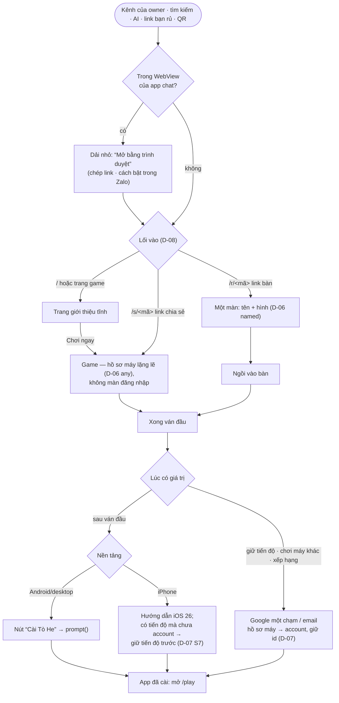

# E-03 — Người mới: chơi trong vài giây, rồi được dẫn cài app và giữ tiến độ đúng lúc

- Status: **decided** (2026-10-19, chat) — đứng trên D-06 (hồ sơ máy, bậc), D-07 (liên kết), D-08 (lối vào)
- Kind: enhancement — màn đầu tiên của hub, cài PWA, xem trước link
- Blocks: E-05 · Blocked by: D-01 (`/play`, `id` manifest), D-05 (Google), D-06, D-07, D-08 · D-03 decided

## Vì sao

Owner (2026-10-19): "về luồng user, UIUX cho 1 người mới là thứ cần được quan tâm ngay (nhìu hướng tiếp cận từ web,
mobile andoind ios,..., tiếp cận PWA dể, ... luồng khi PWA)"; "chúng ta tập trung vòng đời 1 user th nhé".

## Sự thật

Hành trình hôm nay và các ràng buộc nền tảng ở [R-03](../research/R-03-pwa-install-newcomer.md): người mới gặp form đăng
nhập trước; "Chơi thử" là nút mờ; không có chỗ nào nói về cài app; link bàn bắt đăng ký và chờ mã; HTML không có `og:`;
iPhone tách storage của app đã cài khỏi Safari (chỉ cookie được chép một lần) và không mở app đã cài từ link.

## Phạm vi

**Giao diện của những chạm đầu tiên** trong vòng đời một người dùng: từ lúc mở link tới lúc chơi xong ván đầu, có app trên
màn hình chính và (khi muốn) có account. Mô hình bên dưới — hồ sơ máy, bậc, liên kết, lối vào — là của D-06, D-07, D-08.
Quản lý account/hồ sơ sâu, sảnh phòng, bảng xếp hạng → Phase 2.

## Hành trình mục tiêu

## Thay đổi

1. **Vào là chơi.** Mọi lối vào đi qua đường ống của D-08; game `any` mở ngay với hồ sơ máy lặng lẽ. `/welcome` chỉ còn là
   trang đăng nhập khi người ta chọn; một dải mảnh "Đăng nhập" ở danh mục.
2. **Lời chào user-first** (D-03): nói với một người bất kỳ, thay câu chỉ dành cho bố mẹ.
3. **Màn "tên + hình"** của bậc `named` (D-06): tên gợi ý tiếng Việt vui, hình chọn sẵn → một chạm "Vào".
4. **Tờ đăng nhập** của bậc `account`: Google một chạm ở trên (D-05), email ở dưới; xong thì luồng liên kết của D-07.
5. **Nhắc đúng lúc** (tối đa một lần mỗi phiên, tắt được): giữ tiến độ / chơi máy khác / xếp hạng → account; sau ván đầu →
   cài app.
6. **Cài app — một component, ba lối:**
   - Android / Chrome / Edge: giữ `beforeinstallprompt`, hiện thẻ "Cài Tò He" sau ván đầu → `prompt()`.
   - iPhone Safari: tờ hướng dẫn iOS 26 (⋯ → Chia sẻ → Thêm vào MH chính → bật "Mở dưới dạng ứng dụng web"); hồ sơ máy
     có tiến độ mà chưa account → "giữ tiến độ trước" (Google) hoặc mã chuyển máy (D-07 S8).
   - WebView Zalo/Messenger/Facebook (nhận qua User-Agent): dải "Mở bằng trình duyệt" + chép link + cách bật trong Zalo.
   - Đang chạy standalone: không bao giờ hiện. Bỏ qua → im 14 ngày. Mục "Cài app" cố định trong menu → `/huong-dan/cai-dat`.
7. **Ô "Nhập mã"** trong app (mã bàn 6 số, mã chia sẻ 8 ký tự) — iPhone không mở app đã cài từ link (D-08 §1).
8. **Lần đầu mở app đã cài**: `start_url` `/play`; chưa có hồ sơ (iPhone: storage mới) → "Chơi luôn" / "Đăng nhập" / "Tôi
   có mã chuyển máy".
9. **Manifest**: `id "/"`, `start_url "/play"`, mô tả user-first, `screenshots`, `shortcuts` ("Ghép Khối", "Nhập mã bàn").
10. **Xem trước link**: `og:` tĩnh + ảnh trong HTML của hub; thẻ theo link cho `/r/` và `/s/` (D-08 §7).
11. **Góp ý**: một mục "Góp ý / báo lỗi" trong menu → `hello@toheplay.io.vn` (sau Email Routing) — người dùng mới cần một
    đường nói lại với người vận hành.
12. **Mục tiêu đo được**: từ lúc chạm link tới khung hình đầu của game **≤ 10 giây** trên A55 qua 4G (đo bằng telemetry
    thời gian tải sẵn có, ADR 0015).
13. **E2E hành trình** (Playwright, CI `stack`): người mới → landing → chơi → xong ván → nhắc; link bàn khi chưa có gì →
    màn tên → ngồi bàn; link chia sẻ → game đúng seed; hồ sơ máy → Google giả (`mock-oauth2-server`, đã có từ #50) → cùng id;
    giả `beforeinstallprompt`; User-Agent iPhone / Zalo.
14. **Vòng thử thiết bị** (owner, trên prod — E-01 §4): Android Chrome (A55), iPhone iOS 26 Safari + app đã cài, Zalo và
    Messenger trên cả hai, Chrome máy tính; gộp các việc iPhone còn treo: âm thanh (#30), phòng chơi (S5), polish #41.

## Câu hỏi cho owner

| Q | Câu hỏi | Đề xuất |
|---|---|---|
| Q1 | Bỏ màn đăng nhập trước khi chơi (hồ sơ máy lặng lẽ)? | **Có** — đúng lời hứa "mở là chơi" của vision |
| Q2 | Nhắc cài app khi nào: sau ván đầu, hay lần ghé thứ hai? | **Sau ván đầu xong** |
| Q3 | Giữ khoá màn hình dọc (`orientation: portrait`) cho cả app? | Giữ trong Phase 1; xem lại ở Phase 3 (game) |

## Chi phí

Phần lớn ở hub (đường ống, màn tên, tờ đăng nhập, component cài app, manifest) + e2e mới + một buổi thử thiết bị của owner.
Phần API và Game Contract thuộc D-06…D-08.

## Decision

**owner** (2026-10-19, chat): "ổn nha, theo đề xuất" — trả lời lượt gom câu hỏi ở PLAN → *Waiting on the owner*.

Q1 = **có** (không màn đăng nhập trước khi chơi) · Q2 = nhắc cài sau ván đầu · Q3 = giữ màn hình dọc ở Phase 1.
