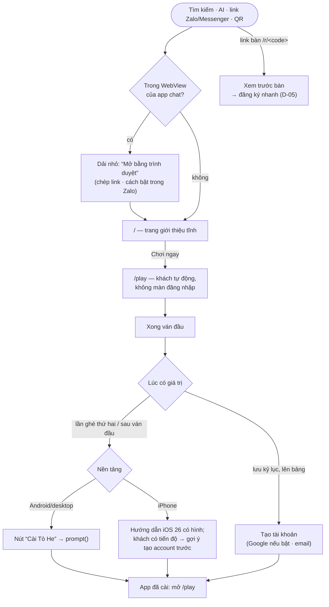

# E-03 — Người mới: chơi trong vài giây, rồi được dẫn cài app và tạo tài khoản đúng lúc

- Status: **proposed** (2026-10-19)
- Kind: enhancement — màn đầu tiên của hub, cài PWA, xem trước link
- Blocks: — · Blocked by: D-01 (`/play`, `id` manifest), D-03 (lời), D-05 (đăng ký, link bàn)
- Decided: —

## Vì sao

Owner (2026-10-19): "về luồng user, UIUX cho 1 người mới là thứ cần được quan tâm ngay (nhìu hướng tiếp cận từ web,
mobile andoind ios,..., tiếp cận PWA dể, ... luồng khi PWA)".

## Sự thật

Hành trình hôm nay và các ràng buộc nền tảng ở [R-03](../research/R-03-pwa-install-newcomer.md): người mới gặp form đăng
nhập trước; "Chơi thử" là nút mờ; không có chỗ nào nói về cài app; link bàn bắt đăng ký và chờ mã; HTML không có `og:`;
iPhone tách storage của app đã cài khỏi Safari (chỉ cookie được chép một lần).

## Phạm vi Phase 1

Chỉ **những chạm đầu tiên**: từ lúc một người chưa biết Tò He mở link tới lúc chơi xong ván đầu, có account và có app trên
màn hình chính. Quản lý account/hồ sơ, sảnh phòng, bảng xếp hạng, cài đặt sâu → Phase 2 (hub).

## Hành trình mục tiêu

## Thay đổi

1. **Vào là chơi.** `/play` khi chưa đăng nhập và chưa có gì trên thiết bị → khách tự động, một dải mảnh trên cùng
   "Đăng nhập · Tạo tài khoản". `/welcome` chỉ còn là trang đăng nhập khi người ta chọn.
2. **Lời chào theo D-03**, thay câu chỉ dành cho bố mẹ.
3. **Nhắc tạo account đúng lúc** (tối đa một lần mỗi phiên, tắt được): xong ván đầu có kỷ lục, chạm 🏆, chạm "chơi cùng bạn".
4. **Cài app — một component, ba lối:**
   - Android / Chrome / Edge: giữ `beforeinstallprompt`, hiện thẻ "Cài Tò He" sau ván đầu hoặc lần ghé thứ hai → `prompt()`.
   - iPhone Safari: tờ hướng dẫn theo iOS 26 (⋯ → Chia sẻ → Thêm vào MH chính → bật "Mở dưới dạng ứng dụng web"); khách
     đã có tiến độ → nói rõ "tạo tài khoản trước để mang tiến độ vào app".
   - WebView của Zalo/Messenger/Facebook (nhận qua User-Agent): dải "Mở bằng trình duyệt" + nút chép link + cách bật
     trong Zalo.
   - Đang chạy standalone: không bao giờ hiện. Bỏ qua → im 14 ngày. Một mục "Cài app" cố định trong menu, dẫn tới
     `/huong-dan/cai-dat`.
5. **Lần đầu mở app đã cài**: `start_url` `/play`; không có phiên và không có dữ liệu (iPhone) → màn chọn ngắn: chơi thử /
   đăng nhập.
6. **Manifest**: `id "/"`, `start_url "/play"`, mô tả theo D-03, `screenshots` (giao diện cài phong phú hơn trên
   Android), `shortcuts` (vd "Ghép Khối", "Tiến Lên — vào bàn").
7. **Xem trước link**: `og:` tĩnh + ảnh trong HTML của hub (link bàn gửi qua Zalo có ảnh và tên); lời chia sẻ của bàn có
   tên game.
8. **Link bàn cho người mới** theo D-05 (đăng ký mở qua link của người rủ; nút Google nổi bật nếu bật).
9. **E2E hành trình** (Playwright, chạy trong CI `stack`): người mới → landing → chơi khách → xong ván → nhắc; giả
   `beforeinstallprompt`; User-Agent iPhone → hướng dẫn; User-Agent Zalo → dải mở trình duyệt; link bàn khi chưa có
   account.
10. **Vòng thử thiết bị** (owner, trên prod — E-01 §4): Android Chrome (A55), iPhone iOS 26 Safari + app đã cài, Zalo và
    Messenger trên cả hai, Chrome máy tính. Gộp luôn các việc iPhone còn treo: âm thanh (#30), phòng chơi (S5), polish #41.

## Câu hỏi cho owner

| Q | Câu hỏi | Đề xuất |
|---|---|---|
| Q1 | Bỏ màn đăng nhập trước khi chơi (khách tự động ở `/play`)? | **Có** — đúng lời hứa "mở là chơi" của vision |
| Q2 | Nhắc cài app khi nào: sau ván đầu, hay lần ghé thứ hai? | **Sau ván đầu xong** (Android cũng chỉ cho cài sau khi có tương tác) |
| Q3 | Giữ khoá màn hình dọc (`orientation: portrait`) cho cả app? | Giữ trong Phase 1; xem lại cùng game flow (Phase 3) |

## Chi phí

Phần lớn ở hub (router, session, một component cài app, manifest) + e2e mới + một buổi thử thiết bị của owner. Không đổi
API, trừ luật đăng ký của D-05 nếu chọn C.
