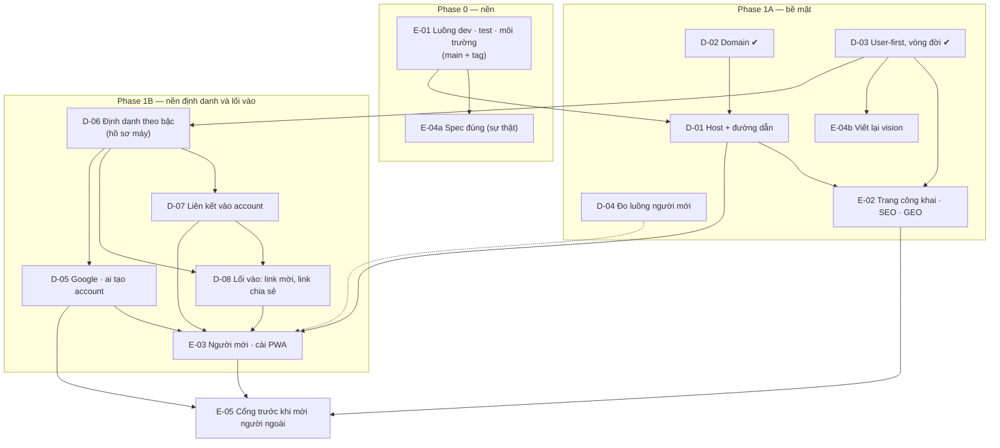

# Map — Bề mặt sản phẩm

Mọi item mục tiêu cần, và cái nào chặn cái nào. Cạnh `A --> B` đọc là "quyết A trước B". Trạng thái nằm ở
[PLAN.md](PLAN.md), trang này là hình dạng.

`D-04 -.-> E-03`: E-03 xây được không cần D-04, chỉ là chưa đo được. ✔ = decided.

## Items

| ID | Câu hỏi / thay đổi | Vì sao mục tiêu cần | Chặn |
|---|---|---|---|
| E-01 | Luồng phát triển, kiểm thử, môi trường thành spec; `main` + tag; luật prod; script kiểm, dev local | Owner muốn làm nền trước | mọi thứ |
| E-04 | Spec nói đúng: (a) sự thật, (b) vision user-first | Agent đọc spec trước khi xây | E-02, E-03 |
| D-02 ✔ | Domain lâu dài → `toheplay.io.vn` duy nhất | Origin của hub đắt khi đổi | D-01, E-05 |
| D-03 ✔ | Đối tượng → không chia; vòng đời một user | Lời, màn đầu tiên, trục của plan | E-02, E-04b, D-06 |
| D-01 | Mỗi thành phần ở host/đường dẫn nào | Landing đang ở `docs.`, gốc là SPA trống với máy | E-02, E-03 |
| D-04 | Đo luồng người mới mà không theo dõi | Biết sửa chỗ nào | (E-03, mềm) |
| E-02 | Trang công khai, SEO, GEO | Hướng 4 của brief | E-05 |
| D-06 | Hồ sơ máy, ba bậc yêu cầu, ba nguồn yêu cầu | Case 1/case 2 của owner, offline, rủ nhau | D-07, D-08, D-05 |
| D-07 | Liên kết hồ sơ máy vào account, mọi trường hợp | "xử lý tất các case mượt mà" | D-08, E-03 |
| D-08 | Một mô hình lối vào, đường ống ở hub, phần việc của game | Link vào đúng lobby / đúng game | E-03 |
| D-05 | Google một chạm; ai được tạo account | "thêm oauth để user vào nhanh" | E-03, E-05 |
| E-03 | Giao diện những chạm đầu tiên, cài PWA, xem trước link | Hướng 5 của brief | E-05 |
| E-05 | Cổng trước khi mời người ngoài (E-10 cũ) | Brief "Xong khi" 7 | — |

## Considered and left off

- **Tách API ra `api.`**: cùng origin đơn giản và an toàn hơn; không có API cho bên thứ ba (D-01).
- **Console admin ra `admin.`**: tốt cho cô lập phiên, không gấp; đổi lúc nào cũng rẻ (R-01 E6).
- **Gửi thư từ subdomain**: không gấp (D-02).
- **UAT có HTTPS (D-15)**: prod là chỗ thử HTTPS trong lúc chỉ owner dùng; mở lại ở Cổng.
- **Nhánh theo môi trường, preview cho từng PR, staging thứ ba**: không (E-01, R-04).
- **App Android qua TWA / store**: ngoài phạm vi; chỉ chừa `/.well-known/` (D-01).
- **Zalo / Facebook đăng nhập**: Phase 2, item riêng — Zalo nhiều khả năng không trả email (D-05).
- **Account ẩn danh trên server cho mọi lượt ghé**: trái offline-first (D-06 phương án C).
- **Link không trạng thái (HMAC trong URL)**: không thu hồi, không đếm (D-08 phương án C).
- Lấp Ô, spike S1/S3/S4, telemetry phase 3, Node 26: ngoài plan ([R-01](research/R-01-backlog-review.md) mục E).
