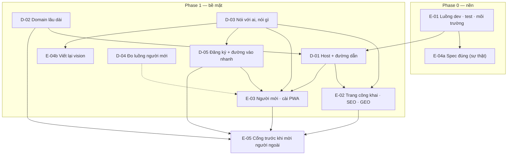

# Map — Bề mặt sản phẩm

Mọi item mục tiêu cần, và cái nào chặn cái nào. Cạnh `A --> B` đọc là "quyết A trước B". Trạng thái nằm ở
[PLAN.md](PLAN.md), trang này là hình dạng.

`D-04 -.-> E-03`: E-03 xây được không cần D-04, chỉ là chưa đo được.

## Items

| ID | Câu hỏi / thay đổi | Vì sao mục tiêu cần | Chặn |
|---|---|---|---|
| E-01 | Luồng phát triển, kiểm thử, môi trường thành spec; luật prod; script kiểm vào repo | Owner muốn làm nền trước; prod chưa có luật cho agent | mọi thứ |
| E-04 | Spec nói đúng: (a) sự thật, (b) vision | Agent đọc spec trước khi xây | E-02, E-03 |
| D-02 | Domain lâu dài, đổi lúc nào | Origin của hub đắt khi đổi sau khi có người dùng | D-01 (tên), E-05 |
| D-01 | Mỗi thành phần ở host/đường dẫn nào | Landing đang ở `docs.`, gốc là SPA trống với máy | E-02, E-03 |
| D-03 | Đối tượng và thông điệp | Lời, từ khoá, màn đầu tiên | E-02, E-03, D-05, E-04b |
| D-05 | Ai được tạo account; đường vào nhanh | Link bàn gãy với người mới khi "theo lời mời" | E-03, E-05 |
| D-04 | Đo luồng người mới mà không theo dõi | Biết sửa chỗ nào | (E-03, mềm) |
| E-02 | Trang công khai, SEO, GEO | Hướng 4 của brief | E-05 |
| E-03 | Hành trình người mới, cài PWA, xem trước link | Hướng 5 của brief | E-05 |
| E-05 | Cổng trước khi mời người ngoài (E-10 cũ) | Brief "Xong khi" 6 | — |

## Considered and left off

- **Tách API ra `api.`**: cùng origin đơn giản và an toàn hơn; không có API cho bên thứ ba (D-01).
- **Console admin ra `admin.`**: tốt cho cô lập phiên, không gấp; đổi lúc nào cũng rẻ (R-01 E6).
- **Gửi thư từ subdomain**: làm cùng D-02 nếu đổi domain.
- **UAT có HTTPS (D-15)**: prod là chỗ thử HTTPS trong lúc chỉ owner dùng; mở lại ở Cổng.
- **Preview environment cho từng PR, staging thứ ba**: chưa cần (E-01).
- **App Android qua TWA / store**: ngoài phạm vi; chỉ chừa `/.well-known/` (D-01).
- **Khách ngồi bàn online không cần account; xác minh email sau**: đổi identity/rooms → Phase 2 (D-05 K, L).
- Lấp Ô, spike S1/S3/S4, telemetry phase 3, Node 26: ngoài plan ([R-01](research/R-01-backlog-review.md) mục E).
