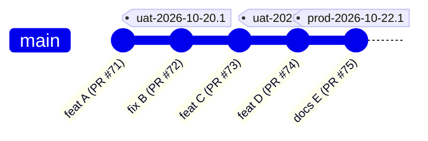

# R-04 — Mô hình phát triển và giao lên prod: `main` + tag làm môi trường

- Date: 2026-10-19 · Feeds: E-01

## Question

Owner (2026-10-19): "prod chỉ chạy commit đã lên UAT, lên prod sẽ là gắn tag prod-... nhé, nhánh main sẽ là nhánh chính,
chúng ta có thể chia môi trường bằng tag k, và dev local sẽ ntn nhỉ, research 1 giải pháp phát triển và giao lên prod phù
hợp với chúng ta đi".

## Findings

### Nhánh, môi trường, cái được promote

- **Trunk-based development**: một nhánh chính luôn ở trạng thái phát hành được; nhánh ngắn hạn cho từng thay đổi; nhánh
  release chỉ là ngoại lệ, tạo đúng lúc từ tag khi cần vá một bản đã phát hành
  ([trunkbaseddevelopment.com](https://trunkbaseddevelopment.com/branch-for-release)).
- **Đừng dùng nhánh cho từng môi trường** (anti-pattern): promote không phải là một lần merge, dễ lệch cấu hình. Khuyên
  dùng một nhánh, và thứ được promote chủ yếu là **phiên bản của ứng dụng** (tag image), còn cấu hình riêng của môi trường
  (endpoint, secret) đứng yên ([Octopus/Codefresh](https://octopus.com/blog/how-to-model-your-gitops-environments),
  [Codefresh](https://codefresh.io/about-gitops/branches-gitops-environments/)).
  → Tò He đã làm đúng: image build **một lần** mỗi commit trên `main` (`sha-<commit>`), UAT và prod chạy cùng image, cấu
  hình riêng nằm ở `uat.env` / `platform-infra` (ADR 0021).
- Các bài trên không nói về **git tag** làm dấu môi trường. Tag là thứ trunk-based dùng để đánh dấu bản phát hành; dùng nó
  làm "con trỏ môi trường" là suy luận của agent, hợp với quy mô một người vận hành.

### Argo CD và phiên bản chart

- Argo CD nhận **ràng buộc semver** ở `targetRevision` cho nguồn Helm (gồm OCI): chọn bản cao nhất khớp ràng buộc
  ([Argo CD tracking strategies](https://argo-cd.readthedocs.io/en/latest/user-guide/tracking_strategies/)). Bản có
  build metadata/pre-release dễ không khớp ([argo-cd#14097](https://github.com/argoproj/argo-cd/issues/14097)) — chart của
  Tò He đang đánh số `0.1.0-g<sha7>` (pre-release) nên **không** dùng ràng buộc semver được nếu không đổi cách đánh số.
- Hôm nay `platform-infra` ghim đúng một bản chart; lên bản mới = PR đổi `targetRevision`, owner merge (ADR 0021).

### Sự thật trong repo

- CI publish image + chart chỉ khi push `main` (`.github/workflows/ci.yml`, job `publish`); runner là GitHub-hosted →
  **không tới được UAT** (10.100.0.2 sau WireGuard).
- `deploy/uat/deploy.sh <commit>` chạy trên homelab (máy agent đang chạy), kéo image GHCR, backup trước.
- Dev: Mode A `pnpm dev` (hot reload), Mode B `docker compose up --build` (image build từ working tree). **Không có dữ liệu
  mẫu** cho dev. Một stack dev mỗi máy (cổng 47xx, project `tohe`); API test dùng Testcontainers nên các lane song song
  vẫn `pnpm verify` được cùng lúc.

## Đề xuất: "một nhánh, build một lần, tag là môi trường"

| | Quy tắc |
|---|---|
| **Nhánh** | `main` là nhánh duy nhất sống lâu. Mỗi thay đổi một nhánh ngắn + worktree, PR, merge commit. Không `develop`, không nhánh môi trường. |
| **Build** | Mỗi commit trên `main`: CI build image `sha-<commit>` + chart `<version>-g<sha7>` **một lần**. Không môi trường nào build lại. |
| **Môi trường = tag** | Tag annotated, **không bao giờ di chuyển hay xoá**: `uat-YYYY-MM-DD.N`, `prod-YYYY-MM-DD.N`. Môi trường đang chạy = tag mới nhất cùng tiền tố. Quay lui = tag **mới** trỏ vào commit cũ. |
| **Luật kiểm bằng CI** (workflow chạy khi push tag) | tag trỏ vào commit trên `main`, CI xanh, image đã publish; `prod-*` chỉ trỏ vào commit **đã có** `uat-*`. Sai → workflow đỏ, không làm gì. |
| **`uat-*`** | Agent gắn tag khi owner nói "deploy", rồi chạy `deploy/uat/deploy.sh <tag>` trên homelab (CI không tới được UAT). Sau này nếu muốn: một timer trên homelab tự deploy tag `uat-*` mới (GitOps kiểu kéo). |
| **`prod-*`** | Owner nói "lên prod" (hoặc tự gắn tag trên GitHub). Workflow `release.yml`: kiểm luật → tạo **GitHub Release** (ghi chú tự sinh từ PR giữa hai tag `prod-*`) → mở PR đổi `targetRevision` ở `platform-infra` → owner merge → Argo CD đồng bộ → `pnpm check:prod`. |
| **Sửa gấp** | Như trên, chỉ rút ngắn thời gian thử trên UAT. Không vá thẳng prod, không nhánh release (chỉ khi thật cần vá một bản cũ mà `main` đã đi xa). |
| **Bật/tắt tính năng** | Cài đặt lúc chạy của console (ADR 0028) khi thật cần; không dựng hệ thống feature flag chung. |

### Mở PR ở `platform-infra` từ workflow — hai cách

| | Cách | Được | Mất |
|---|---|---|---|
| **A** ⭐ | Workflow dùng một token (GitHub App hoặc fine-grained PAT, chỉ quyền contents + pull requests trên `vinetic-spaces/platform-infra`) mở PR; owner merge | giữ đúng ADR 0021 (hai chìa: tag + merge); `platform-infra` vẫn là sổ ghi của hạ tầng | owner tạo token và lưu secret `PLATFORM_INFRA_TOKEN` trong `tohe-play`; chưa có token thì agent mở PR qua API như #239 |
| **B** | Một chìa: tag là deploy — chart đánh số semver sạch theo bản phát hành, `platform-infra` ghim một ràng buộc semver, Argo CD tự lên | đơn giản nhất cho một người vận hành | đổi cách đánh số chart; sửa `platform-infra`; mất bước duyệt ở hạ tầng; sửa ADR 0021 |

### Dev local

| Chế độ | Khi nào | Lệnh |
|---|---|---|
| **A — hot reload** | làm hằng ngày | `docker compose up -d postgres mailpit` + `pnpm dev` (như nay) |
| **B — stack từ mã đang sửa** | trước khi mở PR đụng Caddy/Dockerfile/chart, chạy e2e | `docker compose up --build` (như nay) |
| **C — chạy đúng image của một tag/commit** (mới) | tái hiện lỗi của UAT/prod trên máy | `pnpm stack:image <tag|sha>` — compose dùng image GHCR thay vì build, project riêng, dữ liệu mẫu |
| **Dữ liệu mẫu** (mới) | mọi chế độ | lệnh chỉ chạy ở dev (`dotnet Tohe.Api.dll dev seed`): vài account, hồ sơ người lớn/trẻ em, hồ sơ máy, điểm, một bàn chờ — để thử tay và chụp ảnh nhanh |
| **Điện thoại** | thử thật | LAN: `TOHE_PUBLIC_HOST`; Android: `adb reverse tcp:4720 tcp:4720` (secure context → PWA); iPhone: prod trong giai đoạn owner-only |
| **Nhiều lane song song** | nhiều agent | mỗi máy **một** stack dev chạy cùng lúc; các lane khác dựa vào `pnpm verify` (Testcontainers) và CI `stack` |

Dữ liệu thật **không bao giờ** về máy dev: dump UAT chỉ dùng chạy thử migration (như E-01 của `public-launch`) rồi xoá.

## Assumptions

- `platform-infra` chấp nhận một PR do token của `tohe-play` mở — owner quyết ở phía hạ tầng.
- Tag theo ngày (CalVer) đủ cho người đọc; không ai dùng API của Tò He theo phiên bản, nên không cần semver cho bản phát hành
  (game vẫn semver theo contract — ADR 0007).

## So what

- Trả lời câu hỏi của owner: **có, chia môi trường bằng tag được** — tag là dấu, image là thứ được promote, `main` là nhánh
  duy nhất. Không tạo nhánh môi trường.
- E-01 thêm: luật tag + workflow kiểm, `release.yml`, Mode C + dữ liệu mẫu; Q mới: A hay B cho PR `platform-infra`.

## Sources

- https://trunkbaseddevelopment.com/branch-for-release
- https://octopus.com/blog/how-to-model-your-gitops-environments
- https://codefresh.io/about-gitops/branches-gitops-environments/
- https://argo-cd.readthedocs.io/en/latest/user-guide/tracking_strategies/
- https://github.com/argoproj/argo-cd/issues/14097
