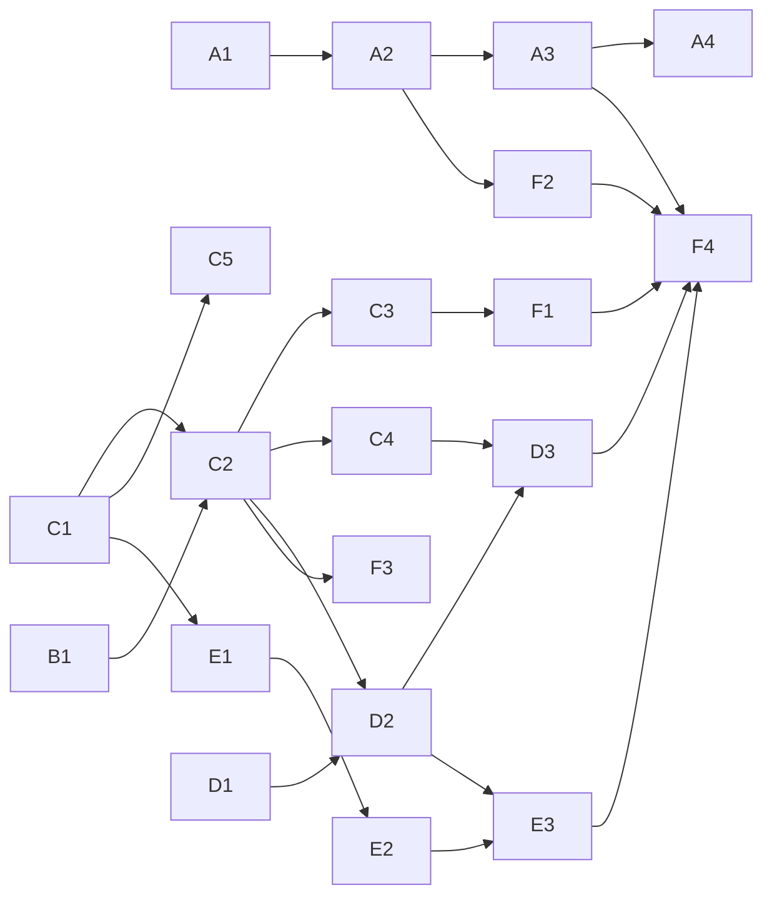

# Delivery — Public launch: thứ tự xây, theo pull request

Danh sách graduate của plan, cụ thể tới từng pull request. Mỗi PR **một mục đích**, mang theo ADR và docs của nó
(spec trước, trong cùng PR — như các PR #36–#40), chạy `pnpm verify` trước khi mở. Owner review và merge từng PR.
Owner: "theo đề xuất bạn có thể impl toàn bộ giúp tôi k, planning và làm những việc song song" (2026-10-18).

## Các lane và PR

| PR | Lane | Nội dung | ADR | Cần trước | Items |
|---|---|---|---|---|---|
| **A1** | Release | Image chạy được ở mọi môi trường: URL công khai của hub trong config API (cookie `Secure`, link trong email sau này); proxy tin cậy + header IP thật cho Caddy; HSTS; site đọc URL của hub lúc chạy | 0021 Production via the Tò He chart (sửa ADR 0010) | — | D-14, E-03 |
| **A2** | Release | Chart `deploy/helm/tohe`: 4 workload, Postgres `builtin` / `external`, `existingSecret`, ingress tắt được, điểm cắm chung, guard, `values.schema.json`, profile CI, cài thử lên kind trong CI; `docs/guides/self-hosting.md` | (0021) | A1 | E-04 |
| **A3** | Release | CI đẩy image + chart lên GHCR; UAT chạy đúng image theo SHA thay vì build tại máy | (0021) | A2 | E-05 |
| A4 | Release | `apps/tohe` trong `platform-infra` (draft) — **phiên mở trong repo đó** | — | A3 (chart đã publish) | E-06 |
| **B1** | Email | Outbox + gửi SMTP, Mailpit cho dev, mẫu thư tiếng Việt, cấu hình `smtp \| disabled`, khối SMTP trong chart | 0022 Transactional email | — (A2 để có khối chart) | E-02 |
| **C1** | Identity | Account sở hữu hồ sơ (bỏ household), ID hồ sơ 12 số (Damm), hồ sơ mặc định, luật tên, tối đa 5 hồ sơ, bàn "chỉ trong account", chuyển dữ liệu UAT | 0023 User-first identity (thay 0004, sửa 0011) | — | D-01, D-17, E-01 |
| **C2** | Identity | Đăng ký bằng email (attempt + mã), đăng nhập bằng email, quên mật khẩu, đổi email, security stamp, chống dò email, thư thông báo; account username trên UAT thêm email ở lần đăng nhập kế | (0023) | C1, B1 | D-02, E-01 |
| **C3** | Identity | Xác thực lại hai mức (mã quản lý, L2), mẫu hồ sơ trẻ em, cổng tuổi 16 + đồng ý điều khoản | (0023) | C2 | D-05, D-06 |
| **C4** | Identity | Google, GitHub, OIDC chung + luồng liên kết; cấu hình hai lớp; test bằng scheme giả + `mock-oauth2-server` | 0024 Sign-in methods and account linking | C2 | D-03, D-04 |
| **C5** | Identity | Mời đích danh bằng ID, "ai được mời tôi", hồ sơ trẻ em "không tìm thấy" | (0023) | C1 | D-17 |
| **D1** | Admin | App `apps/admin` ở `/admin`, `/api/admin` với tài liệu OpenAPI riêng, module chỉ đọc: tổng quan, game, sức khoẻ (telemetry), hệ thống | 0025 Platform admin and the first owner | — | D-07 |
| **D2** | Admin | Vai trò → quyền, admin đầu tiên bằng setup token + CLI, 2FA (TOTP), audit log, xác thực lại cho thao tác nhạy cảm | (0025) | C2, D1 | D-07, D-08 |
| **D3** | Admin | Người dùng, cài đặt đăng nhập (bật/tắt runtime), chế độ đăng ký + mã mời cộng đồng | (0025) | D2, C4 | D-07, D-12 |
| **E1** | Độ tin | Engine `Integrity` (mức tin, chính sách bảng, `RoomVerifier`, tín hiệu `Bounds` / `PersonalJump` / `Rate` / `Farming`, `held` / `rejected`, audit) + bảng trong account / cộng đồng / toàn server, tuần + mọi lúc | 0026 Integrity engine and leaderboards by trust | C1 | D-09, D-11, D-16 |
| **E2** | Độ tin | Run tính hạng: seed của server, kênh gửi nước đi, module xác minh, `ReplayVerifier`, conformance; Ghép Khối là game đầu tiên | 0027 Ranked runs (Game Contract) | E1 | D-10 |
| **E3** | Độ tin | Hàng đợi "Chờ xem xét" trong admin, xem lại run bằng chính game | — | D2, E2 | D-16 |
| **F1** | Public | Trang điều khoản và quyền riêng tư (bản nháp để owner duyệt), lưu phiên bản đồng ý, xoá hồ sơ / account có thời gian chờ, kiểm duyệt tên (từ dành riêng, từ thô tục, lịch sử tên) | — | C3 | E-07 |
| **F2** | Public | `/metrics` + ServiceMonitor trong chart + cảnh báo tối thiểu | — | A2 | E-08 |
| F3 | Public | Turnstile cho đăng ký (tuỳ chọn, mặc định tắt) | — | C2 | E-09 |
| F4 | Ra mắt | Checklist: thử restore, load test phòng, `/security-review`, thử thư tới Gmail / Outlook / Yahoo, D-13, deploy prod, một cộng đồng dùng thử | — | mọi PR trên | E-10 |

## Chạy song song thế nào

- **Bắt đầu được ngay, độc lập với nhau:** A1, B1, C1, D1. Sau đó: A2/A3 (release), C2→C3→C4 (identity), E1→E2 (độ tin),
  D2→D3 (admin).
- **Không chạy song song được:** các PR cùng thêm migration EF Core (C1, C2, C3, C4, D2, E1, E2) đụng chung
  `ToheDbContextModelSnapshot.cs` — merge từng cái một, cái sau rebase lên cái trước. Tương tự với các file sinh ra
  (`services/api/openapi/`, `apps/hub/src/api/schema.gen.ts`): sinh lại sau khi rebase, không sửa tay.
- **Mỗi lane một worktree và một nhánh**; plan này là bảng điều phối chung.

## Việc chỉ owner làm được

| Khi | Việc |
|---|---|
| Mỗi PR | Review và merge |
| Mỗi lần lên UAT | Nói "deploy" — agent chỉ chạy `deploy/uat/deploy.sh` khi được bảo |
| Trước khi C2 lên UAT | Trả lời E-02 Q2 (Resend Free hay Pro); tạo API key (và domain gửi riêng nếu Free), đưa vào `~/.config/tohe-uat/uat.env` |
| Trước khi C4 lên prod | Tạo OAuth app Google và GitHub với redirect URI của prod; secret vào Infisical `/tohe` |
| Trước khi merge A4 | Pre-step của `platform-infra`: role Postgres, `/tohe` trong Infisical, DNS |
| Trước F4 | Chốt D-13 (domain cho games); duyệt văn bản điều khoản và quyền riêng tư (agent soạn, không phải tư vấn pháp lý) |

## Trạng thái

| PR | Nhánh | Trạng thái |
|---|---|---|
| A1 | — | chưa bắt đầu |
