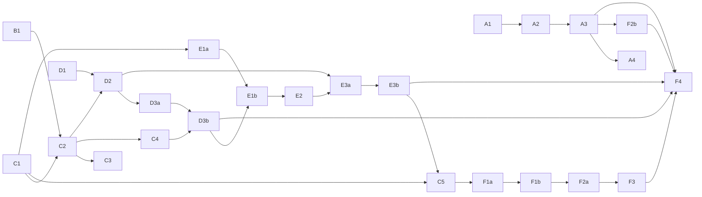

# Delivery — Public launch: thứ tự xây, theo pull request

Danh sách graduate của plan, cụ thể tới từng pull request. Mỗi PR **một mục đích**, mang theo ADR và docs của nó
(spec trước, trong cùng PR — như các PR #36–#40), chạy `pnpm verify` trước khi mở. Owner review và merge từng PR.
Owner: "theo đề xuất bạn có thể impl toàn bộ giúp tôi k, planning và làm những việc song song" (2026-10-18).

## Các lane và PR

| PR | Lane | Nội dung | ADR | Cần trước | Items |
|---|---|---|---|---|---|
| **A1** | Release | Image chạy được ở mọi môi trường: URL công khai của hub trong config API (cookie `Secure`, link trong email sau này); proxy tin cậy + header IP thật cho Caddy; HSTS; site đọc URL của hub lúc chạy | 0021 Production via the Tò He chart (sửa ADR 0010) | — | D-14, E-03 |
| **A2** | Release | Chart `deploy/helm/tohe`: 4 workload, Postgres `builtin` / `external`, `existingSecret`, ingress tắt được, điểm cắm chung, guard, `values.schema.json`, profile CI, cài thử lên kind trong CI; `docs/guides/self-hosting.md` | (0021) | A1 | E-04 |
| **A3** | Release | CI đẩy image + chart lên GHCR; UAT chạy đúng image theo SHA thay vì build tại máy | (0021) | A2 | E-05 |
| A4 | Release | `apps/tohe` trong `platform-infra` (draft) — **phiên mở trong repo đó** | — | A3 (chart đã publish) | E-06 |
| **B1** | Email | Outbox + gửi SMTP, Mailpit cho dev, mẫu thư tiếng Việt, cấu hình `smtp \| disabled`, khối SMTP trong chart | 0022 Transactional email | — (A2 để có khối chart) | E-02 |
| **C1** | Identity | Account sở hữu hồ sơ (bỏ household), ID hồ sơ 12 số (Damm), hồ sơ mặc định, luật tên, tối đa 5 hồ sơ, bàn "chỉ trong account", chuyển dữ liệu UAT | 0023 Accounts own their profiles (thay 0004, sửa 0011) | — | D-01, D-17, E-01 |
| **C2** | Identity | Đăng ký bằng email (attempt + mã), đăng nhập bằng email, quên mật khẩu, đổi email, security stamp, chống dò email, thư thông báo; account username trên UAT thêm email ở lần đăng nhập kế | 0024 Email identifies an account (sửa 0011) | C1, B1 | D-02, E-01 |
| **C3** | Identity | Xác thực lại hai mức (mã quản lý, L2), mẫu hồ sơ trẻ em, cổng tuổi 16 + đồng ý điều khoản | 0025 Step-up in two levels, consent at sign-up | C2 | D-05, D-06 |
| **C4** | Identity | Google, GitHub, OIDC chung + luồng liên kết; cấu hình hai lớp; test bằng scheme giả + `mock-oauth2-server` | 0026 Sign-in methods and account linking | C3 | D-03, D-04 |
| **C5** | Identity | Mời đích danh bằng ID, "ai được mời tôi", hồ sơ trẻ em "không tìm thấy" | 0033 Invite a profile by its ID (sửa 0023, 0016) | C1 | D-17 |
| **D1** | Admin | App `apps/admin` ở `/admin`, `/api/admin` với tài liệu OpenAPI riêng, module chỉ đọc: tổng quan, game, sức khoẻ (telemetry), hệ thống | 0027 Platform admin and the first owner | — | D-07 |
| **D2** | Admin | Vai trò → quyền, admin đầu tiên bằng setup token + CLI, 2FA (TOTP), audit log, xác thực lại cho thao tác nhạy cảm | (0027) | C2, D1 | D-07, D-08 |
| **D3a** | Admin | Người dùng: tìm, tạm khoá, đăng xuất mọi nơi, vai trò, đổi tên hồ sơ (giữ lịch sử tên) | (0027) | D2 | D-07 |
| **D3b** | Admin | Bật/tắt cách đăng nhập lúc chạy, chế độ đăng ký (mở / theo lời mời / đóng), cộng đồng + mã mời | 0028 Sign-in and registration at run time | D3a, C4 | D-04, D-12 |
| **E1a** | Độ tin | Engine `Integrity` (mức tin, `RoomVerifier`, tín hiệu `Bounds` / `PersonalJump` / `Rate`, luật hai người thật như phạm vi, `held` / `rejected`, nhật ký quyết định chỉ ghi thêm) + bảng trong account, tuần (thứ Hai 00:00 giờ Việt Nam) + mọi lúc | 0029 Integrity engine and boards by trust | C1 | D-09, D-11, D-16 |
| **E1b** | Độ tin | Bảng công khai: cộng đồng + toàn server, một dòng mỗi hồ sơ/bảng/chu kỳ, top 50 + quanh tôi; công tắc "hiện trên bảng công khai" của hồ sơ (trẻ em tắt sẵn, "Tôi đã hỏi ý bé") | (0029) | E1a, D3b | D-01, D-06, D-09 |
| **E2** | Độ tin | Run tính hạng: seed của server, kênh gửi nước đi, module xác minh, `ReplayVerifier`, conformance; Ghép Khối là game đầu tiên | 0030 Ranked runs replayed by the server (Game Contract) | E1 | D-10 |
| **E3a** | Độ tin | Hàng đợi "Chờ xem xét" + "Đã quyết" trong admin: duyệt / từ chối / mở lại sau xác thực lại, không quyết kết quả của chính mình; kết quả đã giao cho người giữ nguyên giá trị; ẩn hồ sơ khỏi bảng công khai | 0031 People decide what the engine held (sửa 0029) | D2, E2 | D-09, D-16 |
| **E3b** | Độ tin | Xem lại run bằng chính game trong admin: chế độ xem lại trong Game Contract, admin nhúng game từ games origin | 0032 Watch a ranked run in the game itself (Game Contract, sửa 0027 và 0030) | E3a | D-16 |
| **F1** | Public | F1a: xoá hồ sơ ngay, xoá account sau 7 ngày (đăng nhập để giữ), dữ liệu mọi module, một lối ra cho bảng chỉ ghi thêm, nhật ký admin giữ một năm, ID không cấp lại. F1b: bộ lọc tên thô tục, 5 lần đổi tên mỗi ngày. F1c: hết 7 ngày, account chờ admin xoá hẳn trong console (bỏ job tự xoá — E-07 Q7) | 0034 Delete accounts and profiles for good · 0035 Filter offensive names · 0038 An account waits for an admin after its seven days | C5 | E-07 |
| **F2** | Public | F2a: `/metrics` cổng 9464 (prometheus-net) + metric của Tò He. F2b: ServiceMonitor, PrometheusRule (6 cảnh báo), NetworkPolicy trong chart | 0036 Metrics for Prometheus on a port of its own | F1b (F2a), A3 (F2b) | E-08 |
| **F3** | Public | Proof-of-work tự host trước khi xin mã (đăng ký, quên mật khẩu), công tắc trong console, tắt sẵn | 0037 Proof-of-work before a code by email | F2a | E-09 |
| F4 | Ra mắt | Checklist: thử restore, load test phòng, `/security-review`, thử thư tới Gmail / Outlook / Yahoo, D-13, deploy prod, một cộng đồng dùng thử | — | mọi PR trên | E-10 |

## Chạy song song thế nào

- **Bắt đầu được ngay, độc lập với nhau:** A1, B1, C1, D1. Sau đó: A2/A3 (release), C2→C3→C4 (identity), E1a→E1b→E2→E3a→E3b (độ tin),
  D2→D3a→D3b (admin).
- **Không chạy song song được:** các PR cùng thêm migration EF Core (C1, C2, C3, C4, D2, D3a, D3b, E1a, E1b, E2, E3a, C5; E3b không có migration nhưng xếp trên E3a) đụng chung
  `ToheDbContextModelSnapshot.cs` — merge từng cái một, cái sau rebase lên cái trước. Tương tự với các file sinh ra
  (`services/api/openapi/`, `apps/hub/src/api/schema.gen.ts`): sinh lại sau khi rebase, không sửa tay.
- **Mỗi lane một worktree và một nhánh**; plan này là bảng điều phối chung.

## Việc chỉ owner làm được

| Khi | Việc |
|---|---|
| Mỗi PR | Review và merge |
| Mỗi lần lên UAT | Nói "deploy" — agent chỉ chạy `deploy/uat/deploy.sh` khi được bảo |
| Trước khi C2 lên UAT | E-02 Q2 đã trả lời: **Free** (2026-10-18). Còn: tạo API key, đưa vào `~/.config/tohe-uat/uat.env` |
| ~~Trước lần deploy UAT tới~~ | Không cần: lần publish đầu của `main` (2026-10-18) ra 5 package GHCR **public**, máy UAT kéo không cần đăng nhập |
| Trước khi C4 lên prod | Tạo OAuth client Google (*Web application*) và OAuth app GitHub, redirect URI `https://<hub>/api/auth/external/{google,github}/callback`; secret vào Infisical `/tohe` (`Auth__Providers__Google__ClientId`, `…__ClientSecret`, tương tự GitHub), chart nhận qua `api.extraEnvFrom` |
| Trước khi merge A4 | Pre-step của `platform-infra`: role Postgres, `/tohe` trong Infisical, DNS |
| Trước F4 | Chốt D-13 (domain cho games — agent đề xuất B, [item](items/D-13-games-origin-domain.md)); duyệt văn bản điều khoản và quyền riêng tư (agent soạn, không phải tư vấn pháp lý) |

## Trạng thái

**Merge** (2026-10-18, owner: "tôi verify sơ qua thấy đã ổn, chốt hiện tại nha, merge giúp tôi các PR đi"): cả 23 PR
#43–#65 đã merge vào `main` bằng merge commit, theo đúng phụ thuộc: chuỗi chính trước (#43 → #45 → #46 → #48 … #63 →
#65), rồi dòng chart (#44 → #47 → #64). Sau chuỗi chính, `main` (`ba14386`) trùng từng byte với bản UAT đang chạy
(`a42810dd9f0b`). Sau dòng chart, `main` là `ad83c45`. F1c ([#66](https://github.com/vinh466/tohe-play/pull/66)) mở
trên `main`, chờ owner review, chưa lên UAT. Còn mở từ ghi chú của #45: chart chưa có khối email riêng — trước prod,
cấu hình email của API đi qua `api.extraEnvFrom` (một Secret), hoặc thêm khối đó trong một PR của chart.

**UAT** (2026-10-18, owner: "deploy uat tuần tự + kiểm tra"): #43, #45, #46, #48 … #60, rồi #61 → #62 → #63 → #65
lên lần lượt theo thứ tự merge, mỗi bước kiểm phiên bản, migration, dữ liệu của nhà và log API — UAT chạy
`a42810dd9f0b` (đầu #65). Migration của F1a chạy thử trên dump UAT trước (chỉ thêm, không mất dòng nào). #44, #47, #64
(chart, GHCR) không áp dụng cho UAT tới khi merge. Các PR này chưa merge mà đã lên UAT: **migration của chúng không sửa
nữa** — sửa sau review đi bằng migration mới.

| PR | Nhánh | Trạng thái |
|---|---|---|
| A1 | `feat/deploy-env-agnostic-images` | [#43](https://github.com/vinh466/tohe-play/pull/43) — **merged** |
| A2 | `feat/deploy-helm-chart` (trên A1) | [#44](https://github.com/vinh466/tohe-play/pull/44) — **merged** · CI xanh (cài lên kind, `helm test`, upgrade) |
| B1 | `feat/api-transactional-email` (trên A1) | [#45](https://github.com/vinh466/tohe-play/pull/45) — **merged** · khối SMTP của chart làm sau khi A2 + B1 merge |
| C1 | `feat/identity-accounts-own-profiles` (trên B1) | [#46](https://github.com/vinh466/tohe-play/pull/46) — **merged** · trước khi lên UAT: chạy thử migration trên bản dump UAT (E-01) |
| A3 | `feat/deploy-publish-ghcr` (trên A2) | [#47](https://github.com/vinh466/tohe-play/pull/47) — **merged** · lần publish đầu (`ad83c45`): 5 package GHCR đã public, kéo ẩn danh được |
| C2 | `feat/identity-email-sign-in` (trên C1) | [#48](https://github.com/vinh466/tohe-play/pull/48) — **merged** · trước khi lên UAT: relay email của UAT (E-02 Q2) |
| C3 | `feat/identity-step-up-and-consent` (trên C2) | [#49](https://github.com/vinh466/tohe-play/pull/49) — **merged** · owner duyệt bản nháp Điều khoản + Quyền riêng tư (`apps/hub/src/legal/documents.ts`) |
| C4 | `feat/identity-oauth-and-linking` (trên C3) | [#50](https://github.com/vinh466/tohe-play/pull/50) — **merged** · trước khi lên prod: OAuth app + secret (mục trên) |
| D1 | `feat/admin-console-shell` (trên C4) | [#51](https://github.com/vinh466/tohe-play/pull/51) — **merged** · CI xanh (smoke e2e cấp vai trò bằng lệnh thật rồi đi qua các trang) |
| D2 | `feat/admin-setup-2fa-audit` (trên D1) | [#52](https://github.com/vinh466/tohe-play/pull/52) — **merged** · CI xanh (smoke e2e nhận quyền chủ bằng setup token thật, bật 2FA) |
| D3a | `feat/admin-users` (trên D2) | [#53](https://github.com/vinh466/tohe-play/pull/53) — **merged** · có thêm bản sửa: tài khoản bị khoá không vào lại bằng quên mật khẩu hay gia hạn phiên |
| D3b | `feat/signin-and-registration-settings` (trên D3a) | [#54](https://github.com/vinh466/tohe-play/pull/54) — **merged** · trên UAT (chỉ email) thử chế độ theo lời mời bằng link mã trên điện thoại |
| E1a | `feat/integrity-engine` (trên D3b) | [#55](https://github.com/vinh466/tohe-play/pull/55) — **merged** · trên UAT: bảng 🏆 mở ở "Tuần này", kỷ lục cũ của nhà ở "Mọi lúc" |
| E1b | `feat/public-boards` (trên E1a) | [#56](https://github.com/vinh466/tohe-play/pull/56) — **merged** · trên UAT: hồ sơ người lớn lên bảng công khai, hồ sơ trẻ em tắt cho tới khi bật kèm "Tôi đã hỏi ý bé" |
| E2 | `feat/ranked-runs` (trên E1b) | [#57](https://github.com/vinh466/tohe-play/pull/57) — **merged** · trên UAT (Ghép Khối 1.9.0): chơi một ván khi đã đăng nhập, run lên "Toàn Tò He" vài giây sau khi xong |
| E3a | `feat/review-queue` (trên E2) | [#58](https://github.com/vinh466/tohe-play/pull/58) — **merged** · trên UAT: Người dùng → một hồ sơ → Ẩn khỏi bảng công khai, hub của chủ báo lý do |
| E3b | `feat/run-replay` (trên E3a) | [#59](https://github.com/vinh466/tohe-play/pull/59) — **merged** · trên UAT (Ghép Khối 1.10.0): Xem xét kết quả → một kết quả xếp hạng → ▶ Xem lại run trong game |
| C5 | `feat/invite-by-id` (trên E3b) | [#60](https://github.com/vinh466/tohe-play/pull/60) — **merged** · tra ID → thẻ → xác nhận → mời (design §3.15); giả định người lớn mặc định "Mọi người có ID" — owner nhận (2026-10-18); trên UAT: Quản lý tài khoản → hồ sơ → "Ai được mời vào phòng bằng ID", trong phòng → Mời người chơi → Mời bằng ID hồ sơ |
| F1a | `feat/account-deletion` (trên C5) | [#61](https://github.com/vinh466/tohe-play/pull/61) — **merged** · CI xanh; migration chạy thử trên dump UAT (chỉ thêm, không mất dòng nào); trên UAT: Quản lý tài khoản → Xoá tài khoản… (7 ngày, đăng nhập để giữ), xoá một hồ sơ thử |
| F1b | `feat/name-moderation` (trên F1a) | [#62](https://github.com/vinh466/tohe-play/pull/62) — **merged** · CI xanh; **owner duyệt danh sách từ** (khối thu gọn trong PR) |
| F2a | `feat/api-metrics` (trên F1b) | [#63](https://github.com/vinh466/tohe-play/pull/63) — **merged** · CI xanh; `/metrics` cổng 9464, UAT không mở ra ngoài |
| F2b | `feat/chart-metrics` (trên A3 #47) | [#64](https://github.com/vinh466/tohe-play/pull/64) — **merged** · CI xanh (cài lên kind); `promtool` nhận 6 cảnh báo; giả định namespace `monitoring` |
| F3 | `feat/proof-of-work` (trên F2a) | [#65](https://github.com/vinh466/tohe-play/pull/65) — **merged** · tắt sẵn; bật ở console → Đăng nhập & đăng ký → Chống bot đăng ký |
| F1c | `feat/deletion-waits-for-admin` (trên `main`) | [#66](https://github.com/vinh466/tohe-play/pull/66) — CI xanh (cả e2e); màn console kiểm sáng/tối, desktop/điện thoại; chờ owner review; lên UAT khi owner nói "deploy"; trên UAT: console → Tổng quan "Tài khoản đến hạn xoá", Người dùng → "Chờ xoá" |

Thứ tự merge (đã merge hết, 2026-10-18 — chuỗi chính trước, dòng chart sau): #43 → #44 và #45 (hai cái độc lập) → #46 → #48 → #49 → #50 → #51 → #52 → #53 → #54 → #55 → #56 → #57 → #58 → #59 → #60 → #61 → #62 → #63 → #65; #47 sau #44, #64 sau #47. Số ADR được cấp khi PR mở. Mỗi PR xếp chồng tự đổi base về `main` khi PR dưới nó merge.
