# Design — Public launch: thiết kế đích (v2, đang thành hình)

Trang này **ghép** các item thành một bức tranh. Nó không quyết định gì: mỗi khẳng định trỏ về item quyết định nó;
*(proposed)* đánh dấu item chưa `decided`. Item nào được quyết khác đi thì sửa trang này ngay trong phiên đó.
Ngày: 2026-10-17.

Sơ đồ dùng nhãn tiếng Anh vì khi graduate chúng chuyển nguyên vào `docs/architecture/` (tiếng Anh) làm tài liệu maintain.

## 0. Trả lời ngắn: đã chắc tới đâu

- **Chắc:** email là định danh và bộ luồng auth (D-02), luật liên kết (D-03), các cách đăng nhập + OAuth chỉ ở prod
  (D-04), một account nhiều hồ sơ có hồ sơ mặc định (D-01), tên đặt thoải mái + ID 12 số (D-17), hai mức xác thực lại
  (D-05), admin console và admin đầu tiên (D-07, D-08), bảng xếp hạng phân tầng theo độ tin (D-09, D-11), engine độ tin
  (D-16) với replay Ghép Khối trong v1 (D-10), chế độ đăng ký (D-12), release bằng chart (D-14); UAT HTTPS để sau (D-15).
- **Cũng đã chốt (2026-10-18):** bảng cộng đồng nhận `checked` cho game chưa có replay (D-16 Q4), tự đăng ký từ 16 tuổi
  (D-06), gửi email từ `no-reply@…` (E-02), chuyển dữ liệu UAT (E-01). Resend: gói Free (E-02 Q2, chốt
  2026-10-18). Thứ tự xây: [delivery.md](delivery.md).
- **Chốt sau đó (2026-10-18):** quyền riêng tư/xoá/kiểm duyệt (E-07 — Q7: hết 7 ngày account chờ admin xoá, ADR 0038),
  observability (E-08 — cảnh báo qua email), chống bot (E-09). **Đề xuất, chờ owner:** domain riêng cho games (D-13 —
  agent đề xuất B). **Chưa mở:** checklist ra mắt (E-10).

## 1. Bức tranh

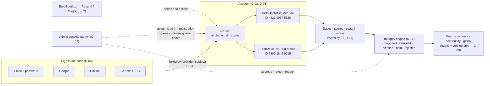

## 2. Các mảnh, chuẩn đứng sau, nằm ở đâu

| Mảnh | Làm gì | Chuẩn / tiền lệ | Nằm ở | Item |
|---|---|---|---|---|
| Account | Đăng nhập, sở hữu hồ sơ, một email đã xác minh | Pre-hijacking (USENIX 2022) | API `Identity` | D-02 |
| Attempt + mã một lần | Xác minh trước, tạo account sau; mã gắn attempt | MSRC: xác minh trước mọi thao tác | API `Identity` | D-02 |
| Liên kết | `(provider, subject)`; chứng minh quyền trước khi gộp | Supabase, Clerk, Lucia | API `Identity` | D-03 |
| Cấu hình cách đăng nhập | Deploy: có sẵn · runtime: đang bật | — | env/chart + DB + admin | D-04 |
| Hồ sơ | Người chơi; account có sẵn hồ sơ mặc định, tối đa 5; mẫu hồ sơ trẻ em | Netflix (hồ sơ) | API `Identity` | D-01 |
| Tên + ID hồ sơ | Tên đặt thoải mái; ID 12 số duy nhất, không đổi, chữ số cuối Damm; mời đích danh | Nintendo friend code, Damm | API `Identity` + `Rooms` | D-17 |
| Xác thực lại | L1 mã quản lý · L2 mật khẩu hoặc mã email | Netflix: mật khẩu để đặt PIN | API + hub | D-05 |
| Email | Outbox, mẫu thư tiếng Việt, SMTP | — | API + Resend/Mailpit | E-02 *(proposed)* |
| Admin | Console chủ sản phẩm, 2FA, audit | Mastodon roles | `apps/admin` + `/api/admin` | D-07 |
| Admin đầu tiên | Token cài đặt, danh sách email, CLI | Jenkins, Discourse, Mastodon | API + admin | D-08 |
| Bảng xếp hạng | Phân tầng theo độ tin; tuần + mọi lúc; ít nhất 2 người thật cho phòng | Open Hexagon (replay), OpenSkill | API `Progress` + `Rooms` | D-09, D-11 |
| Engine độ tin | Mức tin theo bằng chứng; verifier + tín hiệu cắm thêm; máy chỉ ẩn, người mới phạt; audit | Steam trusted writes, Google Play tamper protection, Lichess, Trackmania | API `Integrity` + admin | D-16, D-10 |
| Release | Chart, image GHCR, promote | chart `platform` | `deploy/helm/tohe` + `platform-infra` | D-14 |

## 3. Các luồng

### 3.1 Vòng đời account

Không có trạng thái "chưa xác minh": đăng ký bằng email chỉ tạo một *attempt* (§3.2), account ra đời khi mã đúng.
Khoá tạm vì sai mật khẩu (lockout) là chuyện riêng, không phải một trạng thái.

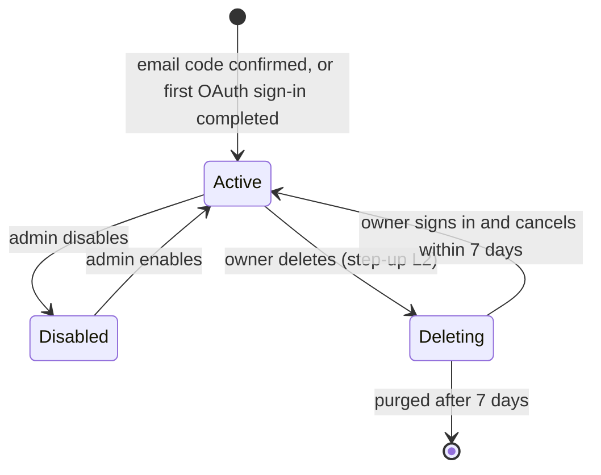

### 3.2 Đăng ký bằng email + mật khẩu

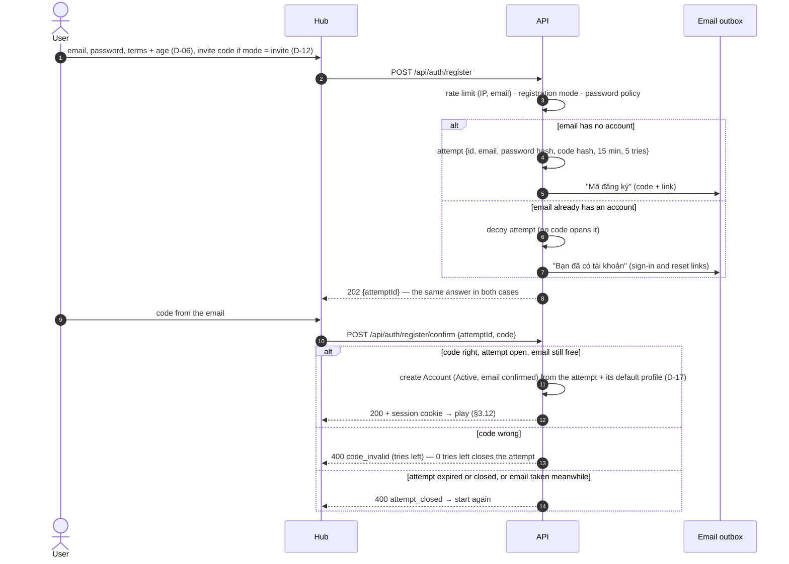

- Mật khẩu nằm trong *attempt* cho tới khi có mã đúng; vì mã chỉ dùng được cùng `attemptId` của phiên đã bắt đầu đăng
  ký, mã trong một email khác (kể cả của kẻ xấu đăng ký trước) không mở được attempt của người thật.
- Link trong email (`attemptId` + mã) mở được ở trình duyệt khác — trên iPhone đó thường là Safari chứ không phải PWA;
  account vẫn được tạo, rồi người dùng đăng nhập trong PWA bằng email + mật khẩu.
- Attempt không dùng hết hạn thì tự xoá; không có account rác để dọn.

### 3.3 Mã một lần

| Dùng cho | Gửi tới | Sống | Thử | Xin mã mới |
|---|---|---|---|---|
| Đăng ký (§3.2) | email đăng ký | 15 phút | 5 | chờ 60 giây; tối đa 5 mã mỗi giờ cho một email |
| Quên mật khẩu (§3.5) | email của account | 15 phút | 5 | như trên |
| Xác minh email cho OAuth không có email (§3.6) | email người dùng nhập | 15 phút | 5 | như trên |
| Chứng minh để liên kết (§3.7) | email của account | 15 phút | 5 | như trên |
| Đổi email (§3.9) | email mới | 15 phút | 5 | như trên |
| Xác thực lại L2 (§3.11) | email của account | 10 phút | 5 | như trên |

Chung cho mọi mã: 6 chữ số, chỉ lưu bản băm, dùng một lần, **gắn với một attempt mà client đang giữ** (chỉ có mã thì
vô dụng), email kèm cả link. Con số trong bảng là đề xuất, chốt khi spec T2.

### 3.4 Đăng nhập bằng mật khẩu

```mermaid
flowchart TD
  start["Email + password"] --> rl{"Rate limit OK?"}
  rl -- no --> slow["429 rate_limited"]
  rl -- yes --> find{"Account with this email<br/>that has a password?"}
  find -- no --> generic["400 invalid_credentials<br/>(one message for every miss)"]
  find -- yes --> lock{"Locked out?<br/>10 wrong in a row → 5 min"}
  lock -- yes --> locked["423 locked_out"]
  lock -- no --> right{"Password right?"}
  right -- no --> fail["Count the failure"] --> generic
  right -- yes --> status{"Account status"}
  status -- Disabled --> disabled["403 account_disabled"]
  status -- Deleting --> cancel["Sign in · offer to cancel deletion"]
  status -- Active --> session["Session cookie"]
  session --> profiles["Profiles on this device (§3.12)"]
```

Trang đăng nhập luôn ghi một dòng: "Đăng ký bằng Google/GitHub? Dùng nút bên dưới · Quên mật khẩu?" — người chỉ có
OAuth nhận cùng thông báo `invalid_credentials` như mọi người khác, nên không lộ account nào tồn tại.

### 3.5 Quên mật khẩu

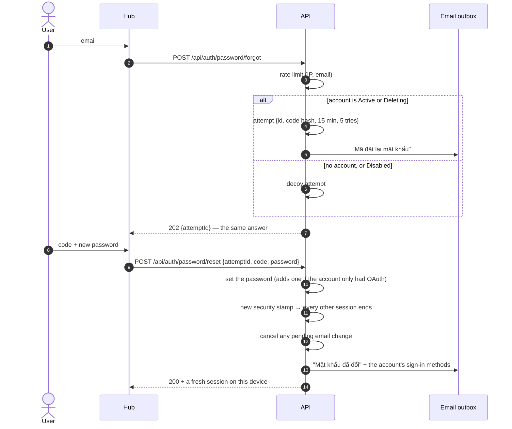

### 3.6 Đăng nhập bằng OAuth

Chỉ ở prod (D-04). Cùng luồng cho Google, GitHub, OIDC chung.

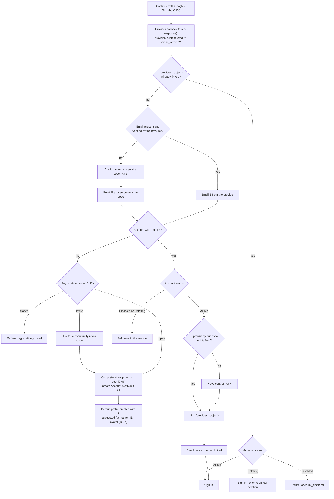

Callback dùng `response_mode=query`: `SameOriginGuard` chặn POST từ origin khác vào `/api`, nên `form_post` mặc định
của OpenID Connect sẽ bị chặn (D-04).

### 3.7 Chứng minh quyền trước khi liên kết

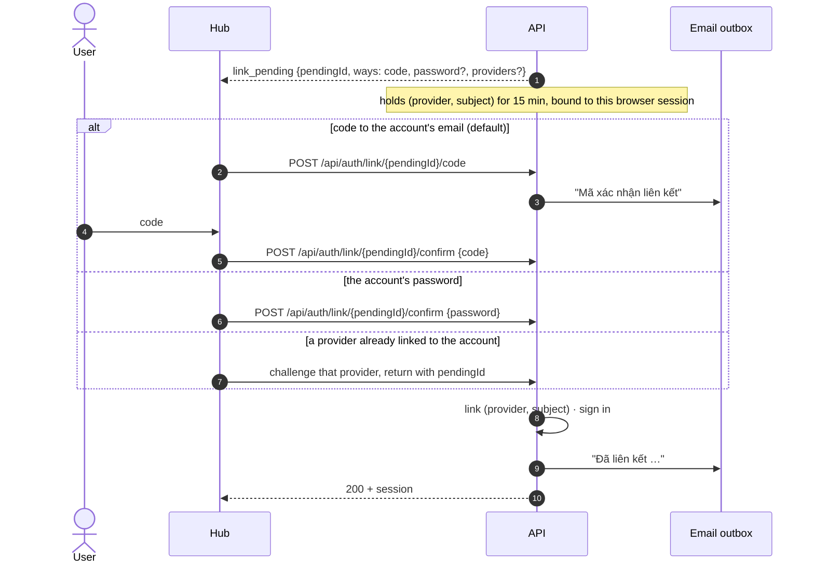

### 3.8 Quản lý cách đăng nhập

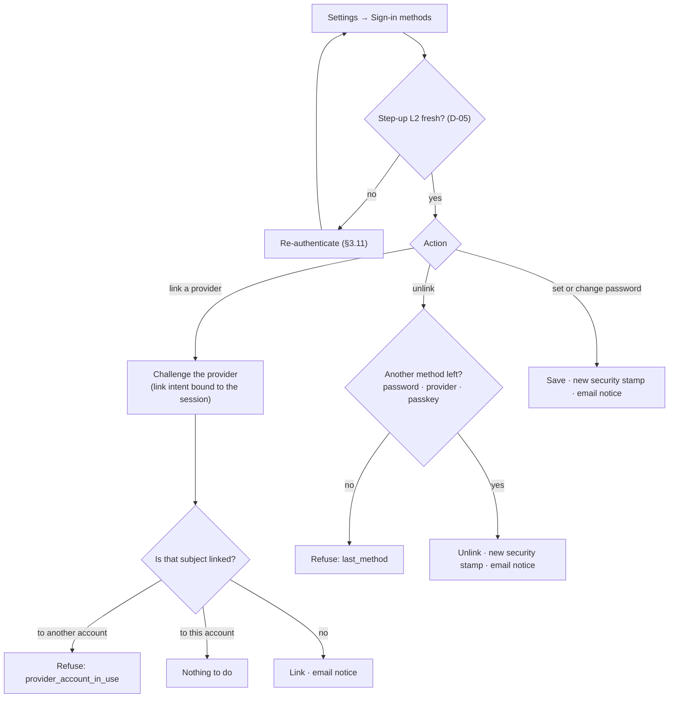

### 3.9 Đổi email

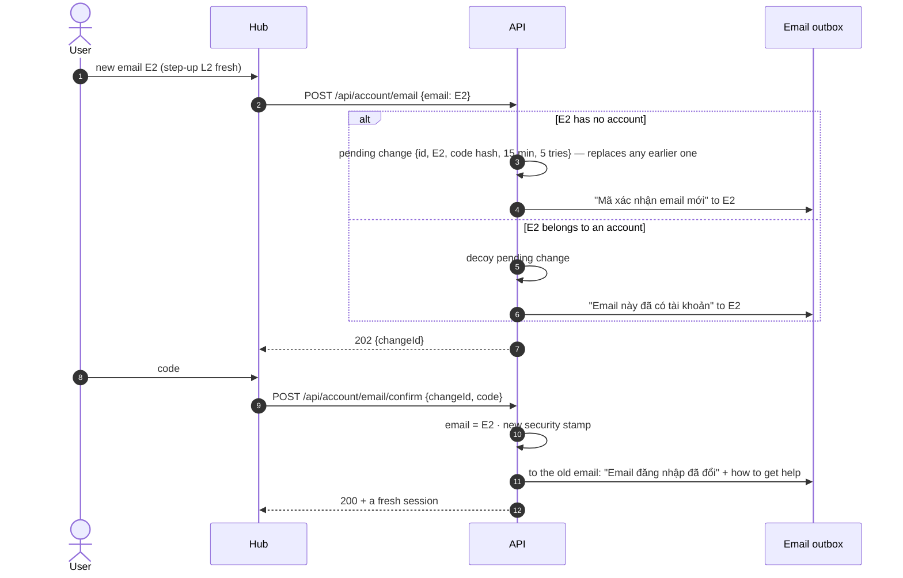

Đặt lại mật khẩu (§3.5) huỷ mọi yêu cầu đổi email đang chờ.

### 3.10 Phiên đăng nhập

| Luật | Giá trị |
|---|---|
| Cookie | `tohe.session`, 90 ngày, gia hạn khi dùng (như nay); HttpOnly; `SameSite=Lax`; `Secure` theo URL công khai (E-03) |
| Kiểm lại security stamp | mỗi 5 phút (mặc định của Identity là 30) — "đăng xuất mọi nơi" có hiệu lực trong tối đa 5 phút |
| Security stamp đổi khi | đặt/đổi/reset mật khẩu · đổi email · gỡ liên kết · admin khoá account · bấm "Đăng xuất mọi thiết bị" |
| Trong cookie | hồ sơ đang chơi, hạn mở khoá L1 và L2 — như parent gate hôm nay |

### 3.11 Xác thực lại

*(D-05)*

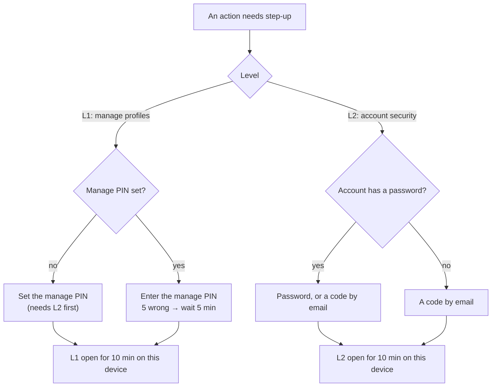

L2 dùng cho: đổi email, đặt/đổi mật khẩu, liên kết/gỡ liên kết, xoá account, đặt/đổi mã quản lý, thao tác nhạy cảm
của admin (admin còn cần 2FA — D-07).

### 3.12 Hồ sơ trên một thiết bị

*(D-01, D-17)* — account luôn có ít nhất một hồ sơ: hồ sơ mặc định ra đời cùng account (§3.2,
§3.6) và không xoá được hồ sơ cuối cùng.

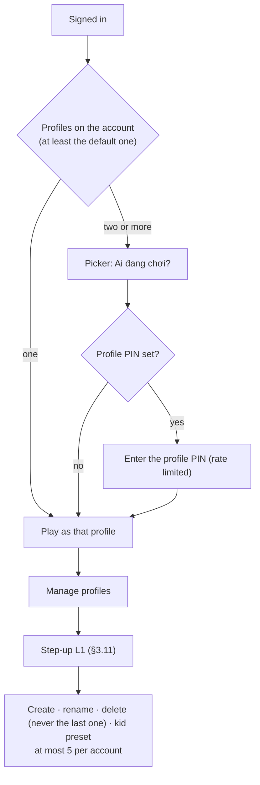

### 3.13 Admin đầu tiên

*(D-08)*

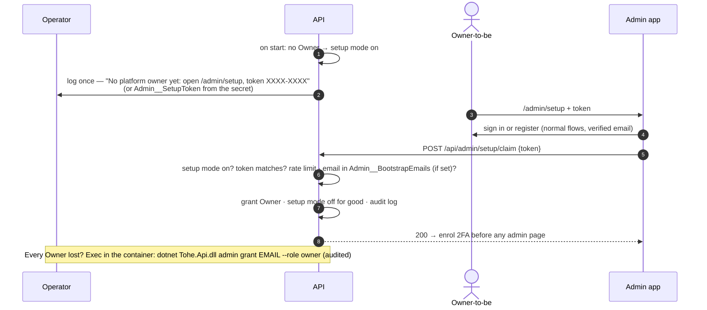

### 3.14 Xoá account

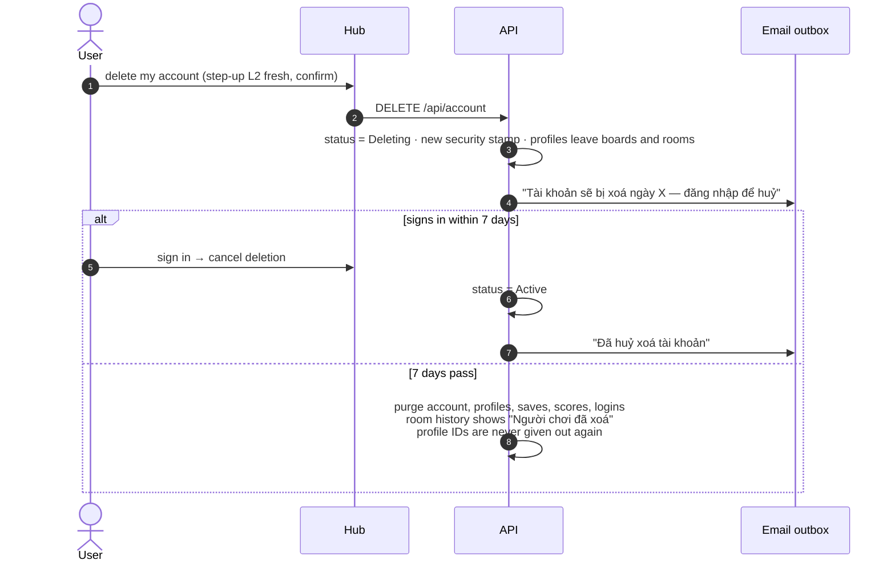

### 3.15 Mời đích danh bằng ID

*(D-17)*

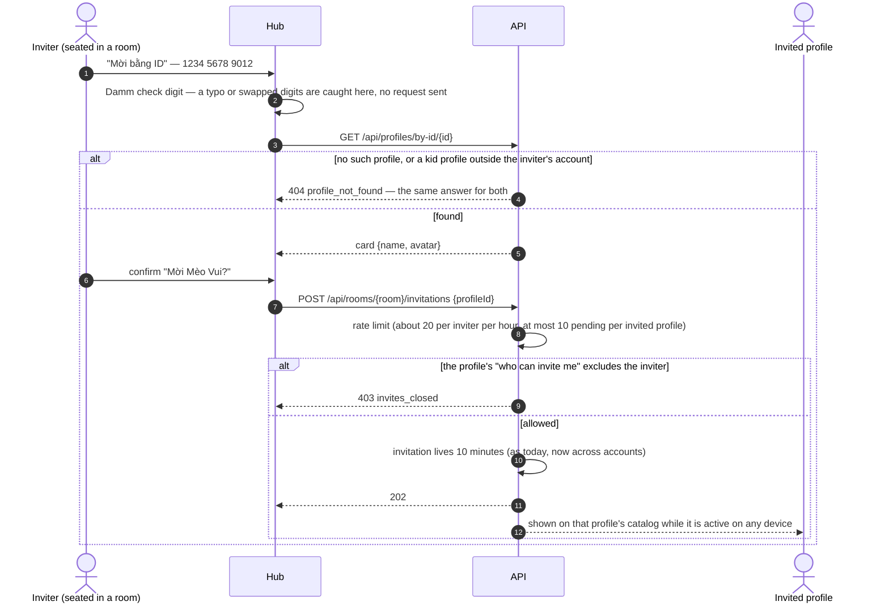

"Ai được mời tôi" của mỗi hồ sơ: mọi người · người từng chơi cùng · chỉ trong account (mặc định của mẫu hồ sơ trẻ em).

## 4. Engine độ tin

*(D-16 — sơ đồ trạng thái và đường đi của một kết quả nằm trong [D-16](items/D-16-integrity-engine.md))*

| Mức | Bằng chứng | Bảng nhận |
|---|---|---|
| `reported` | Chỉ có con số client gửi | Trong account |
| `checked` | Qua luật hợp lý theo giờ server | Trong account; cộng đồng với game chưa có replay, nhãn "chưa xác minh" (D-16 Q4) |
| `verified` | Ván do server điều khiển, hoặc replay bằng seed server khớp điểm | Mọi bảng |
| `held` | Một tín hiệu bắn — chờ admin; chính hồ sơ đó thấy "Đang được xem xét" | Không bảng công khai nào |
| `rejected` | Bằng chứng cứng là sai, hoặc admin quyết | Không đâu cả |

Ba luật cứng: máy chỉ được *ẩn*, người mới *phạt*; mức tin đi theo bằng chứng, không theo người; mọi quyết định có
nhật ký kèm phiên bản luật và đảo ngược được. Verifier v1: `RoomVerifier`, `ReplayVerifier` (Ghép Khối — D-10, nếu
owner chọn ở D-16 Q2). Tín hiệu v1: `Bounds`, `PersonalJump`, `Rate`, `Farming` (ít nhất 2 người thật — D-11).

## 5. Còn mở

| Câu hỏi | Item |
|---|---|
| Games origin trên domain riêng | [D-13](items/D-13-games-origin-domain.md) (proposed: B) |
| Thời hạn xoá account theo văn bản luật | [E-07](items/E-07-privacy-deletion-moderation.md) Q7 — tới khi biết, admin xoá (ADR 0038) |

## 6. Rủi ro chưa có lời giải

- **Mã rơi vào thư rác** → không ai đăng ký được. Dùng domain đã xác minh ở Resend; thử với Gmail, Outlook và Yahoo
  trước khi mở public (E-10).
- **OAuth chạy thật lần đầu ở prod** (D-04) → test bằng scheme giả và mock server, rồi owner thử trên prod khi đăng ký
  còn `closed`.
- **Dữ liệu gia đình khi chuyển mô hình** (E-01) → chạy thử trên bản dump UAT khôi phục vào DB dev trước.
- **Tên phản cảm, hoặc mạo danh bằng cùng một tên** (tên không duy nhất) → tên dành riêng + bộ lọc + admin đổi tên;
  thẻ hồ sơ luôn có avatar và ID; lời mời luôn hỏi xác nhận kèm thẻ (D-17, E-07).
- **Dò ID để làm phiền** → ID ngẫu nhiên, rate limit lời mời, "ai được mời tôi", hồ sơ trẻ em trả "không tìm thấy" (D-17).
- **Engine bắt nhầm người thật** → luật bảo thủ, nghi ngờ chỉ dẫn tới `held`, mọi quyết định đảo ngược được (D-16).
- **Một API instance** → mỗi lần deploy gián đoạn vài giây; phòng chơi dựng lại từ PostgreSQL (ADR 0016) — chấp nhận.
- **Đăng ký hàng loạt bằng bot** → rate limit theo IP và email; Turnstile tuỳ chọn (E-09).
- **Pháp lý về dữ liệu trẻ em** → D-06 và E-07; owner kiểm tra, agent không tư vấn pháp lý.
