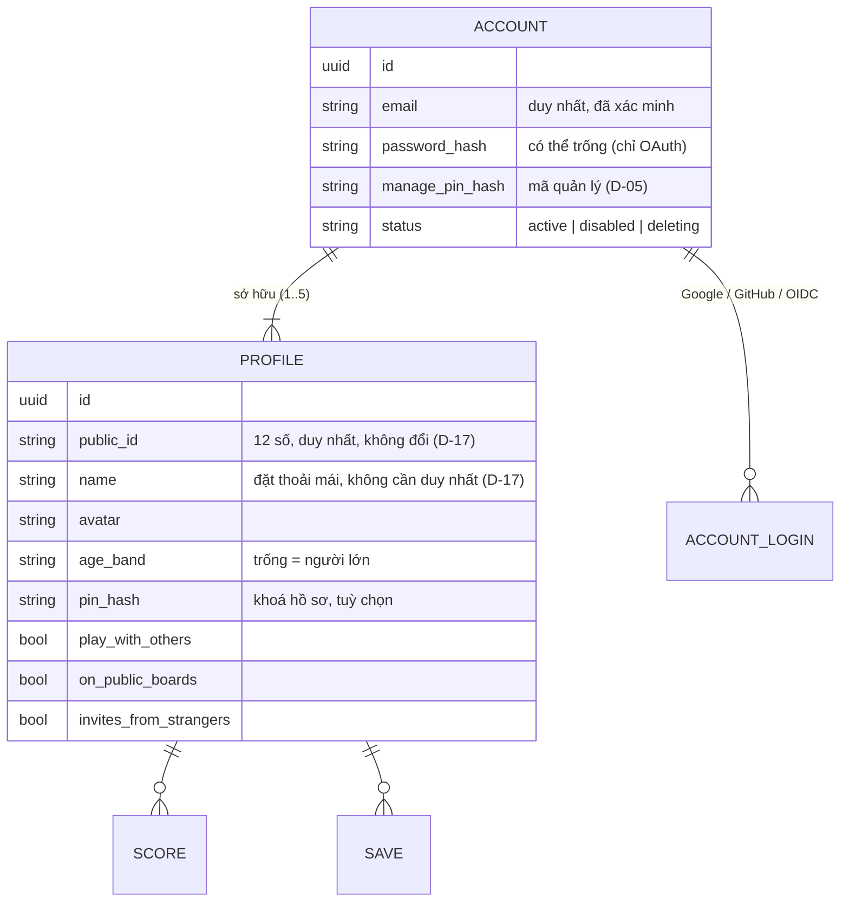

# D-01 — Người chơi là gì: một account có nhiều hồ sơ

- Status: **decided** (2026-10-17, chat) — riêng tên và định danh của hồ sơ chuyển sang [D-17](D-17-profile-name-and-id.md)
- Kind: decision
- Blocks: D-05, D-09, D-11, D-17, E-01, E-07 · Blocked by: —
- Decided: owner, 2026-10-17, chat — xem *Decision*

## Vì sao cần chốt

Đây là mô hình dữ liệu gốc của identity. Nó quyết định ai sở hữu save/điểm/ghế trong phòng, cách bảo vệ trẻ em,
bảng xếp hạng hiển thị ai (D-09), kiểm duyệt tên (E-07), và cách chuyển dữ liệu UAT (E-01).

## Hiện trạng (từ code)

- `Account : IdentityUser<Guid>` có `DisplayName`, `HouseholdId` (`services/api/src/Tohe.Api/Modules/Identity/Account.cs:8-17`);
  đăng nhập bằng username + mật khẩu (ADR 0011).
- `Household` gom các adult và các `Profile`; có mã mời cho adult thứ hai và công tắc `TelemetryEnabled`
  (`Modules/Identity/Household.cs`).
- `Profile` là người chơi: `Kind` Adult|Child, `AgeBand`, `PinHash`, `PlayWithOthers`, `AccountId` (chỉ adult).
  **Save, điểm, ghế trong phòng đều gắn `ProfileId`** — đây là phần nên giữ nguyên.
- Household lan ra ngoài Identity ở 4 chỗ: bàn chỉ-trong-nhà (`Modules/Rooms/RoomActor.cs:210-213`), luật trẻ em chơi
  với nhà khác (`RoomActor.cs:216`), bảng điểm theo household (`Modules/Rooms/RoomStats.cs:61`,
  `Modules/Progress/ProgressModule.cs:191`), công tắc telemetry. Hub có 21 file nhắc household.
- Quản lý household cần *parent gate*: nhập lại mật khẩu, mở khoá 10 phút (`docs/architecture/identity.md`, bảng Rules).
- Hôm nay **không có tên công khai duy nhất** cho người chơi: tên hồ sơ là chữ tự do, chỉ có nghĩa trong một nhà.

## Phương án

### A — Ý owner: account (đăng nhập) sở hữu nhiều hồ sơ (người chơi)

Bản đầu: mỗi hồ sơ có username duy nhất; owner đổi sau đó thành tên đặt thoải mái + ID để mời đích danh (D-17).

Account là thứ đăng nhập (email, mật khẩu, OAuth — D-02). Hồ sơ là người chơi trong hệ sinh thái: tên, ID, avatar,
điểm, ghế trong phòng. Chủ account tạo và cấu hình hồ sơ sau một lớp xác thực lại. "Trẻ em" không còn là một loại
tài khoản, mà là **một hồ sơ có cài đặt hạn chế**.

- Được: một khái niệm sở hữu duy nhất (account → hồ sơ), không cần bảng gia đình hay quan hệ giám hộ; khớp code
  hiện tại (household ≈ account, profile giữ nguyên, parent gate ≈ xác thực lại); định danh của hồ sơ mở đường cho
  mời đích danh, trang hồ sơ, bảng xếp hạng, bạn bè sau này. Chuyện pháp lý gọn hơn: trẻ em không tự đăng ký, người
  lớn tạo hồ sơ cho con.
- Mất: hai bố mẹ có hai account thì không cùng quản lý được hồ sơ của con (v1: dùng chung account của một người
  trên máy gia đình; "đồng sở hữu" làm sau).
- Rủi ro: một người nhiều hồ sơ → chiếm bảng xếp hạng, né lệnh cấm. Chặn bằng giới hạn số hồ sơ, cấm ở cấp account,
  và bảng công khai chỉ nhận kết quả đã xác minh (D-09).

Đây là cách Netflix làm với hồ sơ (nhiều hồ sơ dưới một lần đăng nhập, khoá hồ sơ bằng PIN, đặt PIN lần đầu phải
nhập mật khẩu account); phần định danh thì như friend code của Nintendo — tên tự do + mã số ([R-04](../research/R-04-profiles-handles.md), D-17).

### B — Đề xuất trước đây của agent: Family tùy chọn

User 1–1 hồ sơ của chính mình + nhóm Family tùy chọn có người giám hộ và hồ sơ trẻ em. Thêm một thực thể và một quan
hệ giám hộ để giải đúng bài toán mà A giải bằng cài đặt hồ sơ. **Agent rút lại B: A đơn giản hơn và mở hơn.**

### C — Mỗi người một account, không có hồ sơ con

Đơn giản nhất, nhưng trẻ em phải có email và tự đăng ký — vướng cả UX lẫn pháp lý (D-06).

## Đề xuất của agent: A, với 7 bổ sung

1. ~~**Hai tên cho mỗi hồ sơ** (`@handle` duy nhất + tên hiển thị tự do).~~ **Thay bằng [D-17](D-17-profile-name-and-id.md):**
   owner muốn tên "đặt thoải mái tý cho vui" và một ID `xxxx xxxx xxxx` để mời đích danh. Định danh hồ sơ không bao
   giờ là thông tin đăng nhập (đăng nhập luôn bằng account — D-02).
2. ~~**Luật handle** (chữ thường, 3–20 ký tự, đổi 30 ngày một lần).~~ **Thay bằng D-17.**
3. **Giới hạn hồ sơ mỗi account**, mặc định 5, admin chỉnh được.
4. **Hai mức xác thực lại** (chi tiết ở [D-05](D-05-step-up.md)). Quản lý hồ sơ dùng *mã quản lý* (PIN của chủ
   account) — đúng "1 lớp auth lại khi config profile", và chạy được cả với account chỉ có Google. Thao tác bảo mật
   account (email, mật khẩu, liên kết, xoá) cần xác thực lại thật.
5. **Cài đặt của từng hồ sơ:** avatar, tên, PIN khoá hồ sơ, độ tuổi (lọc game), chơi với người ngoài account, hiện
   trên bảng công khai, ai được mời tôi (D-17). Mẫu **"Hồ sơ trẻ em"** bật sẵn các hạn chế (không chơi với người
   ngoài, ẩn khỏi bảng công khai, chỉ nhận lời mời trong account, người ngoài tra ID thì "không tìm thấy"); chủ
   account chỉnh từng mục.
6. **Account chỉ có một hồ sơ thì bỏ qua màn "Ai đang chơi?"**; hồ sơ mặc định được tạo cùng account (owner: "1
   account tạo ra là có 1 profile mặc định r á"), và không xoá được hồ sơ cuối cùng.
7. **Kiểm duyệt hai cấp:** hồ sơ (đổi tên, ẩn khỏi bảng, chặn vào phòng) và account (khoá — mọi hồ sơ cùng mất quyền).

Mô hình dữ liệu (phác thảo):

Hệ quả cho chỗ khác (để spec ở T2):

| Hôm nay | Sau D-01 |
|---|---|
| `Household` + mã mời adult thứ hai | Bỏ. Account là nhóm hồ sơ; mỗi người lớn có account riêng |
| Bàn "chỉ trong nhà" (`HouseholdOnly`) | Bàn "chỉ hồ sơ trong account", cộng phòng riêng chỉ vào bằng mã |
| Lời mời trong household | Mời hồ sơ trong account; mời đích danh bằng ID khi hồ sơ kia cho phép (D-17) |
| Trẻ em chơi với nhà khác cần bật công tắc | Cài đặt "chơi với người ngoài account" của hồ sơ |
| Bảng điểm household | Bảng "trong account" + các bảng của D-09 |
| Công tắc telemetry của household | Công tắc của account |

Để sau (mỗi việc cần một quyết định riêng khi có nhu cầu): ghim thiết bị vào một hồ sơ ("máy của bé"), chuyển hồ sơ
sang account khác (con lớn lên), đồng sở hữu hồ sơ giữa hai account, hồ sơ tự đăng nhập.

## Câu hỏi cho owner (đã trả lời 2026-10-17)

- **Q1** Giới hạn mặc định 5 hồ sơ mỗi account — *ổn*.
- **Q2** Luật handle — *đổi hướng*: tên đặt thoải mái + ID, xem D-17.
- **Q3** Quản lý hồ sơ dùng *mã quản lý* — *ổn* (D-05).
- **Q4** Hai bố mẹ dùng chung account trên máy gia đình, đồng sở hữu làm sau — *ổn*.
- **Q5** Mẫu "Hồ sơ trẻ em" ẩn khỏi bảng công khai, không chơi với người lạ — *ổn*.

## Decision

**owner** (2026-10-17, chat): "ok on, ma 1.1 toi dong y username cho đặt thoải mái tý cho vui haha, mà ta thêm định
danh cho profile thêm bởi id xxxx xxxx xxxx được k, để mời đích dang profile luôn chẳng hạn (1 account tạo ra là có 1
profile mặc định r á) còn lại ôn".

Đã chốt: phương án A — account sở hữu nhiều hồ sơ (tối đa 5), có sẵn hồ sơ mặc định, trẻ em là hồ sơ với mẫu cài đặt
hạn chế, quản lý hồ sơ qua mã quản lý, kiểm duyệt hai cấp, hai bố mẹ dùng chung account ở v1. Tên và định danh: D-17.

## Discussion

**owner** (2026-10-17, chat): đề xuất mô hình A — "không khái niệm như hiện tại là parent - child mà là 1 account sẽ
có thể tạo nhìu profile chơi … có 1 lóp auth lại khi config profile … các profile sẽ cần có username unique trên
system". Nhu cầu chính: "đa số sẽ là user - user (1 user 1 account r)".

**agent** (2026-10-17): đồng ý A và rút lại B (Family). A giữ nguyên lõi "người chơi = Profile" của code hiện tại,
nên đổi ít hơn B. Thêm 7 bổ sung ở trên; quan trọng nhất là tách handle khỏi tên hiển thị, và hai mức xác thực lại
(account chỉ có OAuth không có mật khẩu để nhập lại).
