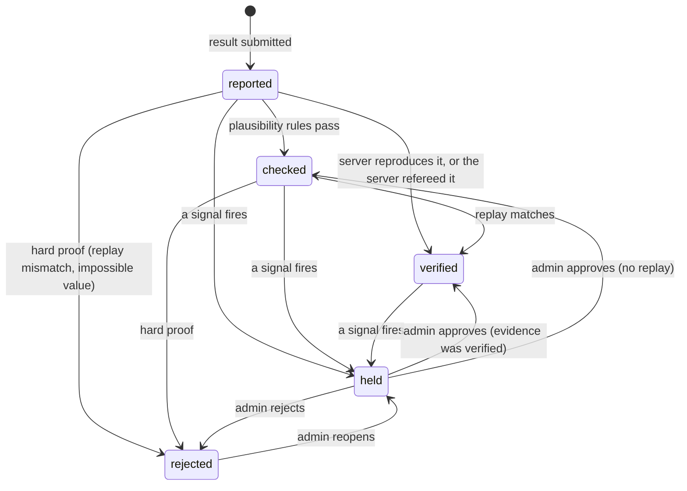
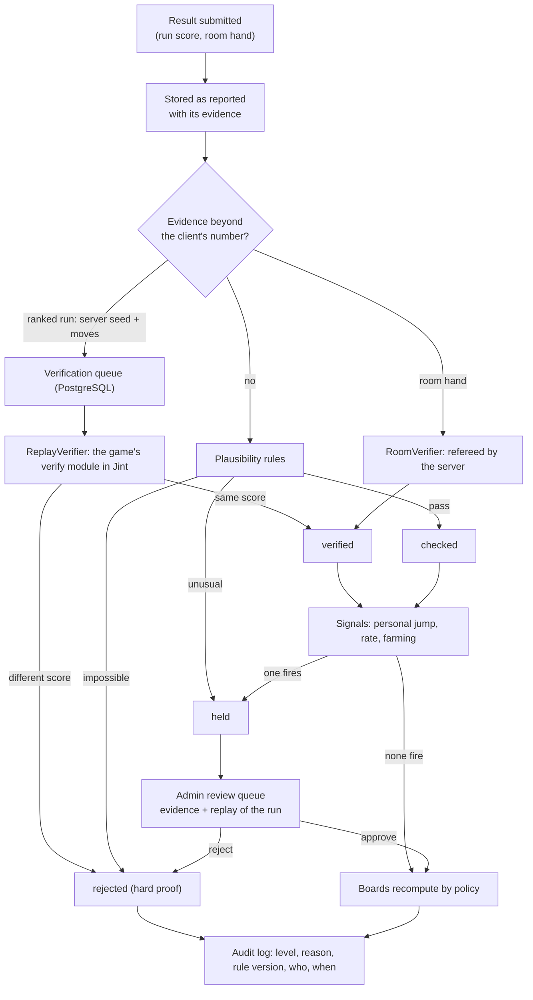

# D-16 — Engine độ tin: một nơi quyết định mỗi kết quả đáng tin tới đâu

- Status: **decided** (2026-10-17/18, chat) — Q1–Q4 như đề xuất
- Kind: decision — module API mới (ADR khi graduate)
- Blocks: D-10 (verifier đầu tiên), D-11 (luật phòng), T5 build, D-07 (hàng đợi xem xét) · Blocked by: D-09
- Decided: owner, 2026-10-17, chat — xem *Decision*

## Vì sao cần chốt

D-09 chia bảng theo độ tin. Owner muốn biến nó thành năng lực của nền tảng: "nhất là phát hiện bảng xếp về uy tín rất
tốt, chúng ta nên có 1 engine xịn để giúp nó (cố hết sức th, chứ tinh thần mọi người cũng legit nha haha, tương lai
enhance thêm từ đây)". Một engine dùng chung thì bảng xếp hạng hôm nay — và thử thách hôm nay, thành tựu, giải đấu,
rating sau này — không ai phải tự làm lại phần độ tin.

## Hiện trạng

- Điểm game một người do client tự báo, server không kiểm (`services/api/src/Tohe.Api/Modules/Progress/ProgressModule.cs:124-178`).
- Kết quả ván phòng do server quyết (luật trong Jint — ADR 0016); ván đã xong replay được bằng module luật của game
  (ADR 0017).
- Chưa có admin, chưa có audit log (D-07 sẽ có).
- Nguyên tắc rút từ Steam, Google Play, Lichess, Trackmania, Open Hexagon: [R-06](../research/R-06-integrity-engines.md).

## Phương án

### A — Engine là một module của nền tảng, với verifier và tín hiệu cắm thêm (agent đề xuất)
Mô tả bên dưới. Chi phí: một module mới (cỡ M–L) cộng thay đổi contract của D-10 cho verifier đầu tiên.

### B — Kiểm tra rải rác trong `Progress` và `Rooms`
Rẻ hôm nay, nhưng mỗi tính năng sau (thử thách hôm nay, thành tựu, giải đấu) lại tự làm phần độ tin; không có hàng đợi
xem xét chung, không có nhật ký chung.

### C — Dịch vụ chống gian lận bên ngoài
Không thấy dịch vụ nào hợp với game web nhỏ chạy trong iframe; thêm phụ thuộc ngoài và gửi dữ liệu người chơi ra ngoài.

## Đề xuất của agent: A

### Khái niệm

- **Kết quả:** một lời khẳng định về thành tích của một hồ sơ — điểm của một run, kết quả của một ván phòng; sau này:
  thử thách hôm nay, thành tựu, giải đấu.
- **Bằng chứng:** những gì server có trong tay — chỉ con số client gửi · seed server cấp + giờ server + chuỗi nước đi ·
  nhật ký ván do chính server điều khiển.
- **Mức tin** — đi theo bằng chứng, không theo người:

| Mức | Nghĩa | Lên bảng nào |
|---|---|---|
| `reported` | Chỉ có lời khai của client | Trong account |
| `checked` | Qua các luật hợp lý (giới hạn, tốc độ, thời lượng theo giờ server) | Trong account (cộng đồng — nếu owner chọn ở Q4) |
| `verified` | Server tự tái tạo được (replay khớp) hoặc tự quyết (ván phòng) | Mọi bảng |
| `held` | Có tín hiệu nghi ngờ — chờ admin | Chỉ chính hồ sơ đó thấy, kèm "Đang được xem xét" |
| `rejected` | Bằng chứng cứng là sai (replay lệch, vượt giới hạn không thể), hoặc admin quyết | Không đâu cả |

### Đường đi của một kết quả

### Thành phần cắm thêm

- **Verifier** — mỗi loại bằng chứng một verifier: `RoomVerifier` (ván do server quyết → `verified` ngay),
  `ReplayVerifier` (D-10: chạy module xác minh của game trong Jint, có giới hạn), sau này thêm loại khác.
- **Tín hiệu** — mỗi tín hiệu một luật nhỏ, trả về "ổn / bất thường / không thể" kèm lý do:
  - `Bounds` — giới hạn mà game tự khai: điểm tối đa mỗi nước, số nước mỗi giây theo giờ server, thời lượng tối thiểu.
  - `PersonalJump` — "không giống chính bạn": vượt xa lịch sử của hồ sơ đó (kiểu Kaladin của Lichess, nhưng bằng luật).
  - `Rate` — nộp kết quả dày bất thường.
  - `Farming` — ván phòng có ít hơn 2 người thật (D-11).
  - Sau này: `Population` ("không giống người": vượt xa phân bố của cả game), `Timing` (nhịp giữa các nước),
    `Collusion` (cặp người chơi lặp lại bất thường trong phòng), uy tín theo account.
- **Mỗi quyết định lưu** mức tin, lý do, tín hiệu nào, **phiên bản luật**, ai, khi nào → đảo ngược được, và tính lại
  được khi luật đổi.

### Ba luật cứng của engine

1. **Tự động chỉ được ẩn, không được phạt.** Chỉ bằng chứng cứng mới dẫn tới `rejected`; mọi nghi ngờ khác là `held`.
   Khoá account luôn là quyết định của người.
2. **Mức tin đi theo bằng chứng.** Không có "người chơi uy tín được miễn kiểm"; uy tín (sau này) chỉ đổi *mức độ soi*,
   không đổi *mức tin*.
3. **Minh bạch với người chơi** — vì phần lớn là người thật: run của mình hiện "Đang xác minh…", "Đã xác minh ✓",
   "Đang được xem xét". Chế độ xử lý âm thầm kiểu Lichess để dành, nếu gặp kẻ gian lì.

### Admin (nối với D-07)

Hàng đợi **Chờ xem xét**: điểm, lịch sử của hồ sơ, tín hiệu nào đã bắn, và **xem lại run bằng chính game** (chế độ
replay của game, như ADR 0017 làm cho ván phòng). Duyệt → `verified` hoặc `checked`; Từ chối → `rejected` (tuỳ chọn
khoá account); mở lại một quyết định cũ. Tất cả vào audit log.

### Nằm ở đâu

Module API mới `Integrity` (schema riêng). `Progress` và `Rooms` nộp kết quả vào; bảng xếp hạng đọc qua chính sách của
engine. Hàng đợi xác minh là bảng PostgreSQL + một `BackgroundService` — đủ với một API instance (ADR 0016), không cần
Redis.

### v1 (trước ra mắt) và sau

| v1 | Sau, nâng cấp từ đây |
|---|---|
| Mức tin, chính sách bảng, audit, đảo ngược | `Population`, `Timing`, `Collusion`, uy tín theo account |
| `RoomVerifier` + luật ít nhất 2 người thật | Chế độ âm thầm; kháng nghị ngay trong app |
| `Bounds`, `PersonalJump`, `Rate` → `held` | Rating OpenSkill trên kết quả `verified` (D-11) |
| `ReplayVerifier` cho Ghép Khối — nếu owner chọn ở Q2 | Thử thách hôm nay, thành tựu, giải đấu dùng chung engine |
| Hàng đợi xem xét + xem lại run trong admin | Thêm game vào `ReplayVerifier` |

## Câu hỏi cho owner

- **Q1** Engine là một module của nền tảng (A) với phạm vi v1 như bảng trên — *đồng ý* (2026-10-17).
- **Q2** Đưa xác minh replay của Ghép Khối (D-10) vào v1, trước ra mắt — *có* (2026-10-17).
- **Q3** Người chơi thấy "Đang được xem xét" (minh bạch) thay vì xử lý âm thầm — *đồng ý* (2026-10-17).
- **Q4** Bảng cộng đồng: chỉ `verified` như D-09, hay nhận cả `checked`? — *theo đề xuất bên dưới* (2026-10-18).

### Q4 — đề xuất của agent (2026-10-17)

Hai mức `checked` và `verified` khác nhau thế này: `checked` nghĩa là điểm *trông hợp lý* (không vượt giới hạn, không
nhanh hơn người thật, thời lượng theo giờ server khớp) nhưng server **không tự chơi lại** được; `verified` nghĩa là
server **tự chơi lại ra đúng điểm đó** (hoặc chính server điều khiển ván phòng).

Sau v1, trong các game một người đang có (`games/merge-block`, `games/tap-merge`; Lấp Ô mới có SPEC), chỉ Ghép Khối
có replay. Nếu bảng cộng đồng chỉ nhận `verified`, cộng đồng chỉ có bảng cho Ghép Khối và các game phòng; Chạm Ghép —
và mọi game một người mới — chưa có bảng cộng đồng cho tới khi có replay.

Đề xuất: **mỗi game một chính sách — game đã có replay thì bảng cộng đồng chỉ nhận `verified`; game chưa có replay thì
nhận `checked`, kèm nhãn nhỏ "chưa xác minh"**. Bảng toàn server vẫn chỉ nhận `verified`. Lý do: cộng đồng là nhóm nhỏ
vào bằng mã mời, người trong nhóm biết nhau (đúng tinh thần "mọi người legit"); tín hiệu của engine vẫn ẩn điểm lạ chờ
admin. Khi một game có replay, bảng cộng đồng của nó tự chuyển sang chỉ nhận `verified`. Chọn đề xuất này thì D-09
được sửa một dòng (bảng cộng đồng không còn "chỉ `verified`" cho mọi game).

## Decision

**owner** (2026-10-17, chat): "ok ngu de xuat cua ban on nba" (ok, những đề xuất của bạn ổn nha) — chấp nhận Q1–Q3
theo đề xuất. Q4 chưa có đề xuất cụ thể lúc owner trả lời, nên còn mở.

**owner** (2026-10-18, chat): "ok rồi đó, theo đề xuất bạn có thể impl toàn bộ giúp tôi k" — Q4 theo đề xuất: mỗi game
một chính sách; game chưa có replay thì bảng cộng đồng nhận `checked` kèm nhãn "chưa xác minh"; bảng toàn server chỉ
nhận `verified`. D-09 sửa đúng một dòng tương ứng.

## Discussion

**owner** (2026-10-17, chat): "nhất là phát hiện bảng xếp về uy tín rất tốt, chúng ta nên có 1 engine xịn để giúp nó
(cố hết sức th, chứ tinh thần mọi người cũng legit nha haha, tương lai enhance thêm từ đây)".

**agent** (2026-10-17): "xịn" ở đây nghĩa là ba điều — mức tin đi theo bằng chứng, máy chỉ ẩn còn người mới phạt, và
mọi thứ cắm thêm được để nâng cấp. Tinh thần "mọi người legit" giữ engine bảo thủ: ít bắt nhầm quan trọng hơn bắt hết.
