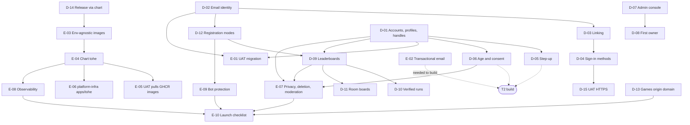

# Map — Public launch

Mọi item mục tiêu phụ thuộc vào, và cái nào chặn cái nào. Cạnh `A --> B` đọc là "quyết A trước B". Trạng thái nằm ở
bảng trong [PLAN.md](PLAN.md); trang này chỉ là hình dạng.

## Các track (làm song song được)

| Track | Gồm | Ghi chú |
|---|---|---|
| **T1 Release** | D-14 (E-03 → E-04 → E-05, E-06), D-15 | Đã decided toàn bộ phần cần làm — graduate được ngay |
| **T2 Identity & hồ sơ** | D-01, D-02, D-05, D-06, E-01 | Thay ADR 0004/0011; household chuyển thành account (D-01) |
| **T3 Email** | E-02 | T2 cần nó để gửi mã |
| **T4 OAuth & liên kết** | D-03, D-04 | OAuth chỉ chạy ở prod; test bằng scheme giả + mock server |
| **T5 Bảng xếp hạng** | D-09, D-10, D-11 | Thay cho "Family" của review trước: family đã tan vào D-01 |
| **T6 Admin** | D-07, D-08 (6a shell + module đọc dữ liệu có sẵn · 6b vai trò, admin đầu tiên, 2FA, audit · 6c người dùng, cài đặt đăng nhập, mã mời) | 6a bắt đầu được ngay |
| **T7 Sẵn sàng public** | D-12, D-13, E-07, E-09 | |
| **T8 Observability** | E-08 | Sau chart (ServiceMonitor) |
| **Ra mắt** | E-10 | Sau mọi thứ "phải có" |

## Phụ thuộc giữa các item

## Thứ tự làm (phase của việc xây, không phải của plan)

| Phase | Song song | Xong khi |
|---|---|---|
| **A — Chốt** | owner trả lời D-01, D-05, D-06, D-09…D-11, E-02 · agent bắt đầu T1 | brief được xác nhận; T2 đủ quyết định để spec |
| **B — Nền** | T1 (E-03 → E-04 → E-05; E-06 sau lần publish đầu) · T3 · spec rồi xây T2 · T6a | chart cài được lên kind và chạy trên UAT; đăng ký bằng email + hồ sơ @handle chạy trên UAT |
| **C — Mở rộng** | T4 · T6b · T5 bước 1–2 (bảng trong account, bảng tuần công khai của phòng) | Google/GitHub chạy trên prod lúc đăng ký còn đóng; tạo được admin đầu tiên |
| **D — Sẵn sàng public** | T6c · T7 · T8 · T5 bước 3 (bảng cộng đồng) | checklist public xanh; gia đình và bạn bè dùng UAT ổn định |
| **E — Ra mắt** | E-10 | một cộng đồng dùng thử trên prod |
| sau ra mắt | D-10 từng game; rating (D-11) | |

## Item

| ID | Câu hỏi / thay đổi | Mục tiêu cần nó vì | Chặn |
|---|---|---|---|
| D-01 | Một account nhiều hồ sơ, @handle duy nhất | Mô hình người chơi cho user-first | D-05, D-06, D-09, E-01, E-07 |
| D-02 | Email là định danh + bộ luồng chuẩn | Public cần khôi phục và liên kết | D-03, D-12, E-01 |
| D-03 | Luật liên kết | Không bị chiếm account qua OAuth | D-04 |
| D-04 | Cách đăng nhập v1, cấu hình hai lớp, OAuth ở prod | "bật tắt và config được" | D-15 |
| D-05 | Xác thực lại hai mức | "1 lớp auth lại khi config profile" cho cả account chỉ có OAuth | T2 |
| D-06 | Cổng tuổi, đồng ý điều khoản | Trẻ em tự đăng ký | E-07 |
| D-07 | Admin console | "quản lý nền tảng, monitor" | D-08 |
| D-08 | Admin đầu tiên | Cài mới an toàn trên URL public | — |
| D-09 | Bảng xếp hạng phân tầng theo độ tin | Bảng công khai không bị gian lận | D-10, D-11, E-07 |
| D-10 | Run đã xác minh (đổi contract) | Bảng công khai cho game một người | — |
| D-11 | Bảng và hạng của phòng | Bảng công khai cho phòng | — |
| D-12 | Chế độ đăng ký, mã mời cộng đồng | Mở dần cho "vài cộng đồng nhỏ" | D-09, E-09 |
| D-13 | Games origin trên domain riêng? | Game có thể do AI viết; passkey sau này | E-10 |
| D-14 | Release bằng chart riêng | Prod trên `platform-infra` | E-03…E-06 |
| D-15 | UAT có HTTPS? | PWA/passkey trên UAT | — |
| E-01 | Chuyển dữ liệu UAT | Gia đình không mất dữ liệu | — |
| E-02 | Email giao dịch | Mọi luồng gửi mã | T2 build |
| E-03…E-06 | Image, chart, UAT kéo image, `apps/tohe` | D-14 | E-08 |
| E-07 | Quyền riêng tư, xoá account, kiểm duyệt tên | Public | E-10 |
| E-08 | `/metrics`, ServiceMonitor, alert tối thiểu | Vận hành prod | E-10 |
| E-09 | Chống bot đăng ký (Turnstile, tuỳ chọn) | Public | E-10 |
| E-10 | Checklist ra mắt: restore thử, load test phòng, security review | Ra mắt | — |

## Đã cân nhắc và để ngoài

- **Redis, nhiều API instance, SignalR backplane** — ADR 0016 chốt một instance; không cần cho vài cộng đồng.
- **Hệ thống bạn bè** — handle (D-01) chừa đường; làm khi có nhu cầu.
- **Hồ sơ tự đăng nhập, đồng sở hữu hồ sơ, ghim thiết bị vào hồ sơ, chuyển hồ sơ sang account khác** — ghi ở D-01.
- **Passkey** — .NET 10 có sẵn; làm sau khi có HTTPS ở nơi cần thử (D-15).
- **Facebook, Zalo** — không thuộc v1; đường "provider không có email" của D-03 đã chừa sẵn.
- **UAT chạy bằng chart trên k3s homelab** — đổi ADR 0010; cân nhắc khi chart đã ổn.
- **Thử thách hôm nay (seed chung)** — khả năng mở ra sau D-10, không phải yêu cầu.
