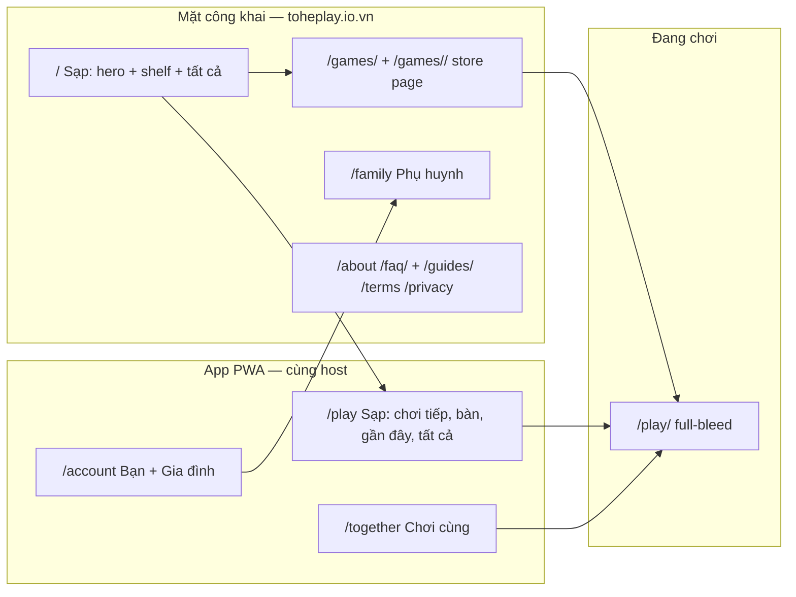
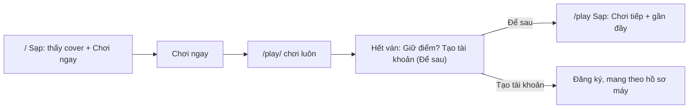
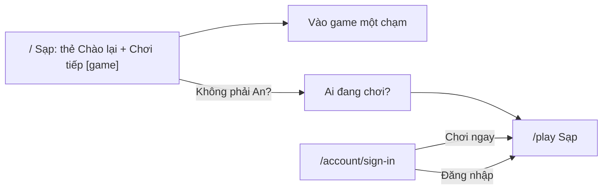
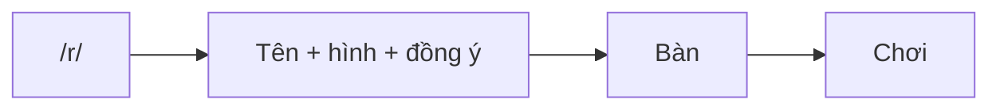
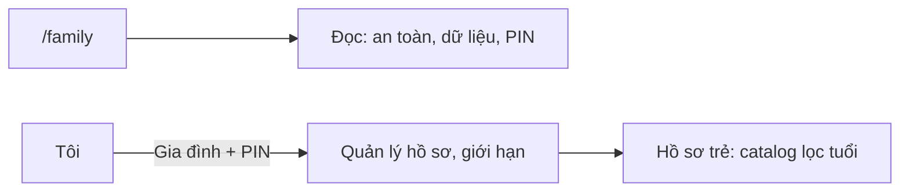

# Design — Bề mặt sản phẩm v2: sạp game cho 16+ (v1, đã chốt hướng)

Trang này **ghép** các quyết định thành một bức tranh. Nó không quyết gì: mỗi ý chỉ về item đã quyết. Ngày: 2026-10-31.

## Ngắn gọn: đã chốt tới đâu?

- **Định vị**: giữ Tò He + chất đồ chơi nặn tay; "sạp" là mặt tiền; 16+ mặc định, gia đình là lớp phụ (D-01).
- **Bề mặt**: home là sạp (D-02); catalog cover-first, search/tag, tab "Sạp" (D-03); trang game là store page (D-04);
  cửa giữ nhưng "Chơi ngay" trước + gợi ý đăng ký sau khi chơi (D-05); brand giấy/mực/gấc/nghệ/lá (D-06); gia đình
  trong `Tôi` + `/family` (D-07); ảnh screenshot + khung tạm (D-08).
- **Còn mở**: copy cuối, giá trị màu qua test tương phản, contract `coverUrl`, thứ tự PR và số đo. Không còn câu hỏi định
  vị nào chờ owner.

## 1. Bức tranh

- Một host, hai vùng: **Khám phá** (công khai, index) và **Chơi** (PWA, không index). Giữ ADR 0042/0046.
- `Sạp` là từ của mặt tiền; route vẫn `/play`, tab vẫn là một trong ba.
- Gia đình không có host riêng; chỉ có trang công khai `/family` và màn quản lý trong `Tôi`.

## 2. Các mảnh

| Mảnh | Làm gì | Chuẩn / tiền lệ | Ở đâu | Item |
|---|---|---|---|---|
| **Sạp công khai** | 5 giây hiểu, 10 giây chơi | Poki/Coolmath: cover + shelf; Duolingo: hero có hành động | `apps/web` `/` | D-02 |
| **Catalog** | Chọn game, chơi tiếp, lọc | CrazyGames/Miniblox: cover, shelf, search | `apps/hub` `/play` | D-03 |
| **Trang game** | Bán game bằng ảnh + facts | Poki game page, itch store page | `apps/web` `/games/<id>/` | D-04 |
| **Cửa** | Chơi ngay, đăng nhập, gợi ý sau | NN/g: không tường đăng nhập; Duolingo: hai nút | `apps/hub` `/account/sign-in` | D-05 |
| **Chơi cùng** | Tạo bàn, mã, link, bàn của bạn | Discord/Jackbox: link, không cần tài khoản | `apps/hub` `/together` | D-03 |
| **Bạn** | Hồ sơ, tiến độ, cài đặt, gia đình | GitHub/Duolingo: hồ sơ là nơi quay lại | `apps/hub` `/account` | D-05, D-07 |
| **Gia đình** | Hồ sơ trẻ, PIN, dữ liệu | YouTube Kids/Khan: người lớn mở đường | `apps/web` `/family`, hub `/account/family` | D-07 |
| **Brand** | Giấy/mực/gấc/nghệ/lá, viền mực, cover | Sạp chợ + đồ chơi nặn tay | tokens + components | D-06 |
| **Nội dung** | Cover 16:9, shots, hook, tag | Poki thumbnail guide | `games/<id>/page/`, API | D-08 |

## 3. Luồng chính

### 3.1 Người mới, điện thoại

- Không hỏi tên trước; hồ sơ máy có tên gợi ý, chip nói "Trên máy này".
- Gợi ý đăng ký chỉ sau khi đã có điểm; không chặn, không lặp lại 7 ngày nếu bỏ qua.

### 3.2 Người quay lại

- Trang công khai nhận ra máy đã chơi (ADR 0055), hiện tên + game, không phải banner chung.
- Cửa vẫn có, nhưng "Chơi ngay" là nút chính; người có tài khoản thấy "Đăng nhập" rõ.

### 3.3 Link bàn

- Link bàn không qua cửa; đây là đường vào nhanh nhất, giữ nguyên (ADR 0044).
- Nút "Vào chơi" dính đáy trên mobile; bớt chữ giải thích.

### 3.4 Phụ huynh

- Phụ huynh không phải đi qua "bé" khi chơi; họ tìm thấy phần quản lý trong `Tôi` hoặc footer.

## 4. Bố cục theo màn

| Màn | Điện thoại | Tablet | Máy tính |
|---|---|---|---|
| `/` | hero full-bleed + 2 cột card + shelf cuộn ngang | hero + list, 3 cột | 2/3 hero + 1/3 list, 4–5 cột |
| `/play` | chip + Chơi tiếp + 2 cột + bottom nav | rail + 3–4 cột | rail 240 + 4–6 cột + search |
| `/games/<id>/` | cover + info + shots 1 cột + nút dính đáy | 2 cột media/info | 2 cột, max 1200 |
| `/account/sign-in` | một cột, không nav, Chơi ngay to | thẻ 480 giữa | thẻ 480 giữa |
| `/account` | hồ sơ + tiến độ + cài đặt | 2 cột | 2 cột, max 1000 |
| `/together` | Tạo bàn + mã + danh sách | 2 cột | 2 cột |
| `/family` | một cột, chữ dễ đọc | 2 cột | 2 cột, max 900 |

Quy tắc: max 1440; card không kéo giãn để lấp hàng; cover 16:9; safe area; 44px; dark mode.

## 5. Nội dung

- **Game card**: cover, tên, hook ≤ 60 ký tự, tag + thời lượng, nút Chơi. Không tuổi.
- **Game page**: cover, hook, facts chip, 3 shots, cách chơi 3 bullet, trò khác. Tuổi ở "Phù hợp".
- **Home**: "Sạp hôm nay", "Đang mở", "Chơi tiếp", "Mới tuần này", "Rủ bạn qua một link", "Tất cả trò chơi".
- **Auth**: "Chơi không cần tài khoản. Đăng nhập nếu muốn giữ điểm."
- **Family**: "Bé chơi an toàn: không quảng cáo, không chat với người lạ, bố mẹ giữ PIN."
- **Bỏ**: "cả nhà", "bé", "bố mẹ" ở mặt tiền; "Từ 3 tuổi" trên card; "Chào mừng đến Tò He"; "Sẵn sàng chơi?".

## 6. Còn mở (triển khai)

| Việc | Vì sao chưa chốt | Ai/ở đâu |
|---|---|---|
| Giá trị màu cuối | Phải qua `contrast.test.ts` ở light/dark | D-06, PR token |
| `coverUrl` | Convention hay contract change? | D-08, spike API |
| Copy vi/en | Cần viết và owner đọc | D-01…D-05 |
| Tab "Sạp" tiếng Anh | "Shelf" hay "Games"? | D-03 |
| Thứ tự PR | P0 trước hay brand trước? | PLAN graduation |
| Số đo | Chưa có phễu theo phiên | E-05 |

## 7. Rủi ro

- **Mất người dùng gia đình**: giữ `/family`, PIN, promise; copy nói rõ "vẫn an toàn cho bé".
- **5 game không đủ giữ 16+**: bề mặt không sửa game yếu; cần roadmap game song song.
- **Ảnh bìa tạm trông tệ**: khung tạm phải thống nhất; chụp screenshot đẹp, crop đúng; thay dần.
- **SEO**: `/` mất bài giới thiệu dài; bù `/about`, `/family`, `/games/`, JSON-LD.
- **Contract/API**: `coverUrl` có thể kéo theo ADR + conformance; làm spike trước.
- **Dark mode ảnh sáng**: viền + giảm nhẹ; kiểm axe.

## 8. Liên kết

- [brief.md](brief.md) · [PLAN.md](PLAN.md) · [map.md](map.md)
- [R-01](research/R-01-current-surface-review.md) · [R-02](research/R-02-peers-16plus.md) · [R-03](research/R-03-direction.md)
- [prototype/home.html](prototype/home.html) · [prototype/game.html](prototype/game.html) · [prototype/door.html](prototype/door.html)
