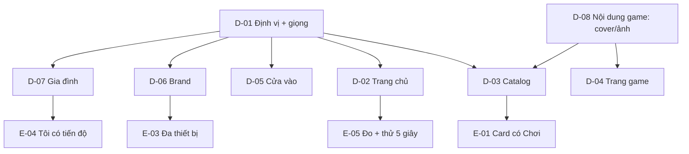

# Map — Bề mặt sản phẩm v2

Every item the goal depends on, and what blocks what. Status lives on the [PLAN.md](PLAN.md) board.

## Items

| ID | Question / change | Why the goal needs it | Blocks |
|---|---|---|---|
| D-01 | Định vị 16+ mặc định; giữ hay đổi chất Tò He; hai register giọng | Khóa mọi quyết định về copy, màu, bố cục | D-02, D-03, D-05, D-06, D-07 |
| D-02 | `/` là sạp game hay giới thiệu ngắn + danh mục | Quyết định 5 giây đầu và SEO | E-05 |
| D-03 | Catalog: cover, search, tag, shelf; tab "Sạp" hay "Trò chơi" | Màn chính của người chơi | E-01 |
| D-04 | `/games/<id>/` là store page: ảnh, chơi, facts, tuổi | Trang công khai đang là bài viết | — |
| D-05 | Cửa vào: bỏ gate hay "Chơi ngay" trước | 16+ muốn chơi trước | — |
| D-06 | Brand: palette, type, shape, motion, wordmark | Bỏ dấu hiệu "AI", tạo gu | E-03 |
| D-07 | Gia đình: `/family` + `Tôi`, PIN, hồ sơ, giọng | Giữ phụ huynh mà không làm mặt tiền trẻ con | E-04 |
| D-08 | Cover 16:9, ảnh chụp, hook, tag; contract/API | Không có ảnh thì không có sạp | D-03, D-04 |
| E-01 | Card game có "Chơi" rõ | Sửa affordance rẻ, tác động ngay | — |
| E-02 | Bỏ SHA, bỏ "Dữ liệu kỹ thuật" khỏi auth | Bớt nghiệp dư | — |
| E-03 | Grid/rail/max width/player full-bleed | Đa thiết bị sạch | — |
| E-04 | Tôi có tiến độ; empty state | Trang Tôi có lý do quay lại | — |
| E-05 | TTFP, phễu, 5 giây test | Biết thay đổi có hiệu quả | — |

## Considered and left off

- **Game mới / luật chơi**: bề mặt không sửa được game yếu; roadmap game là plan riêng.
- **Chat, kết bạn, moderation**: ngoài phạm vi; cần ADR riêng vì an toàn trẻ em.
- **Thanh toán/quảng cáo**: trái định vị "không quảng cáo, không xu".
- **Đổi backend/API toàn bộ**: chỉ đổi tối thiểu cho `coverUrl` và metadata.
- **Điều khoản/Quyền riêng tư**: E-05 của `launch-review` vẫn giữ.
